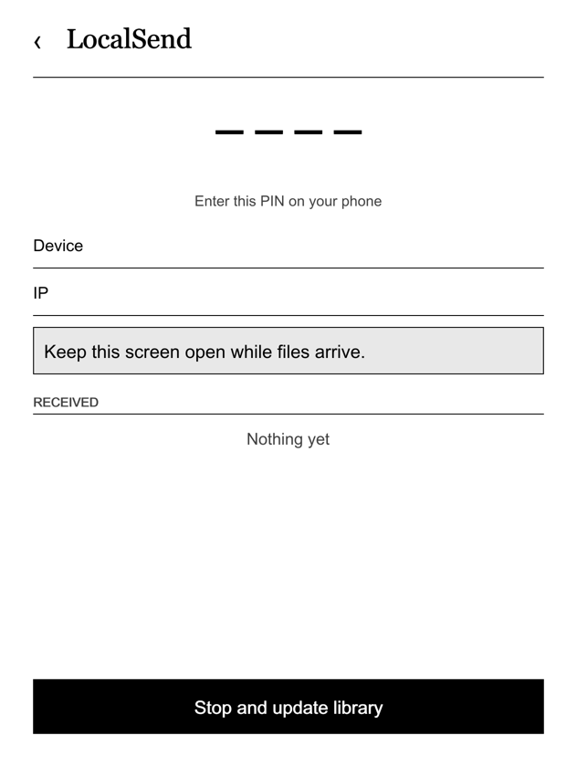
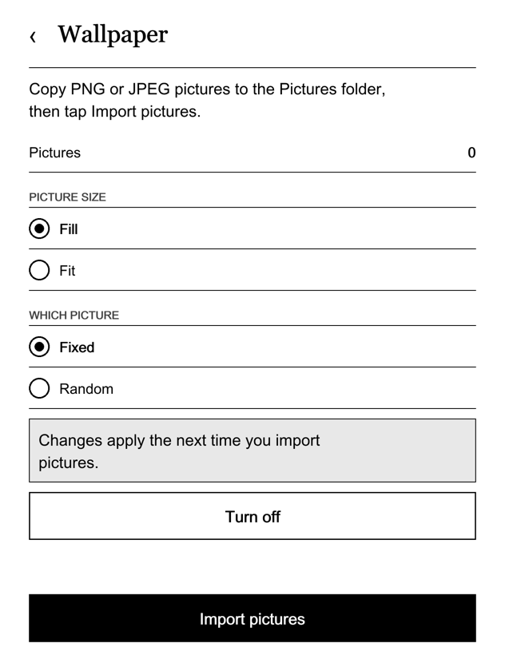

# NickelDrawer

An app drawer for Kobo e-readers that run the stock firmware (Nickel). It adds an **Apps** row and a **Tweaks** panel to the More tab, and gives small tools (receive files from a phone, sync books from GitHub, use your pictures as the sleep screen, tidy your library) a native Kobo look. It works without a cloud account and sends nothing anywhere unless you start a feature that needs the network.

**Status: 1.0.0-beta.1.** Verified on one device and one firmware build (see [Supported firmware](#supported-firmware)). Read [Safety](#safety) before you install.

| LocalSend | Wallpaper |
|---|---|
|  |  |

These are renders made on a computer with `ndpreview` at the e-ink size, not photos of a device. To regenerate them:

```sh
go run ./cmd/ndpreview render apps/localsend --out docs/img/localsend.png
go run ./cmd/ndpreview render apps/wallpaper --out docs/img/wallpaper.png
```

Use `--screen ID`, `--locale vi` and `--state state.json` for other screens, languages and states. Write extra renders to `build/preview/` (gitignored) and copy the ones you want to show into `docs/img/`.

## What you get

- **A native drawer.** An Apps row in Nickel's More tab opens a list or grid of your apps. It uses Nickel's own fonts, icons and dialogs.
- **Tweaks.** A settings-style panel for sleep screen, screenshots, auto USB connect, text legibility, IP address, reboot and library rescan.
- **Apps are folders.** Copy a folder with a manifest and a few scripts to `.adds/apps/` and it appears. No C++ needed ([docs/APPS.md](docs/APPS.md)).
- **Native app screens.** Apps describe lists, toggles, buttons, QR codes and live status in a `ui.json` file; the drawer draws them.
- **Included apps.** LocalSend (receive files from a phone, sorted into Books, Documents, Comics and Pictures), GitHub sync (add-only book sync, paired from your phone), Wallpaper (a gallery for your sleep screen pictures), Library (dedupe, language tags, Unicode normalisation) and To-do (a small task list). A hidden UI Kit app shows every screen component for developers and testers ([apps/uikit](apps/uikit/README.md)).
- **Signed updates.** Apps and the host tool update over Wi-Fi from GitHub Releases. Only releases signed with the maintainer's ed25519 key are applied, with backup, self-check and rollback ([docs/UPDATES.md](docs/UPDATES.md)).
- **Any language.** English is the source; Vietnamese ships first. The language follows the Kobo's own setting ([docs/TRANSLATING.md](docs/TRANSLATING.md)).

## Supported firmware

Kobo Libra 2 (Mark 9, firmware family `kobo9`), the five newest 4.38 builds. The native drawer checks every libnickel symbol it needs at boot and turns itself off, with a log line, on a build it does not know or a missing symbol.

| Firmware | Native drawer | Notes |
|---|---|---|
| 4.38.23828 | tested on a device | |
| 4.38.23697 | symbols checked in CI | not run on a device yet |
| 4.38.23684 | symbols checked in CI | not run on a device yet |
| 4.38.23648 | symbols checked in CI | not run on a device yet |
| 4.38.23552 | symbols checked in CI | not run on a device yet |

Firmware 5.x is **not** supported. Other Kobo models are untested. Details: [docs/COMPATIBILITY.md](docs/COMPATIBILITY.md).

## Install

You need a Kobo Libra 2 on one of the builds above, a computer, a USB cable and the files from the latest [release](../../releases): `koboapps-<version>.zip` (apps and host tool) and `KoboRoot-nickeldrawer.tgz` (the native drawer).

1. **Back up first.** Connect the Kobo, copy the whole `.kobo` and `.adds` folders to your computer. Keep them until you are happy.
2. Unzip `koboapps-<version>.zip`. Copy the `.adds` folder inside `onboard/` into the root of the Kobo drive and merge it with the existing `.adds` (hidden folders: Cmd+Shift+. in macOS Finder, "show hidden files" on Windows and Linux). An app's `data/` folder is never part of the zip.
3. Copy `KoboRoot-nickeldrawer.tgz` to `.kobo/KoboRoot.tgz` on the drive (rename it while copying).
4. Eject the Kobo from the computer. It installs the drawer and reboots. After the boot, the More tab has an **Apps** row.

On macOS or Linux with a checkout of this repository there is a safer installer that backs up everything it replaces to `backups/<date-time>/` and never touches `data/` folders:

```sh
make check build dist
tools/install-to-kobo.sh --dry-run     # show what would happen
tools/install-to-kobo.sh               # KOBO_ROOT=/path if the volume has another name
```

[NickelMenu](https://github.com/pgaskin/NickelMenu) is optional. NickelDrawer does not need it, and it coexists with it.

### Switches

Empty files you create over USB in `.adds/nickeldrawer/` (create the folder if it is missing). They are read at boot.

| File | Effect |
|---|---|
| `uninstall` | Removes the native drawer on the next boot, then deletes itself |
| `disable` | Loads the drawer but keeps it inactive (kill switch) |
| `screens` | Opens an app's `ui.json` screen when you tap it (off by default in this beta) |
| `no-keyboard` | Text fields show "edit on your phone" instead of Nickel's keyboard |

## Safety

Apps run as root on a device that holds your library. Install only apps you trust. The rules:

- The native drawer is a [NickelHook](https://github.com/pgaskin/NickelHook) mod with a **failsafe**: if Nickel crashes in the first 15 seconds after boot, the mod removes itself on the next boot and Nickel starts as stock.
- **Uninstall:** create `.adds/nickeldrawer/uninstall` (empty), eject, wait for the reboot. Then delete the `.adds/koboapps` and `.adds/apps` folders if you want everything gone. Your books are never touched.
- No telemetry. The network is used only for what you start (LocalSend, GitHub sync, update check).
- Releases are signed (ed25519). The private key stays on the maintainer's computer.
- No Kobo binaries or Kobo assets are in this repository or in a release.

Read [SECURITY.md](SECURITY.md) before you install or report a problem.

## Building

Go 1.24 or newer, `make`, `zip`. The native drawer needs Docker (the pinned [NickelTC](https://github.com/pgaskin/NickelTC) toolchain image, see [mod/TOOLCHAIN.md](mod/TOOLCHAIN.md)).

```sh
make check                          # gofmt, go vet, go test
make build dist                     # ARMv7 binaries, dist/ tree, dist/koboapps-<version>.zip
bash tools/test-install.sh          # installer against a fake Kobo tree

make -C mod/drawer docker-build     # build/mod/KoboRoot-nickeldrawer.tgz
make -C mod/drawer docker-test      # host unit tests of the Qt-free units
mod/drawer/check-symbols.sh         # static checks of the built library
```

CI and release steps: [docs/CI.md](docs/CI.md), [docs/RELEASING.md](docs/RELEASING.md). Contributing: [CONTRIBUTING.md](CONTRIBUTING.md).

## Writing an app

```sh
go run ./cmd/appsctl new my-app --with-ui     # scaffold ./my-app
go run ./cmd/appsctl validate my-app          # checks app.json, locales and ui.json
go run ./cmd/ndpreview serve my-app           # preview ui.json at Kobo size on 127.0.0.1
```

The guide is [docs/APPS.md](docs/APPS.md); the formats are in [docs/spec/](docs/spec/); worked examples are in [examples/](examples/README.md).

## Languages

English and Vietnamese are maintained here. A new language is one JSON file per app and one for the host, no code change. See [docs/TRANSLATING.md](docs/TRANSLATING.md). Right-to-left languages are not supported yet.

Tiếng Việt: xem [README.vi.md](README.vi.md).

## License

[PolyForm Noncommercial 1.0.0](LICENSE): free for personal use, study, hobby projects and non-profit organisations; **no commercial use**. Forks and changes are welcome under the same terms. NickelDrawer is source-available, not OSI open source. Third-party code keeps its own license, listed in [third_party/README.md](third_party/README.md).

## Credits

- [NickelHook](https://github.com/pgaskin/NickelHook) and [NickelMenu](https://github.com/pgaskin/NickelMenu) by Patrick Gaskin (MIT): the hook framework the native drawer is built on, and the menu it coexists with.
- [NickelTC](https://github.com/pgaskin/NickelTC): the cross toolchain, and the wider Kobo reverse-engineering community for the knowledge of how Nickel works.
- [localgo](https://github.com/bethropolis/localgo) (MIT): the LocalSend protocol implementation used by the LocalSend app.
- [Tabler Icons](https://github.com/tabler/tabler-icons) (MIT): fallback icons when Nickel's own are not available.
- [kobo-tieng-viet](https://github.com/redphx/kobo-tieng-viet): Vietnamese UI and font fixes for Kobo. NickelDrawer is designed to coexist with it; it is not a dependency.

NickelDrawer is an independent project. It is not made by, affiliated with or endorsed by Rakuten Kobo. "Kobo" and "Nickel" are trademarks of their owners.
