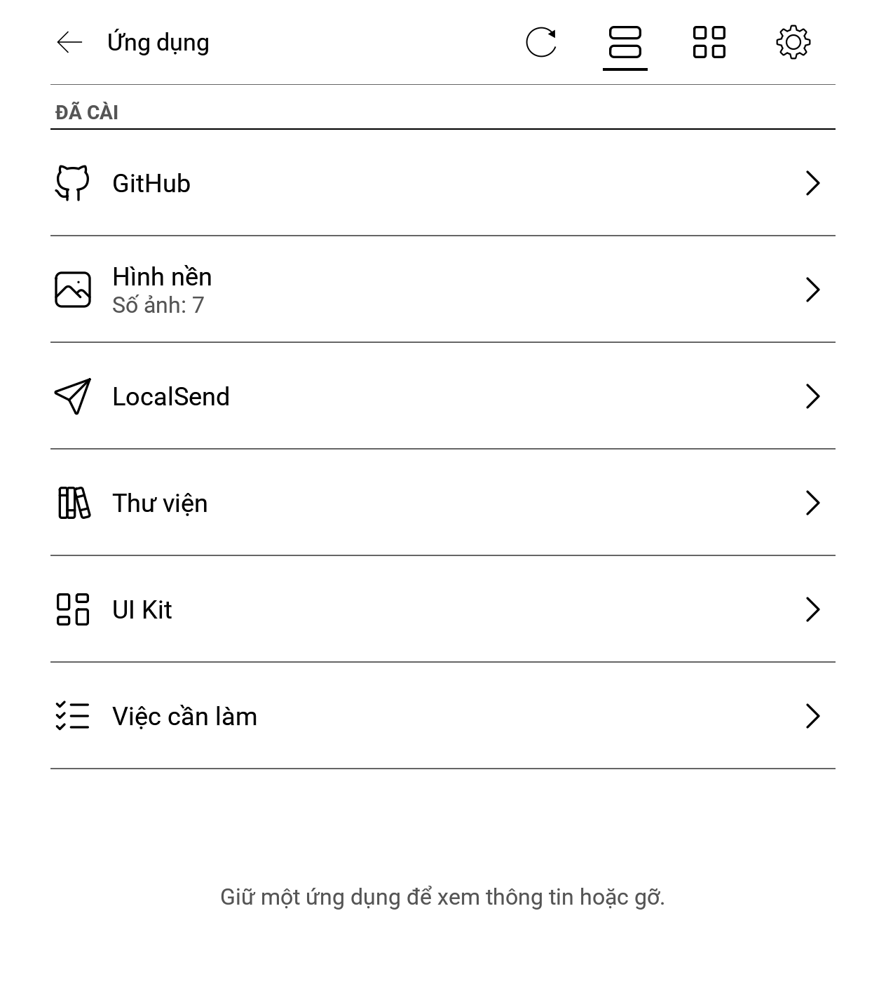
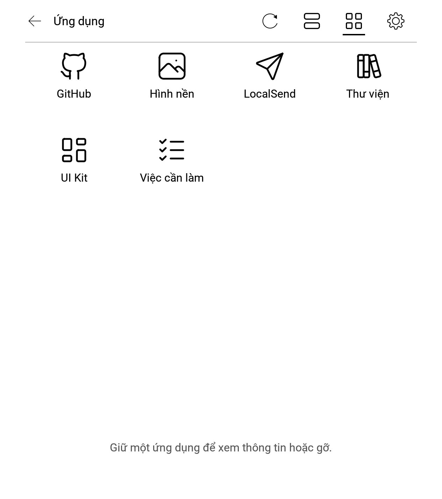

# NickelDrawer (Tiếng Việt)

Ngăn ứng dụng cho máy đọc sách Kobo chạy phần mềm gốc (Nickel). NickelDrawer thêm hàng **Ứng dụng** và bảng **Tinh chỉnh** vào tab **Thêm**, giúp các ứng dụng nhỏ có giao diện giống Kobo. Không cần tài khoản đám mây và không gửi dữ liệu đi đâu nếu bạn không bật tính năng cần mạng.

**Trạng thái: 1.0.0 beta** ([bản phát hành](../../releases)). Mới thử trên một máy và một bản firmware (xem [Firmware hỗ trợ](#firmware-hỗ-trợ)). Đọc [An toàn](#an-toàn) trước khi cài. Bản tiếng Anh: [README.md](README.md). Hướng dẫn chi tiết: [user-guide.vi.html](docs/guide/user-guide.vi.html) ([.md](docs/guide/user-guide.vi.md)).

| Dạng danh sách | Dạng lưới |
|---|---|
|  |  |

Ảnh chụp từ Kobo Libra 2 (tiếng Việt), chỉ giữ phần Ngăn (bỏ thanh trạng thái và thanh tab của Kobo). Ngăn hiện ứng dụng dạng danh sách (biểu tượng, tên, trạng thái trực tiếp) hoặc dạng lưới; các nút trên tiêu đề chuyển dạng xem, làm mới danh sách và mở cài đặt của Ngăn.

## Bạn được gì

- **Ngăn ứng dụng gốc.** Hàng Ứng dụng trong tab Thêm mở danh sách hoặc lưới ứng dụng, dùng phông, biểu tượng và hộp thoại của chính Nickel.
- **Tinh chỉnh.** Bảng giống phần cài đặt: màn hình ngủ, chụp màn hình, tự kết nối USB, chữ rõ nét, địa chỉ IP, khởi động lại và quét lại thư viện.
- **Ứng dụng là thư mục.** Chép một thư mục có tệp mô tả và vài tập lệnh vào `.adds/apps/` là nó hiện ra. Không cần C++ ([docs/APPS.md](docs/APPS.md)).
- **Màn hình ứng dụng gốc.** Ứng dụng mô tả danh sách, nút gạt, nút bấm, mã QR và trạng thái trực tiếp trong tệp `ui.json`; Ngăn vẽ ra.
- **Cập nhật có chữ ký.** Ngăn (công cụ chủ và mod) cập nhật qua Wi-Fi từ GitHub Releases. Chỉ bản phát hành ký bằng khóa ed25519 của người duy trì mới được áp dụng, có sao lưu, tự kiểm tra và hoàn lại ([docs/UPDATES.md](docs/UPDATES.md)).
- **Mọi ngôn ngữ.** Tiếng Anh là bản gốc; tiếng Việt có sẵn đầu tiên. Ngôn ngữ theo cài đặt của chính Kobo ([docs/TRANSLATING.md](docs/TRANSLATING.md)).

## Firmware hỗ trợ

Kobo Libra 2 (Mark 9, dòng firmware `kobo9`), năm bản 4.38 mới nhất. Ngăn gốc kiểm mọi ký hiệu libnickel nó cần lúc khởi động và tự tắt, kèm một dòng log, nếu gặp bản firmware hay mẫu máy lạ hoặc thiếu ký hiệu.

| Firmware | Ngăn gốc | Ghi chú |
|---|---|---|
| 4.38.23828 | đã thử trên máy | |
| 4.38.23697 | kiểm ký hiệu trong CI | chưa chạy trên máy |
| 4.38.23684 | kiểm ký hiệu trong CI | chưa chạy trên máy |
| 4.38.23648 | kiểm ký hiệu trong CI | chưa chạy trên máy |
| 4.38.23552 | kiểm ký hiệu trong CI | chưa chạy trên máy |

Firmware 5.x **chưa** được hỗ trợ. Chi tiết: [docs/COMPATIBILITY.md](docs/COMPATIBILITY.md).

### Thiết bị được hỗ trợ

Trong 27 mẫu Kobo đã bán, **1 mẫu đã thử** (Libra 2, firmware 4.38.23828), **2 mẫu dự kiến chạy được nhưng chưa thử** (Libra H2O và Libra Colour, hai mẫu còn lại có cùng màn 1264×1680), **19 mẫu chạy firmware 4.x nhưng ngăn tự tắt** (chưa hỗ trợ kích thước màn hình) và **5 mẫu không hỗ trợ** (Kobo eReader và Wireless, Mini, máy tính bảng Vox và Arc). Máy Libra Colour và Clara đã chuyển sang 5.x cũng không được hỗ trợ. Màn hình ứng dụng được dàn trang cho màn 1264×1680, nên mod kiểm mẫu máy (mã thiết bị trong `.kobo/version`) và kích thước màn hình thật; trên mẫu khác nó hiện thông báo "chưa hỗ trợ máy này" rồi tự tắt. Mod cũng chỉ nạp trên đúng các bản firmware liệt kê ở trên. Bảng đầy đủ (năm ra mắt, nền tảng, mã thiết bị, cách giúp thêm một mẫu) nằm ở [docs/COMPATIBILITY.md](docs/COMPATIBILITY.md#supported-devices).

## Cài đặt

Bạn cần Kobo Libra 2 chạy một trong các bản trên, một máy tính, cáp USB và các tệp của [bản phát hành](../../releases) mới nhất: `koboapps-<phiên bản>.zip` (công cụ chủ của ngăn) và `KoboRoot-nickeldrawer.tgz` (ngăn gốc).

1. **Sao lưu trước.** Cắm Kobo, chép toàn bộ thư mục `.kobo` và `.adds` vào máy tính. Giữ cho đến khi bạn hài lòng.
2. Giải nén `koboapps-<phiên bản>.zip`. Chép thư mục `.adds` trong `onboard/` vào thư mục gốc của ổ Kobo và gộp với `.adds` có sẵn (thư mục ẩn: Cmd+Shift+. trong Finder của macOS, "hiện tệp ẩn" trên Windows và Linux). Tệp zip không có ứng dụng và không có thư mục `data/`. **Finder trên macOS: nếu hỏi có Thay thế (Replace) thư mục đã có không, đừng chọn.** Thay thế xóa nội dung hiện có của thư mục (cài đặt ứng dụng, token, tệp của mod khác). Giữ phím Option rồi chọn **Gộp (Merge)**, hoặc dùng tập lệnh cài bên dưới.
3. Chép `KoboRoot-nickeldrawer.tgz` vào `.kobo/KoboRoot.tgz` trên ổ (đổi tên khi chép).
4. Ngắt kết nối (eject) Kobo khỏi máy tính. Máy tự cài ngăn và khởi động lại. Sau khi lên, tab Thêm có hàng **Ứng dụng**.

Lúc đầu ngăn còn trống. **Ứng dụng tách riêng khỏi ngăn:** mỗi ứng dụng là một tệp `app-<id>-<phiên bản>.zip` trong bản phát hành, cài từng cái; xem [apps/README.vi.md](apps/README.vi.md). Cài hay cập nhật ngăn không bao giờ thêm, đổi hay xóa ứng dụng nào.

Trên macOS hoặc Linux, với bản checkout của kho mã này có tập lệnh cài an toàn hơn: nó sao lưu mọi thứ nó thay vào `backups/<ngày-giờ>/` và không bao giờ đụng vào thư mục `data/`:

```sh
make check build dist
tools/install-to-kobo.sh --dry-run     # cho xem việc sẽ làm
tools/install-to-kobo.sh               # chỉ cài ngăn; tìm /Volumes/KOBOeReader, /media/$USER/KOBOeReader hoặc /run/media/$USER/KOBOeReader; không thì đặt KOBO_ROOT=/đường/dẫn
```

[NickelMenu](https://github.com/pgaskin/NickelMenu) là tùy chọn. NickelDrawer không cần nó và chạy chung được với nó.

### Tệp công tắc

Tệp rỗng bạn tạo qua USB trong `.adds/nickeldrawer/` (tạo thư mục nếu chưa có). Chúng được đọc lúc khởi động.

| Tệp | Tác dụng |
|---|---|
| `uninstall` | Gỡ ngăn gốc ở lần khởi động sau, rồi tự xóa |
| `disable` | Nạp ngăn nhưng để nó không hoạt động (công tắc tắt) |
| `no-screens` | Không dùng màn hình ứng dụng: chạm sẽ chạy tác vụ chính của ứng dụng thay vì mở màn hình `ui.json`. Màn hình ứng dụng bật sẵn (tệp `screens` cũ bị bỏ qua) |
| `no-keyboard` | Ô nhập hiện "hãy đổi từ điện thoại" thay vì bàn phím của Nickel |
| `debug` | Ghi log từng bước vào `.adds/nickeldrawer/debug.log` |
| `test-unknown-fw` | Dùng để thử: giả vờ firmware lạ, ngăn tự tắt kèm một thông báo ngắn. Xóa tệp và khởi động lại để về bình thường |

## An toàn

Ứng dụng chạy với quyền root trên một thiết bị chứa thư viện sách của bạn. Chỉ cài ứng dụng bạn tin tưởng. Các quy tắc:

- Ngăn gốc là mod [NickelHook](https://github.com/pgaskin/NickelHook) có **failsafe**: nếu Nickel treo (hoặc bạn tắt máy một lần) trong 15 giây đầu sau khi mod nạp, mod bị bỏ ở lần khởi động sau và Nickel chạy như bản gốc.
- **Gỡ cài đặt:** tạo tệp rỗng `.adds/nickeldrawer/uninstall`, eject, đợi máy khởi động lại. Muốn xóa hết thì xóa thêm hai thư mục `.adds/koboapps` và `.adds/apps`. Sách của bạn không bao giờ bị động đến.
- Không thu thập dữ liệu. Mạng chỉ dùng cho việc bạn bắt đầu (tính năng mạng của một ứng dụng, kiểm tra cập nhật).
- Bản phát hành có chữ ký (ed25519). Khóa riêng nằm trên máy của người duy trì.
- Không có tệp nhị phân hay tài nguyên của Kobo trong kho mã này hay trong bản phát hành.

Đọc [SECURITY.md](SECURITY.md) trước khi cài hoặc báo lỗi.

## Xây dựng

Go 1.24 trở lên, `make`, `zip`. Ngăn gốc cần Docker (ảnh toolchain [NickelTC](https://github.com/pgaskin/NickelTC) đã ghim, xem [mod/TOOLCHAIN.md](mod/TOOLCHAIN.md)).

```sh
make check                          # gofmt, go vet, go test
make build dist                     # tệp ARMv7, cây dist/, dist/koboapps-<phiên bản>.zip
bash tools/test-install.sh          # thử tập lệnh cài trên một cây Kobo giả

make -C mod/drawer docker-build     # build/mod/KoboRoot-nickeldrawer.tgz
make -C mod/drawer docker-test      # kiểm thử đơn vị trên máy chủ cho phần không dùng Qt
mod/drawer/check-symbols.sh         # kiểm tĩnh thư viện đã build
```

CI và phát hành: [docs/CI.md](docs/CI.md), [docs/RELEASING.md](docs/RELEASING.md). Đóng góp: [CONTRIBUTING.md](CONTRIBUTING.md).

## Viết một ứng dụng

```sh
go run ./cmd/appsctl new my-app --with-ui     # tạo khung ./my-app
go run ./cmd/appsctl validate my-app          # kiểm app.json, locales và ui.json
go run ./cmd/ndpreview serve my-app           # xem trước ui.json ở cỡ Kobo trên 127.0.0.1
```

Hướng dẫn: [docs/APPS.md](docs/APPS.md); định dạng trong [docs/spec/](docs/spec/); ví dụ trong [examples/](examples/README.md).

## Ngôn ngữ

Tiếng Anh và tiếng Việt do dự án duy trì. Thêm ngôn ngữ mới chỉ cần một tệp JSON cho mỗi ứng dụng và một cho phần chủ, không phải sửa mã. Xem [docs/TRANSLATING.md](docs/TRANSLATING.md). Chưa hỗ trợ ngôn ngữ viết từ phải sang trái.

## Giấy phép

[PolyForm Noncommercial 1.0.0](LICENSE): miễn phí cho cá nhân, học tập, sở thích và tổ chức phi lợi nhuận; **không dùng cho mục đích thương mại**. Có thể fork và sửa theo cùng điều khoản. NickelDrawer là mã nguồn có thể xem (source-available), không phải mã nguồn mở theo chuẩn OSI. Mã của bên thứ ba giữ giấy phép riêng, liệt kê ở [third_party/README.md](third_party/README.md).

**Ứng dụng bạn viết là của bạn.** Giấy phép này không áp dụng cho ứng dụng chỉ dùng định dạng ứng dụng, giao thức và công cụ của Ngăn: bạn tự chọn giấy phép cho ứng dụng, kể cả thương mại; mẫu ứng dụng và các ví dụ theo 0BSD. Chi tiết: [LICENSE-APPS.md](LICENSE-APPS.md) (tiếng Anh).

## Ghi công

- [NickelHook](https://github.com/pgaskin/NickelHook) và [NickelMenu](https://github.com/pgaskin/NickelMenu) của Patrick Gaskin (MIT): khung hook mà ngăn gốc dùng, và menu chạy chung với nó.
- [NickelTC](https://github.com/pgaskin/NickelTC): bộ biên dịch chéo, và cộng đồng nghiên cứu ngược Kobo với hiểu biết về cách Nickel hoạt động.
- [localgo](https://github.com/bethropolis/localgo) (MIT): phần cài giao thức LocalSend.
- [Tabler Icons](https://github.com/tabler/tabler-icons) (MIT): biểu tượng dự phòng khi không có biểu tượng của Nickel.
- [kobo-tieng-viet](https://github.com/redphx/kobo-tieng-viet): sửa giao diện và phông tiếng Việt cho Kobo. NickelDrawer được thiết kế để chạy chung với nó; không phụ thuộc vào nó.

NickelDrawer là dự án độc lập. Không do Rakuten Kobo làm ra, không liên kết hay được Rakuten Kobo bảo trợ. "Kobo" và "Nickel" là nhãn hiệu của chủ sở hữu.

## Công cụ và cài đặt thêm

Tùy chọn, tách riêng khỏi ngăn. Chỉ cài thứ bạn cần.

### Ứng dụng

[apps/README.vi.md](apps/README.vi.md): LocalSend, GitHub, Thư viện, Hình nền và Việc cần làm (cùng UI Kit chỉ dành cho nhà phát triển). Mỗi ứng dụng là một tệp zip riêng trong bản phát hành, được cài, cập nhật và gỡ từng cái; ngăn và các bản cập nhật của nó không bao giờ đụng vào chúng.

### Nút chụp màn hình trên thanh trạng thái

[helpers/statusbar-screenshot](helpers/statusbar-screenshot/README.md): một mod nhỏ riêng, thêm nút chụp màn hình vào thanh trạng thái phía trên của Kobo. Chạm để lưu màn hình thành `screen_NNN.png` ở thư mục gốc của ổ Kobo. Để tắt nút, tạo một tệp rỗng `.adds/helpers/screenshot/off` trên Kobo qua USB (xóa tệp để bật lại; `install.sh --off` / `--on` làm việc này). Dựng và cài từ mã nguồn; không có tệp phát hành.

<a id="giao-dien-tieng-viet"></a>

### Giao diện Kobo bằng tiếng Việt

Phần này **tách riêng khỏi NickelDrawer** (NickelDrawer đã có bản dịch tiếng Việt của riêng nó và chạy được dù bạn có làm phần này hay không). Đây là việc cài thêm để chính menu và cài đặt của Kobo hiện bằng tiếng Việt, kèm phông chữ có đủ dấu để chữ không hiện thành ô vuông □.

Công cụ: [kobo-tieng-viet](https://github.com/redphx/kobo-tieng-viet) của redphx. Dự án của bên thứ ba, có giấy phép riêng (trang dự án không nêu), không thuộc NickelDrawer và không liên kết với Kobo. Tóm tắt theo trang dự án (đọc ngày 2026-10-10); khi có khác biệt, **hướng dẫn của dự án là đúng**.

- **Firmware:** chỉ 4.x. 3.x và 5.x không được hỗ trợ.
- **Cài:** sao lưu trước; tải `KoboRoot.tgz` ở [trang phát hành](https://github.com/redphx/kobo-tieng-viet/releases) (đừng tải bằng Safari); chép vào thư mục ẩn `.kobo` (không giải nén, giữ tên); eject; đợi khoảng 3 phút để máy tự cập nhật.
- **Chọn ngôn ngữ:** máy nên tự chuyển. Nếu không: **Thêm** → **Cài đặt** → **Ngôn ngữ và từ điển** † → chọn ngôn ngữ → **Extra: vi**.
- **Gỡ:** tạo tệp rỗng `uninstall.txt` trong `.adds/tiengviet/`, eject, khởi động lại. Chữ tiếng Việt vẫn hiện tiếp cho đến khi Factory Reset hoặc cài lại firmware.
- **Với NickelDrawer:** thứ tự nào cũng được; cài xong một bên, đợi máy khởi động lại rồi mới cài bên kia. Sau khi Kobo cập nhật firmware, kiểm lại cả hai (kobo-tieng-viet từ bản `20260319` tự sửa lỗi hiển thị; NickelDrawer cần bản hỗ trợ firmware mới). **Từ chối lời mời nâng lên 5.x (Qt6)** của Kobo: cả hai đều không chạy trên 5.x ([giải thích](docs/DECISIONS.md)).
- **Phông để đọc sách, mẹo đọc EPUB tiếng Việt (KEPUB, NFC, ngôn ngữ `vi`), từ điển Anh–Việt tùy chọn, cách khôi phục:** xem phần đầy đủ trong hướng dẫn: [Cài thêm: giao diện Kobo bằng tiếng Việt](docs/guide/user-guide.vi.md#s-giao-dien-tieng-viet) ([bản HTML](docs/guide/user-guide.vi.html#s-giao-dien-tieng-viet)). Công cụ kiểm phông có đủ dấu: `python3 tools/vncheck.py phong-chu.ttf` (cần `pip install fonttools`).

Tên mục có dấu † chưa được đối chiếu trên máy thật; trên máy bạn có thể khác đôi chút.
