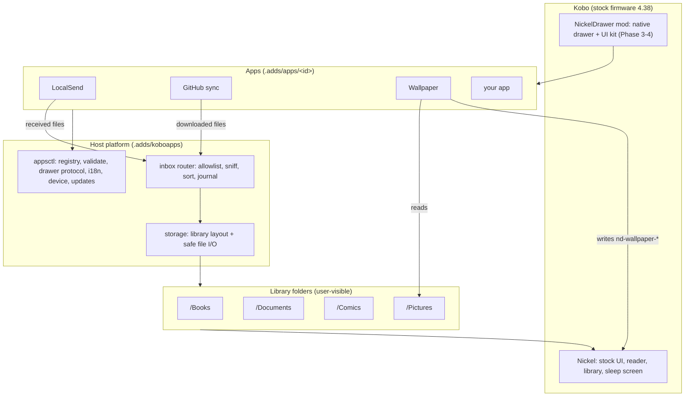
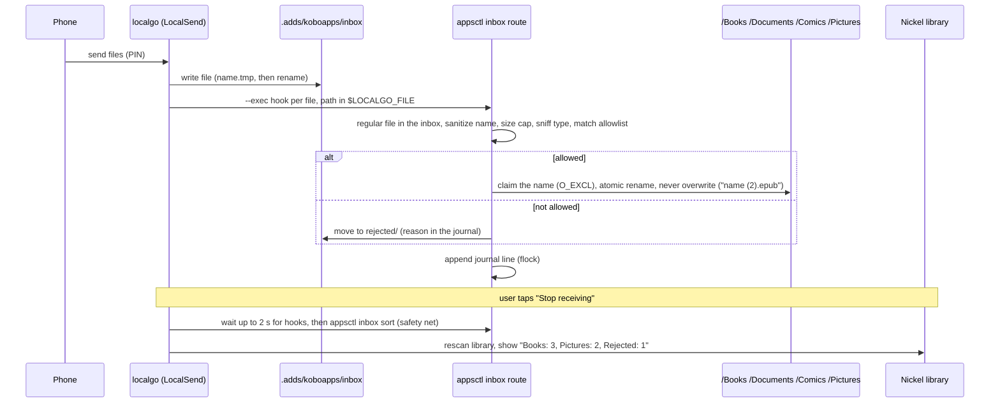

# NickelDrawer architecture

How the pieces fit, the principles behind them, and how files that arrive on the Kobo (LocalSend, GitHub sync, USB) end up in the right place. Status: design v1, 2026-10-09. Decisions are logged in [DECISIONS.md](DECISIONS.md).

## 1. Principles

| # | Principle | What it means in practice |
|---|---|---|
| P1 | **Native first** | Look and behave like stock Kobo. Reuse Nickel's own screens, reader, sleep screen and keyboard before drawing anything ourselves. |
| P2 | **Host owns shared concerns, apps own one job** | Storage layout, file routing, menus, languages, updates and device info live in the host (`appsctl`). An app does one thing and calls the host for the rest. |
| P3 | **Declare, don't hardcode** | Apps declare actions, strings and the storage they touch in `app.json`. Paths are logical names (`books`, `pictures`) resolved by the host, never literal paths in app code. |
| P4 | **Least privilege by declaration** | Everything runs as root on a Kobo, so we cannot sandbox. Instead: each app declares what it reads and writes, `appsctl validate` checks it, reviews check the code against it, and the native host will broker file access later. |
| P5 | **Safe by default** | Allowlists, not blocklists. Content sniffing (magic bytes), size caps, sanitized names, no overwrites, atomic writes, never hold files open on `/mnt/onboard`, never execute received files. |
| P6 | **Fail soft** | A broken app is skipped and listed; the menu still works. Unknown firmware turns the native drawer off (one toast, reason logged); a missing symbol turns off only the feature that needs it. NickelMenu is retired and is not a fallback (DECISIONS.md). |
| P7 | **Offline and private** | No telemetry. Network only when the user taps something (receive, sync, update). Secrets stay in the app's `data/`. |
| P8 | **Trust is signed** | Releases are ed25519-signed; the device verifies before installing and rolls back on failure. |
| P9 | **Any language** | English source strings, translations in `locales/`; Vietnamese maintained first. |
| P10 | **Testable without a Kobo** | Every device path has a root override; a fake Kobo tree runs the installer and apps on the Mac and in CI. |

## 2. Layers



| Layer | Owns | Does not |
|---|---|---|
| **Nickel** (Kobo) | UI, reader, library database, sleep screen | We never modify it on disk; native features come from hooks at runtime |
| **Front ends** | NickelMenu items (today), native drawer (Phase 3+) | Contain app logic |
| **Host** | App registry and validation, menu generation, i18n, device info, signed updates, **storage layout**, **inbox router** | Know what any specific app does |
| **Apps** | One job each; their own `data/` | Touch another app's folder or choose library paths themselves |
| **Library folders** | User content, visible over USB and in Kobo's library | Contain anything executable or hidden app state |

## 3. Storage layout

All user content lives in a few top-level folders with plain names. App state is hidden under `.adds` (excluded from Kobo's library scan by `ExcludeSyncFolders`).

| Logical name | Device path | Holds | Who writes |
|---|---|---|---|
| `books` | `/mnt/onboard/Books` | EPUB, KEPUB, MOBI | router; ghsync under `Books/GitHub` |
| `documents` | `/mnt/onboard/Documents` | PDF, TXT, HTML, RTF | router |
| `comics` | `/mnt/onboard/Comics` | CBZ, CBR | router; imageview albums under `Comics/Albums` |
| `pictures` | `/mnt/onboard/Pictures` | PNG, JPEG, GIF | router |
| `inbox` | `/mnt/onboard/.adds/koboapps/inbox` | staging for files being received | LocalSend (localgo); the router empties it |
| `rejected` | `/mnt/onboard/.adds/koboapps/inbox/rejected` | files that failed the allowlist, `appsctl inbox purge` deletes them after 7 days | router |
| `screensaver` | `/mnt/onboard/.kobo/screensaver` | Nickel's sleep screen pictures | wallpaper app only |
| app data | `/mnt/onboard/.adds/apps/<id>/data` | config, tokens, state, logs | that app only |
| system | `/mnt/onboard/.kobo/...` | Kobo's own files | **only** `.kobo/screensaver/nd-wallpaper-*` (wallpaper app) |

Rules: logical names are resolved by `internal/storage` (one place, test root override). Reads use the safe-read helpers: direct children only, no hidden files, symlinks must resolve inside the folder, regular files only, type checked by content, size cap.

## 4. LocalSend file allowlist and sorting

### 4.1 Flow



### 4.2 Allowlist (default rules)

| Type | Extensions | Content check (magic bytes) | Max size | Destination |
|---|---|---|---|---|
| EPUB / KEPUB | `.epub`, `.kepub.epub` | ZIP header + first entry stored `mimetype` = `application/epub+zip` | 200 MB | `books` |
| MOBI | `.mobi` | `BOOKMOBI` at offset 60 | 200 MB | `books` |
| PDF | `.pdf` | `%PDF-` | 300 MB | `documents` |
| Text | `.txt` | valid UTF-8, no NUL bytes | 20 MB | `documents` |
| HTML / RTF | `.html`, `.htm`, `.rtf` | `<` as first visible character / `{\rtf` | 20 MB | `documents` |
| Comics | `.cbz`, `.cbr` | ZIP / RAR4 or RAR5 signature | 500 MB | `comics` |
| Pictures | `.png`, `.jpg`, `.jpeg`, `.gif` | PNG / JPEG / GIF signature | 30 MB | `pictures` |

Everything else (`.exe`, `.sh`, `.apk`, `.zip`, unknown) is rejected. Extension and content must agree; a `.pdf` that is really a ZIP is rejected. The rules are data (`host/config/routing.json`, installed to `.adds/koboapps/config/routing.json` and replaced on every install). A user override `.adds/koboapps/data/routing.json` (never touched by the installer) may only **remove** types (`{"remove": ["gif"]}`) or **change a destination** to another library folder (`{"destinations": {"txt": "books"}}`); it cannot add types, extensions, checks, size caps or paths. Both files are validated; a bad override is reported and ignored (defaults apply), a bad shipped file stops routing. Format and reason codes: [spec/inbox.md](spec/inbox.md).

### 4.3 Safety

- Only a regular file directly inside the inbox (or the old `/mnt/onboard/LocalSend` folder, for migration) is routed. The folder is resolved with `EvalSymlinks` and must equal an allowed source; a symlink or other non-regular file is rejected, and the content is read through `O_NOFOLLOW` and checked to be the same file.
- File names: NFC-normalized (Vietnamese), path separators and control characters removed, vfat-forbidden characters replaced by `_`, never starting with `.`, at most 180 bytes with the extension kept.
- No overwrite: the destination name is claimed with `O_EXCL`, then the file is renamed onto the claim; collisions get ` (2)`, ` (3)`. No hard links (vfat has none), so parallel routers never clash.
- Atomic: the inbox and the library are on the same filesystem, so routing is a rename; there is no copy fallback.
- Nothing received is ever executed or unpacked. Only the first bytes of a file are read (the whole file only for the UTF-8 check, streamed).
- Journal `.adds/koboapps/data/inbox-journal.jsonl` (one line per file: time, source app, original name, type, destination, stored name, rejection reason). Each append takes an exclusive `flock`, so concurrent routers (localgo runs one hook per file at the same time) cannot interleave lines. `status` summarizes the newest session (entries less than 30 minutes apart).
- Rejected files are kept 7 days (counted from the rejection) so a wrongly rejected file can be recovered over USB; `appsctl inbox purge` then deletes them, only inside `rejected/`. A leftover `*.tmp` from a cut transfer is deleted at once instead.

### 4.4 Who uses the router

| Source | How |
|---|---|
| LocalSend | localgo saves into `inbox`; its `--exec` hook runs `appsctl inbox route --from-env --source localsend` per file. "Stop receiving" waits up to 2 s for running hooks, runs `appsctl inbox sort` as a safety net, prints `appsctl inbox status`, then the library rescan runs. "Sort old files" runs `appsctl inbox sort --source-dir /mnt/onboard/LocalSend` in the background to migrate the old folder. |
| GitHub sync | add-only. Each file must pass the same allowlist as the router (`routing.json`: extension, size cap, magic bytes on the downloaded temp file) and goes to the folder its type maps to, below a `GitHub` subfolder: `Books/GitHub`, `Documents/GitHub`, `Comics/GitHub` (names in NFC). A `config.json` with an explicit `dest` (such as the old `/mnt/onboard/GitHub`) puts everything there instead. |
| USB | `appsctl inbox route <path>` and `sort` apply the same rules to files in the inbox |

#### Security: the `--exec` hook must have no `%` placeholders

localgo builds the hook by replacing `%f` (path), `%n` (file name), `%a` (sender alias), `%i` and `%s` **inside the shell string** and then runs it with `sh -c`. The file name and alias are chosen by whoever sends the file, so `--exec 'router %n'` lets a sender run commands on the Kobo (a file named `$(...)` or `x; ...`). Therefore the hook is the fixed string `/mnt/onboard/.adds/koboapps/bin/appsctl inbox route --from-env --source localsend`, and `route --from-env` reads the path only from the `LOCALGO_FILE` environment variable, which the shell never parses. `--from-env` refuses an extra path argument. `cmd/appsctl` has a test that fails if the hook gains a `%` or a shell metacharacter.

## 5. App contract (summary)

```json
{
  "schema": 1,
  "id": "wallpaper",
  "name": "Wallpaper",
  "version": "0.1.0",
  "storage": { "reads": ["pictures"], "writes": ["screensaver"] },
  "network": false,
  "actions": [ { "id": "import", "label": "Import pictures", "run": "bin/import.sh", "output": "show" } ]
}
```

`storage` (logical names `books`, `documents`, `comics`, `pictures`, `inbox`, `rejected`, `screensaver`) and `network` are optional and declarative; `appsctl validate` rejects an unknown name. Full format: [spec/app-format.md](spec/app-format.md).

## 6. Components and where they live

| Component | Code | Spec |
|---|---|---|
| App registry, validation, i18n, msg, tweaks | `cmd/appsctl`, `internal/manifest`, `internal/tweaks`, `internal/i18n` | spec/app-format.md |
| Device info | `internal/device` | |
| Storage layout + safe I/O | `internal/storage` | this document §3 |
| Inbox router | `internal/inbox` + `appsctl inbox` (route, sort, status, purge), rules in `host/config/routing.json` | this document §4, spec/inbox.md |
| Signed updates | `internal/release`, `internal/update`, `cmd/ndrelease` | UPDATES.md |
| Apps | `apps/*` | each app's README |
| Native drawer + UI kit | `mod/` | spec/ui-kit.md, re/notes/G2-findings.md |
| CI, firmware checks | `.github/workflows`, `tools/symcheck.py`, `tools/fw-watch.sh` | CI.md |

## 7. Roadmap impact

1. Done: `internal/storage` (logical folders incl. `inbox`, `rejected`), `internal/inbox` and `appsctl inbox route|sort|status|purge`, `host/config/routing.json`, tests on a fake Kobo.
2. Done: LocalSend receives into `inbox`, routes per file, shows the summary; "Sort old files" migrates the old `/LocalSend` folder.
3. Done: ghsync routes by type to `Books|Documents|Comics/GitHub` with the inbox rules; an explicit `dest` keeps working.
4. Done: `app.json` has `storage` / `network`; `appsctl validate` checks them.
5. Open: signed updates (`internal/release`) do not yet ship `.adds/koboapps/config/`; until `config` is added to the host folders an update leaves `routing.json` as the installer wrote it.
