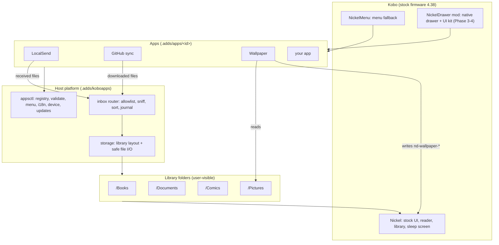
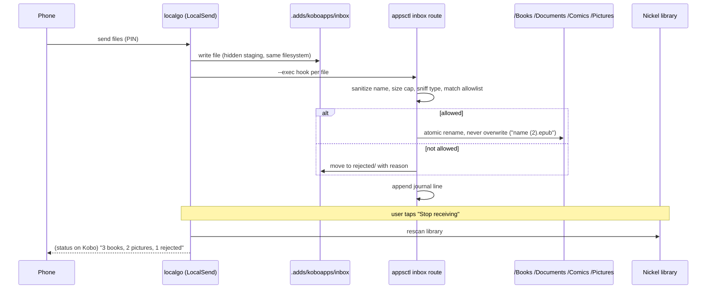

# NickelDrawer architecture

How the pieces fit, the principles behind them, and how files that arrive on the Kobo (LocalSend, GitHub sync, USB) end up in the right place. Status: design v1, 2026-10-09. Decisions are logged in [DECISIONS.md](DECISIONS.md).

## 1. Principles

| # | Principle | What it means in practice |
|---|---|---|
| P1 | **Native first** | Look and behave like stock Kobo. Reuse Nickel's own screens, reader, sleep screen and keyboard before drawing anything ourselves. |
| P2 | **Host owns shared concerns, apps own one job** | Storage layout, file routing, menus, languages, updates and device info live in the host (`appsctl`). An app does one thing and calls the host for the rest. |
| P3 | **Declare, don't hardcode** | Apps declare actions, strings and the storage they touch in `app.json`. Paths are logical names (`books`, `pictures`) resolved by the host, never literal paths in app code. |
| P4 | **Least privilege by declaration** | Everything runs as root on a Kobo, so we cannot sandbox. Instead: each app declares what it reads and writes, `appsctl validate` checks it, reviews check the code against it, and the native host will broker file access later. |
| P5 | **Safe by default** | Allowlists, not blocklists. Content sniffing (magic bytes), size caps, sanitized names, no overwrites, atomic writes, never hold files open on `/mnt/onboard`, never execute received files. |
| P6 | **Fail soft** | A broken app is skipped and listed; the menu still works. Unknown firmware or a missing symbol turns the native drawer off; NickelMenu stays as the fallback. |
| P7 | **Offline and private** | No telemetry. Network only when the user taps something (receive, sync, update). Secrets stay in the app's `data/`. |
| P8 | **Trust is signed** | Releases are ed25519-signed; the device verifies before installing and rolls back on failure. |
| P9 | **Any language** | English source strings, translations in `locales/`; Vietnamese maintained first. |
| P10 | **Testable without a Kobo** | Every device path has a root override; a fake Kobo tree runs the installer and apps on the Mac and in CI. |

## 2. Layers



| Layer | Owns | Does not |
|---|---|---|
| **Nickel** (Kobo) | UI, reader, library database, sleep screen | We never modify it on disk; native features come from hooks at runtime |
| **Front ends** | NickelMenu items (today), native drawer (Phase 3+) | Contain app logic |
| **Host** | App registry and validation, menu generation, i18n, device info, signed updates, **storage layout**, **inbox router** | Know what any specific app does |
| **Apps** | One job each; their own `data/` | Touch another app's folder or choose library paths themselves |
| **Library folders** | User content, visible over USB and in Kobo's library | Contain anything executable or hidden app state |

## 3. Storage layout

All user content lives in a few top-level folders with plain names. App state is hidden under `.adds` (excluded from Kobo's library scan by `ExcludeSyncFolders`).

| Logical name | Device path | Holds | Who writes |
|---|---|---|---|
| `books` | `/mnt/onboard/Books` | EPUB, KEPUB, MOBI | router; ghsync under `Books/GitHub` |
| `documents` | `/mnt/onboard/Documents` | PDF, TXT, HTML, RTF | router |
| `comics` | `/mnt/onboard/Comics` | CBZ, CBR | router; imageview albums under `Comics/Albums` |
| `pictures` | `/mnt/onboard/Pictures` | PNG, JPEG, GIF | router |
| `inbox` | `/mnt/onboard/.adds/koboapps/inbox` | staging for files being received | LocalSend only |
| `rejected` | `/mnt/onboard/.adds/koboapps/inbox/rejected` | files that failed the allowlist, auto-deleted after 7 days | router |
| app data | `/mnt/onboard/.adds/apps/<id>/data` | config, tokens, state, logs | that app only |
| system | `/mnt/onboard/.kobo/...` | Kobo's own files | **only** `.kobo/screensaver/nd-wallpaper-*` (wallpaper app) |

Rules: logical names are resolved by `internal/storage` (one place, test root override). Reads use the safe-read helpers: direct children only, no hidden files, symlinks must resolve inside the folder, regular files only, type checked by content, size cap.

## 4. LocalSend file allowlist and sorting

### 4.1 Flow



### 4.2 Allowlist (default rules)

| Type | Extensions | Content check (magic bytes) | Max size | Destination |
|---|---|---|---|---|
| EPUB / KEPUB | `.epub`, `.kepub.epub` | ZIP header + `mimetype` = `application/epub+zip` | 200 MB | `books` |
| MOBI | `.mobi` | `BOOKMOBI` at offset 60 | 200 MB | `books` |
| PDF | `.pdf` | `%PDF-` | 300 MB | `documents` |
| Text | `.txt` | valid UTF-8, no NUL bytes | 20 MB | `documents` |
| HTML / RTF | `.html`, `.htm`, `.rtf` | `<` / `{\rtf` near start | 20 MB | `documents` |
| Comics | `.cbz`, `.cbr` | ZIP / RAR header | 500 MB | `comics` |
| Pictures | `.png`, `.jpg`, `.jpeg`, `.gif` | PNG / JPEG / GIF header | 30 MB | `pictures` |

Everything else (`.exe`, `.sh`, `.apk`, `.zip`, unknown) is rejected. Extension and content must agree; a `.pdf` that is really a ZIP is rejected. The rules are data (`host/config/routing.json`) shipped with the host; a user override file `.adds/koboapps/data/routing.json` may **remove** types or change destinations to other logical names, never add arbitrary paths. Both are validated.

### 4.3 Safety

- File names: NFC-normalized (Vietnamese), path separators and control characters removed, length capped, never starting with `.`.
- No overwrite: collisions get ` (2)`, ` (3)`.
- Atomic: staging and library are on the same filesystem, so routing is a rename.
- Nothing received is ever executed or unpacked. Book files are moved as-is.
- Journal `.adds/koboapps/data/inbox-journal.jsonl` (one line per file: time, source app, original name, type, destination or rejection reason). The status action summarizes it.
- Rejected files are kept 7 days so a wrongly rejected file can be recovered over USB, then deleted.

### 4.4 Who uses the router

| Source | How |
|---|---|
| LocalSend | localgo saves into `inbox`; its `--exec` hook calls `appsctl inbox route` per file (verify localgo's exec semantics; fallback: route the whole inbox when receiving stops) |
| GitHub sync | downloads already go through allowlisted extensions; destination becomes `books` → `Books/GitHub` (migration: keep the old folder working) |
| USB | the user can drop anything into `/Inbox` (optional, later); "Sort inbox" routes it with the same rules |

## 5. App contract (summary)

```json
{
  "schema": 1,
  "id": "wallpaper",
  "name": "Wallpaper",
  "version": "0.1.0",
  "storage": { "reads": ["pictures"], "writes": ["screensaver"] },
  "network": false,
  "actions": [ { "id": "import", "label": "Import pictures", "run": "bin/import.sh", "output": "show" } ]
}
```

`storage` and `network` are new, declarative and checked by `appsctl validate` against the known logical names. Full format: [spec/app-format.md](spec/app-format.md).

## 6. Components and where they live

| Component | Code | Spec |
|---|---|---|
| App registry, validation, menu, i18n, msg | `cmd/appsctl`, `internal/manifest`, `internal/nmconfig`, `internal/i18n` | spec/app-format.md |
| Device info | `internal/device` | |
| Storage layout + safe I/O | `internal/storage` | this document §3 |
| Inbox router | `internal/inbox` + `appsctl inbox` (planned) | this document §4 |
| Signed updates | `internal/release`, `internal/update`, `cmd/ndrelease` | UPDATES.md |
| Apps | `apps/*` | each app's README |
| Native drawer + UI kit | `mod/` | spec/ui-kit.md, re/notes/G2-findings.md |
| CI, firmware checks | `.github/workflows`, `tools/symcheck.py`, `tools/fw-watch.sh` | CI.md |

## 7. Roadmap impact

1. `internal/storage` (in progress with the wallpaper app).
2. `internal/inbox` + `appsctl inbox route|status|sort` + `host/config/routing.json` + tests (fake Kobo).
3. LocalSend: receive into `inbox`, route per file, status shows the summary, migration of the old `/LocalSend` folder ("Sort old files").
4. ghsync destination → `books` (`Books/GitHub`), with migration.
5. `app.json` gains `storage` / `network`; `appsctl validate` checks them.
