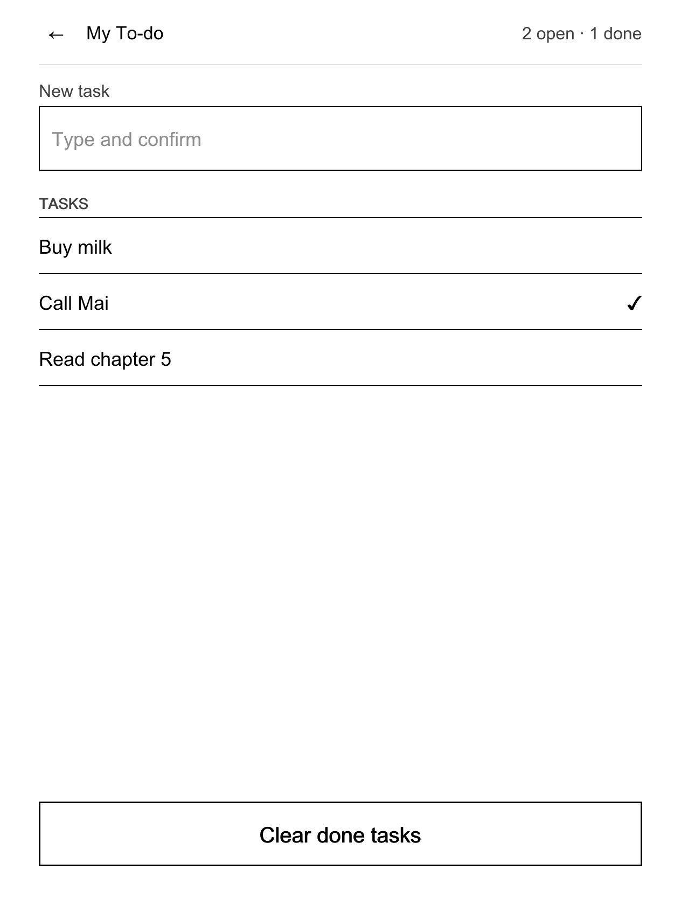

# NickelDrawer developer guide

How to build, test and ship an app for the NickelDrawer app drawer on a Kobo. You need a computer with Go 1.24 or newer and a checkout of this repository. You do not need a Kobo until the last step, and you never write C++.

The formats are defined in [docs/spec/](../spec/). This guide is the friendly path through them; when the two disagree, the spec wins.

> **Status.** The format, the validator, the previewer and the protocol are tested on a computer. Earlier builds of the drawer and its app screens ran on a Kobo; the current build has not been through its full device test session yet. Treat the previewer as a layout check, not as proof that a screen works on a device.

## Build an app in 15 minutes

We build **My To-do**, a small version of the shipped To-do app ([apps/todo](../../apps/todo/)): a text box to add a task, a list you tap to mark tasks done, a long-press menu to delete, and a button to clear done tasks. It is plain `sh`, no binary.



*Rendered with `ndpreview` at the Kobo's screen size.*

### 1. Scaffold

```sh
make build                                   # host tools in build/
build/appsctl-host new mytodo --name "My To-do" --with-ui --dir /tmp/apps
```

`appsctl new` copies `templates/app` into `/tmp/apps/mytodo/`: `app.json`, `ui.json`, `bin/run.sh`, `bin/state.sh`, `locales/en.json`, `locales/vi.json` and a README. It refuses an existing folder and validates the result. Delete `bin/run.sh`; we write our own scripts.

### 2. Declare the actions: `app.json`

Every tap on the screen runs one **action**: a script named in `app.json`.

```json
{
  "schema": 1,
  "id": "mytodo",
  "name": "My To-do",
  "version": "0.1.0",
  "description": "A tiny to-do list kept in a text file",
  "network": false,
  "actions": [
    { "id": "newitem",    "label": "New task",          "run": "bin/newitem.sh",    "output": "show", "timeout_ms": 3000 },
    { "id": "toggle",     "label": "Mark done or open", "run": "bin/toggle.sh",     "output": "show", "timeout_ms": 3000 },
    { "id": "remove",     "label": "Delete task",       "run": "bin/remove.sh",     "output": "show", "timeout_ms": 3000, "confirm": "Delete this task?" },
    { "id": "clear-done", "label": "Clear done tasks",  "run": "bin/clear-done.sh", "output": "show", "timeout_ms": 3000, "menu": true, "confirm": "Clear all done tasks?" },
    { "id": "state",      "label": "State",             "run": "bin/state.sh",      "output": "show", "timeout_ms": 1000 }
  ]
}
```

- The `id` equals the folder name and never changes after a release: the user's data lives under it.
- `state` is special: the drawer runs it to fill the screen's variables.
- An input control runs the action whose id equals its variable name. That is why the text box's variable and its action are both `newitem` (action ids allow no `_`).

### 3. Describe the screen: `ui.json`

```json
{
  "kit": 1,
  "start": "main",
  "vars": { "open": "0", "done": "0", "hasdone": false, "newitem": "", "items": [] },
  "screens": {
    "main": {
      "title": "@ui.title",
      "status": "@ui.counts",
      "body": [
        { "field": "@ui.new_task", "bind": "newitem", "placeholder": "@ui.new_task_hint", "keyboard": "text" },
        {
          "list": "$items",
          "title": "@ui.tasks",
          "empty_text": "@ui.empty",
          "tap": "toggle",
          "menu": [ { "id": "remove", "label": "@ui.delete", "confirm": true } ]
        }
      ],
      "footer": [
        {
          "button": "@ui.clear_done",
          "action": "clear-done",
          "enabled": "$hasdone",
          "confirm": { "text": "@ui.clear_confirm", "ok": "@ui.clear_ok", "cancel": "@ui.cancel" }
        }
      ],
      "toasts": {
        "added": "@ui.toast_added",
        "removed": "@ui.toast_removed",
        "cleared": "@ui.toast_cleared",
        "empty": "@ui.toast_empty",
        "failed": "@ui.toast_failed"
      }
    }
  }
}
```

- Every variable a screen uses is declared in `vars` with its default.
- `"@ui.title"` is a text from `locales/<lang>.json`. `$items` and `$hasdone` are bindings filled from `state`.
- `toasts` lists every short message a script may show. A script names one by id; it never prints the text itself.
- A `failed` toast belongs on every screen: the helpers in `common.sh` use it.

### 4. Write the texts: `locales/`

`locales/en.json` (English is the source):

```json
{
  "msg.added": "Task added.",
  "msg.removed": "Task deleted.",
  "msg.cleared": "Cleared {count} done tasks.",
  "msg.empty": "Type the task first.",
  "ui.title": "My To-do",
  "ui.counts": "$open open · $done done",
  "ui.new_task": "New task",
  "ui.new_task_hint": "Type and confirm",
  "ui.tasks": "Tasks",
  "ui.empty": "Nothing to do yet",
  "ui.delete": "Delete...",
  "ui.clear_done": "Clear done tasks",
  "ui.clear_confirm": "Delete every task that is marked done?",
  "ui.clear_ok": "Delete",
  "ui.cancel": "Cancel",
  "ui.toast_added": "Task added",
  "ui.toast_removed": "Task deleted",
  "ui.toast_cleared": "Done tasks cleared",
  "ui.toast_empty": "Type the task first",
  "ui.toast_failed": "That did not work. See data/log.txt."
}
```

`ui.*` keys are screen texts. `msg.*` keys are what a script prints on the command line (tests, debugging). `locales/vi.json` has the same keys translated, plus `name`, `description` and `actions.<id>.label` for the manifest texts (see [Languages](#languages-i18n)).

### 5. Share the plumbing: `bin/lib.sh`

```sh
# Shared by the action scripts. Source it; do not execute.
# MYTODO_COMMON lets tests on a computer point at host/lib/common.sh.
APP_DIR=$(cd "$(dirname "$0")/.." && pwd)
. "${MYTODO_COMMON:-/mnt/onboard/.adds/koboapps/lib/common.sh}"

APP_ID=mytodo
DATA_DIR=$APP_DIR/data
TASKS=$DATA_DIR/tasks.txt   # one task per line: "[ ] text" or "[x] text"

ensure_tasks_file() {
    mkdir -p "$DATA_DIR" && touch "$TASKS"
}

# The text the screen sent (typed field or tapped row), on one line.
screen_text() {
    printf '%s' "${NICKELDRAWER_VALUE:-}" | tr '\r\n\t' '   ' | sed 's/^ *//; s/ *$//'
}

# Writes stdin to a temp file next to the list, then renames it over the list:
# a power cut never leaves a half-written file.
replace_tasks() {
    cat >"$TASKS.tmp" && mv "$TASKS.tmp" "$TASKS" || {
        rm -f "$TASKS.tmp"
        fail_with "$APP_DIR" "could not rewrite $TASKS"
    }
}
```

The drawer starts scripts from `/` as root with only `PATH`, `HOME=/` and `NICKELDRAWER=1` set, so find your folder from `$0` and source `common.sh` by its absolute path. An overridable path (here `MYTODO_COMMON`) lets you run the same scripts on a computer.

### 6. Report the screen state: `bin/state.sh`

```sh
#!/bin/sh
# Prints the ui.json variables as one JSON object. Must be fast: it runs every 5 s.
. "$(dirname "$0")/lib.sh"
ensure_tasks_file || exit 1
awk '
function json(text) { gsub(/\\/, "\\\\", text); gsub(/"/, "\\\"", text); return "\"" text "\"" }
/^\[ \] / { open++; rows = rows sep "[" json(substr($0, 5)) ",\"\"]"; sep = "," }
/^\[x\] / { done++; rows = rows sep "[" json(substr($0, 5)) ",\"✓\"]"; sep = "," }
END {
    printf "{\"open\":\"%d\",\"done\":\"%d\",\"hasdone\":%s,\"newitem\":\"\",\"items\":[%s]}\n",
        open, done, (done > 0 ? "true" : "false"), rows
}' "$TASKS"
```

The drawer runs `state` when the screen opens and every 5 seconds while it is open, with a 1-second budget. Print one JSON object whose keys are your `vars`. A list row is a string or `[primary, secondary]`. If `state` fails, the drawer keeps showing the previous values.

### 7. Answer the taps: the action scripts

`bin/newitem.sh`, run when the user confirms the text box:

```sh
#!/bin/sh
# The "New task" field: adds the typed text as an open task.
. "$(dirname "$0")/lib.sh"
ensure_tasks_file || fail_with "$APP_DIR" "cannot create $TASKS"
task=$(screen_text)
[ -n "$task" ] || report_failure empty "$APP_ID" msg.empty
{ cat "$TASKS"; echo "[ ] $task"; } | replace_tasks
report added "$APP_ID" msg.added
```

`bin/toggle.sh`, run when a row is tapped (the row's text arrives in `NICKELDRAWER_VALUE`):

```sh
#!/bin/sh
# Tap on a row: open becomes done, done becomes open. The row change is the feedback.
. "$(dirname "$0")/lib.sh"
ensure_tasks_file || fail_with "$APP_DIR" "cannot create $TASKS"
awk -v task="$(screen_text)" '
    !changed && $0 == "[ ] " task { print "[x] " task; changed = 1; next }
    !changed && $0 == "[x] " task { print "[ ] " task; changed = 1; next }
    { print }' "$TASKS" | replace_tasks
```

`bin/remove.sh` (row menu **Delete...**) and `bin/clear-done.sh` follow the same shape:

```sh
#!/bin/sh
# Removes every done task. The button's confirm dialog already asked.
. "$(dirname "$0")/lib.sh"
ensure_tasks_file || fail_with "$APP_DIR" "cannot create $TASKS"
count=$(grep -c '^\[x\] ' "$TASKS")
grep -v '^\[x\] ' "$TASKS" | replace_tasks
report cleared "$APP_ID" msg.cleared count="$count"
```

`report <toast> <app> <msg-key>` prints `{"toast":"added"}` inside the drawer and the localized `msg.added` text on the command line. `report_failure` does the same and ends the script. `fail_with` logs the reason to `data/log.txt` and shows the `failed` toast. Make every script executable: `chmod +x bin/*.sh`.

### 8. Run the scripts on your computer

```sh
export MYTODO_COMMON=$PWD/host/lib/common.sh NICKELDRAWER=1
NICKELDRAWER_VALUE='Buy milk' /tmp/apps/mytodo/bin/newitem.sh    # {"toast":"added"}
NICKELDRAWER_VALUE='Buy milk' /tmp/apps/mytodo/bin/toggle.sh
/tmp/apps/mytodo/bin/state.sh    # {"open":"0","done":"1","hasdone":true,...}
NICKELDRAWER_VALUE='' /tmp/apps/mytodo/bin/newitem.sh            # {"toast":"empty"}
```

Without `NICKELDRAWER=1` the same scripts print the localized sentences instead (they call `appsctl msg`, which needs the Kobo path or an override).

### 9. Preview the screen

```sh
build/ndpreview-host serve /tmp/apps/mytodo --locale vi
```

Open `http://127.0.0.1:8790/`. The page draws the screen at the Libra 2 size (1264 × 1680) in black, white and greys. The sidebar switches screen and language, edits the variables (try a list of 60 tasks and long Vietnamese texts), and shows the JSON line a tap would send and which action would run. Arrow keys stand in for the page-turn buttons; "←" pops a screen. Edit, save, reload.

A picture for a review or bug report:

```sh
build/ndpreview-host render /tmp/apps/mytodo --out mytodo.png --locale vi --state state.json
```

`render` needs a TrueType font with Vietnamese letters; without `--font` it tries common system fonts and otherwise draws shapes only (with a warning).

### 10. Validate

```sh
build/appsctl-host validate /tmp/apps/mytodo
# ok      mytodo (5 actions, ui.json)
```

Each problem prints as `path: [code] message`. The codes are listed in [ui-json.md §7](../spec/ui-json.md#7-error-codes). Fix every error and warning before you go on.

### 11. Install on a Kobo

> **Kobo safety.** Back up `.adds/apps` first. Never leave your shell's working directory on the Kobo volume (it blocks ejecting); use absolute paths. Do not ship or copy a `data/` folder.

```sh
cp -R /tmp/apps/mytodo /Volumes/KOBOeReader/.adds/apps/mytodo
rm -rf /Volumes/KOBOeReader/.adds/apps/mytodo/data
```

Eject, open **More** → **Apps**, tap the refresh button in the header. Tap **My To-do**. If a tap does nothing visible, read `.adds/apps/mytodo/data/log.txt` and, with the `debug` switch on, `.adds/nickeldrawer/debug.log`.

That is a complete app. The shipped To-do does the same job with a small Go helper (`cmd/todo`) that stores tasks as JSON, cleans the text to Unicode NFC, refuses duplicates, caps the list at 200 tasks and recovers from a damaged file.

## The mental model

```
tap on the Kobo ──► libnickeldrawer.so (inside Nickel, draws only)
                        │  runs as a child process, reads one JSON reply
                        ▼
                    appsctl drawer screen | event | run
                        │  runs your script with NICKELDRAWER=1
                        ▼
                    bin/<action>.sh ──► {"toast":"added"}  (+ optional requests)
                    bin/state.sh    ──► {"open":"2", ...}  (re-read every 5 s)
```

Three rules:

1. **Scripts are short.** Each tap runs one script. It does a quick job, or starts a detached background job, and returns at once. Inside the drawer a script is stopped when its `timeout_ms` runs out (5 s when you declare none, never more than 30 s) and the user sees a timeout message; aim for well under a second.
2. **State is re-read.** The screen's values come only from `state`. A background job shows progress by writing files that `state` reads. There is no long-running app process inside or next to Nickel.
3. **Signals are declared.** A script answers with JSON signals naming things the screen declared: `{"toast":"id"}`, `{"dialog":"id"}`, and requests the manifest allows: `{"request":"rescan"}`, `{"request":"wifi"}`. Anything else on stdout is logged and dropped.

### The API-only rule, and why

Inside the drawer an app never shows its own text: no prose dialogs, no log dumps, no NickelMenu output. It talks to the host only through the protocol above, and the host maps signals to Nickel's own widgets (toasts, confirm dialogs, menus, the keyboard, Wi-Fi connect, library rescan).

Why:

- **Nickel stays safe.** The less code runs inside Nickel, the fewer ways to crash the reader. All logic lives in `appsctl` and your scripts, outside Nickel.
- **It looks like a Kobo.** Every app gets the same fonts, sizes, dialogs and e-ink refresh behaviour.
- **Every language works.** Texts live in locale files, so a translator never touches code.
- **It is testable.** The whole path from tap to reply runs on a computer.

Rule of thumb: if you are about to `echo` a sentence, declare it as a toast instead.

## app.json reference

Full rules: [app-format.md](../spec/app-format.md).

| Field | Rule |
|---|---|
| `schema` | Always `1`. |
| `id` | Lowercase letters, digits and `-`, 2 to 31 characters. Equals the folder name. Never changes. |
| `name` | 1 to 24 characters, no `:`. English; translations in `locales/`. |
| `version` | Semver `MAJOR.MINOR.PATCH`. |
| `description` | Optional, up to 120 characters. Shown in **Info**. |
| `storage` | Optional `{"reads": [...], "writes": [...]}` of logical folders (see [Storage](#storage-and-safe-paths)). |
| `network` | `true` if the app uses the network. Shown in **Info**. |
| `requests` | Host services scripts may ask for: `rescan`, `wifi`. |
| `min_host` | Optional oldest NickelDrawer version the app needs. |
| `hidden` | Optional. `true` keeps the app out of the drawer list (it still validates and runs by id). Users can show it from ⚙ → Hidden apps. |
| `actions` | 1 to 12 actions. |
| `actions[].id` | Lowercase letters, digits and `-`. `state` and `status` are special (below). |
| `actions[].label` | 1 to 32 characters, no `:`. |
| `actions[].run` | Path inside the app folder, executable. |
| `actions[].output` | `show`: run and wait, only JSON signals reach the screen. `none`: start detached and return at once. |
| `actions[].timeout_ms` | With `show`: 500 to 9999, default 5000. The drawer stops the script when it runs out and shows a timeout message. |
| `actions[].menu` | `true` puts the action in the drawer's long-press menu. Default `false`: an action stays on the screen only. |
| `actions[].confirm` | A question (up to 120 characters, no `:`; translate it as `actions.<id>.confirm`). The drawer asks it in a Nickel dialog before it runs the action from a tap or the long-press menu. Set it on every destructive action. |
| `actions[].wifi` | `true`: the drawer makes sure Wi-Fi is connected first (it asks the user, connects and retries once). |
| `actions[].rescan` | `none`, `quick` or `full`: the host rescans the library after the action, only when it exits 0. |

Special actions:

| Action id | Used for |
|---|---|
| `state` | Fills the screen's `vars`. Runs on open and every 5 s, 1 s budget. |
| `status` | Optional. The status line under the app's name in the drawer list. First line plain text, or `{"running":true,"line":"…"}`. 1 s budget, cached 30 s. |
| the first action | The **primary** action. It runs on a tap only when the app has no `ui.json` or the user set the `no-screens` switch. |

Scripts get these environment variables:

| Variable | When |
|---|---|
| `NICKELDRAWER=1` | Always inside the drawer. Return at once and print only JSON signals. |
| `NICKELDRAWER_VALUE` | The control's value: toggle `true`/`false`, radio option id, field text, list row's primary text, gallery/viewer picture id. |
| `NICKELDRAWER_LIST`, `NICKELDRAWER_INDEX` | A list row menu: the list's variable and the zero-based row. |

## ui.json components

Full rules: [ui-json.md](../spec/ui-json.md). Looks and sizes: [ui-kit.md](../spec/ui-kit.md). To see every component on a device, the hidden **UI Kit** app ([apps/uikit](../../apps/uikit/)) shows them all with sample content; tap the gear (⚙) in the drawer header and turn on **UI Kit** under **Hidden apps** (the choice is kept in the host's `data/settings.json`; the app's `app.json` stays `hidden: true`).

A screen has a header (back arrow, `title`, `status`, and one `action` text link or up to two icon `actions`), a `body` that pages, a `footer` that stays at the bottom, and declared `dialogs` and `toasts`. Texts are plain strings, `"@ui.key"` references, or `{"en": …, "vi": …}` maps.

| Component | Example | Notes |
|---|---|---|
| `text` | `{ "text": "Copy books here over USB.", "style": "caption" }` | `style`: `body`, `caption`, `heading`. Hidden when it resolves to empty. |
| `section` | `{ "section": "Network" }` | Small-caps group label. |
| `kv` | `{ "kv": [["IP", "$ip"], ["PIN", "$pin"]] }` | 1 to 12 key/value rows. |
| `row` | `{ "row": "Pair with your phone", "detail": "Not paired", "action": "pair" }` | Tappable when it has an `action`. |
| `toggle` | `{ "toggle": "Use Wi-Fi", "bind": "wifi" }` | Runs the action named like the variable with `true`/`false`. |
| `radio` | `{ "radio": "How it shows", "bind": "mode", "options": [["fill", "Fill the screen", "Edges are cropped"], ["fit", "Fit inside"]] }` | 1 to 8 options, optional sub-line. Sends the option id. |
| `field` | `{ "field": "New task", "bind": "newitem", "placeholder": "Type and confirm", "keyboard": "text" }` | Opens Nickel's keyboard (`text`, `number`, `url`). Not for secrets: use `pair`. |
| `bigcode` | `{ "bigcode": "$pin", "digits": 4 }` | Large digits, 3 to 12. |
| `qr` | `{ "qr": "$url", "caption": "Scan with your phone" }` | QR code of a short value. |
| `pair` | `{ "pair": { "url": "$url", "code": "$code", "title": "Open on your phone", "hint": "Use only on your own Wi-Fi.", "expires": "$expires" } }` | The phone-pairing block: QR, address, code. |
| `steps` | `{ "steps": { "label": "Downloading", "done": "$done", "total": "$total", "detail": "$file" } }` | Progress of a background job. |
| `notice` | `{ "notice": "$notice", "title": "Last sync failed" }` | Boxed note. Hidden when the text is empty: bind it to show it conditionally. |
| `button` | `{ "button": "Stop", "action": "stop", "style": "secondary", "enabled": "$running", "confirm": { "text": "Stop now?", "ok": "Stop", "cancel": "Cancel" } }` | At most one `primary` per screen. `enabled` takes `$var` or `!$var`. |
| `list` | `{ "list": "$received", "title": "Received", "empty_text": "Nothing yet", "max": 10, "tap": "open-item", "menu": [{ "id": "delete-item", "label": "Delete...", "confirm": true }] }` | Rows from an array; tap and long-press menu (up to 6 entries). |
| `empty` | `{ "empty": "No pictures yet", "text": "Copy PNG or JPEG pictures to Pictures.", "button": "Import pictures", "action": "import" }` | Empty state; its button counts as the primary. |
| `gallery` | `{ "gallery": "$pictures", "columns": 4, "rows": 3, "on_tap": { "push": "viewer" }, "on_long_press": [{ "label": "Info", "info": true }] }` | Picture grid. Items come from `state`: `{id, thumb, image, label, info, badge}`; paths must be absolute `.png` below your `data/`. |
| `viewer` | `{ "viewer": "$pictures", "selected": "selected", "primary": { "label": "Set as wallpaper", "label_current": "In use", "action": "set-current" } }` | One picture at a time. Must be alone on its screen, no footer. |

Two details the validator enforces: a `list` menu's `confirm` may be `true`, but a gallery `on_long_press` or viewer `secondary` `confirm` must be an object (`{"title", "text", "ok", "cancel"}`); and every variable you bind must be declared in `vars`.

Dialogs and toasts are per screen:

```json
"dialogs": { "done": { "title": "Synced", "text": "$summary", "ok": "OK" } },
"toasts":  { "saved": "Saved", "failed": "That did not work. See data/log.txt." }
```

A script shows them with `{"dialog":"done"}` or `{"toast":"saved"}`. On a dialog's OK the host runs its `action`, if it has one.

## Navigation and the back stack

Your screens and their `push` links are the flow. There is one back stack, like Nickel's own pages:

```
More → Apps drawer → main → sub-screen → detail
```

- **"←" goes back exactly one level** and restores the previous screen at the page it was on, with fresh data. Never draw your own back button.
- **At most two levels below `main`.** Deeper means the design needs a popup menu or fewer screens.
- **No cycles.** A screen never pushes its own parent.
- **A bottom-tab tap clears the stack.** Keep anything important in `data/` and return it from `state`; screen state does not survive.
- **Leaving a screen never cancels work.** Background jobs keep running.
- **No stacked modals**: no dialog on a popup, at most one dialog at a time. After an action, stay on the screen; do not push a result screen.

`appsctl validate` checks the flow: `main` exists, every screen is reachable from it, depth at most 2, no cycles, no push to a missing screen.

| Need | Use |
|---|---|
| A place the user stays | A screen |
| Options or details of one thing | A sub-screen opened with `push` |
| One of several actions on an item | A long-press menu |
| A destructive confirmation or one result | A dialog |
| "It finished" | A toast |

## Languages (i18n)

- English is the source: `app.json` texts plus `locales/en.json`. Ship `locales/vi.json` too; other languages are welcome.
- The drawer picks the language from the Kobo's `CurrentLocale`: `pt_BR.json`, then `pt.json`, then English, key by key.
- Keys: `name`, `description`, `actions.<id>.label`, `ui.*` (screen texts), `msg.*` (script texts).
- Placeholders: `{count}` in `msg.*`, `$var` bindings in `ui.*`. A translation must keep the same placeholders; `validate` checks it.
- Never build a sentence from pieces. One string with placeholders per message.
- Keep texts short: e-ink, small screen, and Vietnamese runs 20 to 40 % longer than English. No `:` in labels (menus use it as a separator).
- Scripts never print literal text. On the command line they print `appsctl msg --app <id> msg.<key> name=value`; in the drawer they print a toast id.
- Check a language without a Kobo: `build/ndpreview-host serve <app> --locale vi`, or `appsctl msg --locale vi --app <id> msg.<key>`.

How to add a language for users: [user-guide.en.md, Languages](user-guide.en.md#languages) and [TRANSLATING.md](../TRANSLATING.md).

## Storage and safe paths

Apps run as **root** on the device that holds the user's library. Nothing is sandboxed, so the manifest is the contract that reviews and `validate` hold your code to.

| Logical name | Folder |
|---|---|
| your `data/` | `/mnt/onboard/.adds/apps/<id>/data` (no declaration needed) |
| `books` | `/mnt/onboard/Books` |
| `documents` | `/mnt/onboard/Documents` |
| `comics` | `/mnt/onboard/Comics` |
| `pictures` | `/mnt/onboard/Pictures` |
| `inbox`, `rejected` | `/mnt/onboard/.adds/koboapps/inbox` and its `rejected/` |
| `screensaver` | `/mnt/onboard/.kobo/screensaver` (Wallpaper only) |

Rules:

- Touch only your `data/` and the folders you declare. Put files you create in shared folders in a sub-folder or with a prefix that shows they are yours (`Books/GitHub/`, `nd-wallpaper-*`).
- **Never delete or overwrite user files.** Delete only what your app made. Move to `data/trash/` when unsure.
- **Write atomically**: a temp file in the same folder, then `mv` over the target.
- **Hold no file open on `/mnt/onboard`** after a script exits: it blocks USB. Keep running logs in `/tmp` and copy them to `data/` at the end.
- Validate every path from config or the network: no `..`, no absolute paths from outside.
- **Secrets** live in `data/` with mode 600 and never appear in output, logs or `state`. `/mnt/onboard` is FAT, so mode 600 is not enforced there: anyone with USB access can read the file. Ask users for the narrowest token possible, and get long or secret input from a phone with the pairing pattern ([ghsync-pairing.md](../spec/ghsync-pairing.md)), never from the Kobo keyboard.
- Never edit `KoboReader.sqlite`. Ask for a rescan instead.
- Never ship Kobo binaries or firmware files.

## Requests: rescan and Wi-Fi

A script can ask the host for a Nickel service it cannot reach. Declare it in `app.json`:

```json
"requests": ["rescan", "wifi"]
```

Then print the request, alone or with a toast:

```sh
emit_request rescan quick     # {"request":"rescan","mode":"quick"}
emit_request wifi             # {"request":"wifi"}
```

| Request | Host does |
|---|---|
| `{"request":"rescan","mode":"quick"}` | Nickel's quick library rescan (`mode` omitted = `quick`). |
| `{"request":"rescan","mode":"full"}` | Full rescan. |
| `{"request":"wifi"}` | Nickel's Wi-Fi connect flow. |

The host does Wi-Fi first, then one rescan. A request the manifest does not list is dropped and logged. For "rescan when the action succeeded", the action's `rescan` field is simpler.

## Background jobs

Anything that may take more than a second runs in the background. The pattern (see `apps/library/bin/lib.sh`):

1. The action checks a pid file; if a job runs, it answers `{"toast":"busy"}`.
2. Otherwise it starts the job **detached with every file descriptor redirected** (`start_detached` in `common.sh`, or `sh -c '…' </dev/null >/tmp/out 2>&1 &`), writes the pid to `/tmp/<app>.pid`, and answers `{"toast":"started"}` at once.
3. The job writes its progress (`done`, `total`, current file) to a small file and its result to `data/`.
4. `state` reads those files and fills a `steps` component and a summary. The screen updates every 5 seconds.
5. When the job changed the library, it leaves a marker. The next `state` that sees the job has ended prints `"requests":[{"request":"rescan","mode":"quick"}]` and deletes the marker, so the request is handed over exactly once.

Rules for jobs:

- The Kobo may sleep or drop Wi-Fi at any time; no script can keep it awake. Check the connection inside long jobs, end with a clear error, and stop yourself after a time limit.
- No polling loops or busy waits. Do the work, then exit. Skip work that is already done.
- Make jobs restartable: a half-finished download is a temp file that the next run cleans up.

## Testing

| Level | Command | What it covers |
|---|---|---|
| Format | `build/appsctl-host validate <app>` | Manifest, locales, `ui.json`, navigation graph. |
| Shell | `sh -n bin/*.sh` and `shellcheck -x bin/*.sh` | Syntax and common shell mistakes. |
| Scripts | Run them with `NICKELDRAWER=1` and path overrides (step 8 above) | Exit codes, signals, files written atomically. |
| Protocol | `appsctl drawer screen <app> --apps-dir <dir>`; Go tests in `cmd/appsctl/examples_test.go` | The exact JSON the mod receives. The Go test runs the real protocol with `ScriptEnv` overrides; copy it for your app. |
| Golden replies | `go test ./cmd/appsctl -run Golden` (`-update` rewrites, then review the diff) | Screen replies with bindings and locales resolved, in `cmd/appsctl/testdata/drawer/`. |
| Whole repo | `make check` | `gofmt`, `go vet`, `go test ./...`, `shellcheck` if installed. |
| Install | `tools/test-install.sh` | The installer against a fake Kobo in a temp folder, including `--uninstall`. |
| Preview | `build/ndpreview-host render …` | A picture of each screen and language for review. |
| Device | the device checklist below | What a computer cannot show. |

Device checklist (with the device owner present and backups made):

1. The refresh button in the header makes the app show; its icon and name fit.
2. Each tap answers within a second or two with a toast or a visible change.
3. Texts fit in English and Vietnamese (switch the Kobo's language).
4. Failure paths (no Wi-Fi, empty input, missing file) end in the `failed` toast, never a freeze.
5. USB connects right after using the app (nothing held open).
6. New files appear in the library after the rescan.
7. Let the Kobo sleep during a background job and check that it ends cleanly.

## Icons

Icons come from **Nickel's own resources first, then Tabler Icons (MIT)**. Never draw your own: hand-drawn icons look wrong next to Nickel's.

- An app icon is `icon.png` next to `app.json`: 96 × 96 px, black outline strokes on a transparent background. The drawer scales it (52 px in a list row). SVG is not supported on the device.
- In this repository, icons are rendered from the vendored Tabler SVGs so the stroke weight matches Nickel: add the SVG to `third_party/tabler-icons/svg/`, add a row to `cmd/iconsgen/icons.go`, and run `go run ./cmd/iconsgen -repo .`. A test fails when a committed PNG is stale.
- Header icon buttons (`actions`) use the names `import`, `settings`, `refresh`, `add`; the host provides those icons.
- No icon file: the drawer shows a generic apps icon.

## Publishing an app

1. Bump `version` (see below) and run every check in [Testing](#testing).
2. Package the folder so the folder itself is at the top level, **without `data/`**:

        zip -r mytodo-0.1.0.zip mytodo -x 'mytodo/data/*'

    If you need a default config, ship `config.example.json` next to `app.json` (not in `data/`) and let the user copy it, as GitHub sync does.

3. Write a README: what the app does, which folders it reads and writes, whether it uses the network, and how to remove it.
4. Users install by copying the folder to `.adds/apps/` and tapping the refresh button in the header.

Signed over-the-air updates cover only the apps inside an official NickelDrawer release; a separate app is updated by copying the new folder over the old one (its `data/` stays). Never include Kobo binaries or firmware files.

To propose an app for the main repository, follow [CONTRIBUTING.md](../../CONTRIBUTING.md). Code in this repository is under PolyForm Noncommercial 1.0.0.

## Versioning and min_host

- **PATCH** for fixes, **MINOR** for new actions, screens or messages, **MAJOR** when the `data/` format changes incompatibly. On a MAJOR change, migrate old data or refuse with a clear message.
- Bump `version` on every release; **Info** shows it.
- If your app needs a newer NickelDrawer feature, set `"min_host": "1.2.0"`. On an older host the drawer row reads "Needs a newer version" instead of the app's status. The app still runs, so fail gracefully.
- The protocol is versioned (`"v": 1`). New fields are additive within v1.

## Common mistakes

| Mistake | Fix |
|---|---|
| A script prints a sentence for the user. | Declare a toast in `ui.json` and print `{"toast":"id"}` (`report`). Prose is dropped. |
| A toast id the screen did not declare. | Add it to that screen's `toasts`. Undeclared ids are dropped silently. |
| A slow script (a download, a scan) in the foreground. | Background job pattern. The drawer gives up after 30 s and the screen waits the whole time. |
| `state` that does real work. | `state` only reads small files. It runs every 5 seconds with a 1-second budget. |
| A control does nothing when tapped. | An input control runs the action whose id equals its `bind` variable. No such action means read-only. |
| A variable used but not in `vars`. | Declare it with a default. `validate` reports `ui.unknown_var`. |
| Two primary buttons. | One primary per screen, counting `empty`, gallery `empty` and `viewer` buttons. |
| `:` in a label. | Reword. Menus use `:` as a separator. |
| Writing outside `data/` and declared folders, or overwriting user files. | Declare the folder, use your own sub-folder or prefix, never overwrite. |
| A file left open on `/mnt/onboard`, or a background job without redirected fds. | Log to `/tmp`; use `start_detached`. Otherwise USB connect hangs. |
| A token typed on the Kobo or printed in a log. | Pairing page on the phone; secrets only in `data/`, never printed. |
| A hand-drawn icon. | A Tabler icon rendered with `iconsgen`. |
| Testing first on the device. | Validate, run the scripts and preview on the computer first. |

## Known gaps in this beta

Places where nothing has run on a device yet, or where the Kobo side differs from the preview. Design around them.

| Gap | What to do |
|---|---|
| The current app screens, gallery and viewer have run on a Kobo only in earlier builds, and the `field` keyboard never. | Treat `ndpreview` as a layout check only. Expect real fonts to be wider: long screens page earlier on the device. |
| The mod's own texts (the More rows, a few errors) exist in English and Vietnamese only. | Nothing for app authors; your app's texts follow its locale files. |

## Further reading

- [docs/APPS.md](../APPS.md): the original app guide with more design rules.
- [spec/app-format.md](../spec/app-format.md), [spec/ui-json.md](../spec/ui-json.md), [spec/ui-kit.md](../spec/ui-kit.md), [spec/drawer-protocol.md](../spec/drawer-protocol.md).
- [apps/todo](../../apps/todo/), [apps/uikit](../../apps/uikit/), [apps/library](../../apps/library/) (background jobs), [apps/ghsync](../../apps/ghsync/) (phone pairing), [examples/imageview](../../examples/imageview/).
- [mod/drawer/README.md](../../mod/drawer/README.md): how the Kobo side draws your screens and how it degrades.
