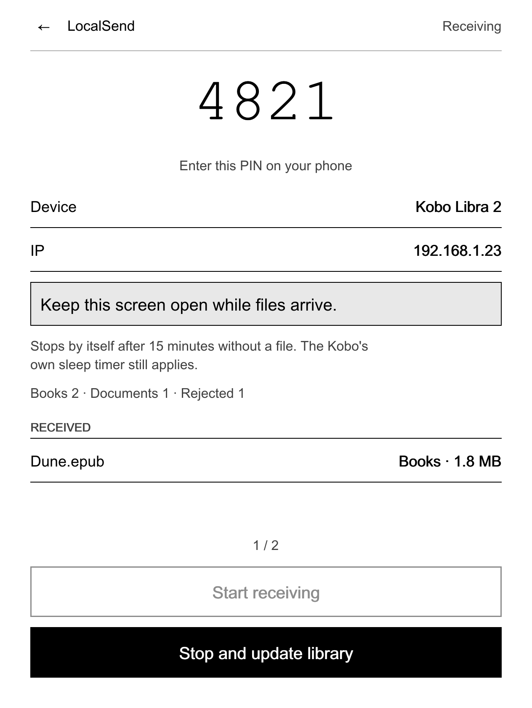
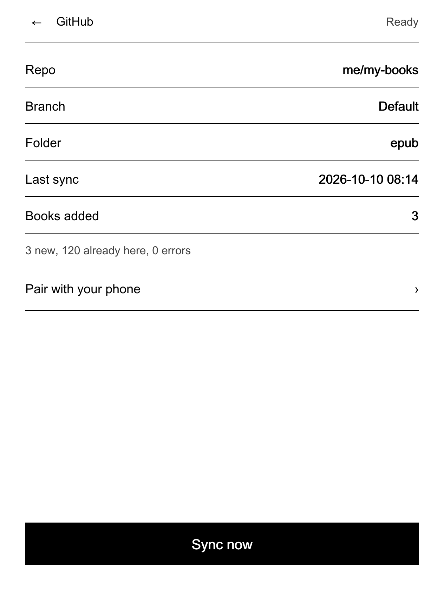
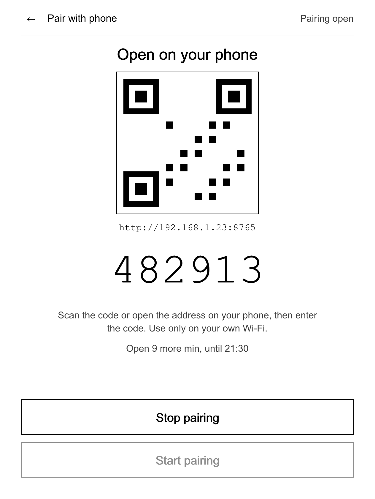
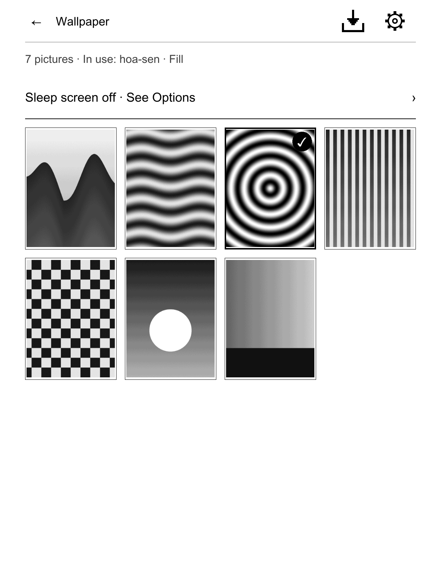
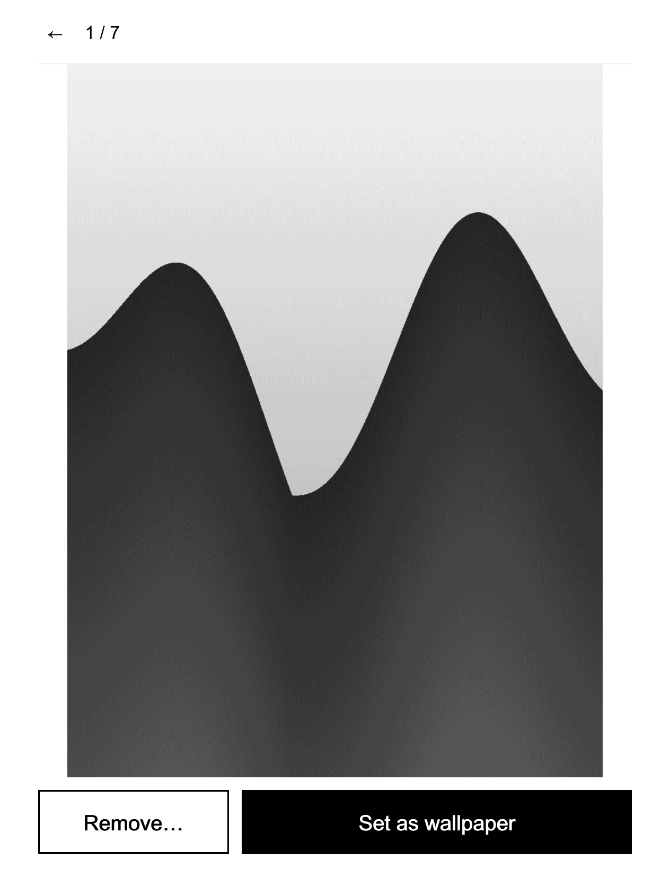
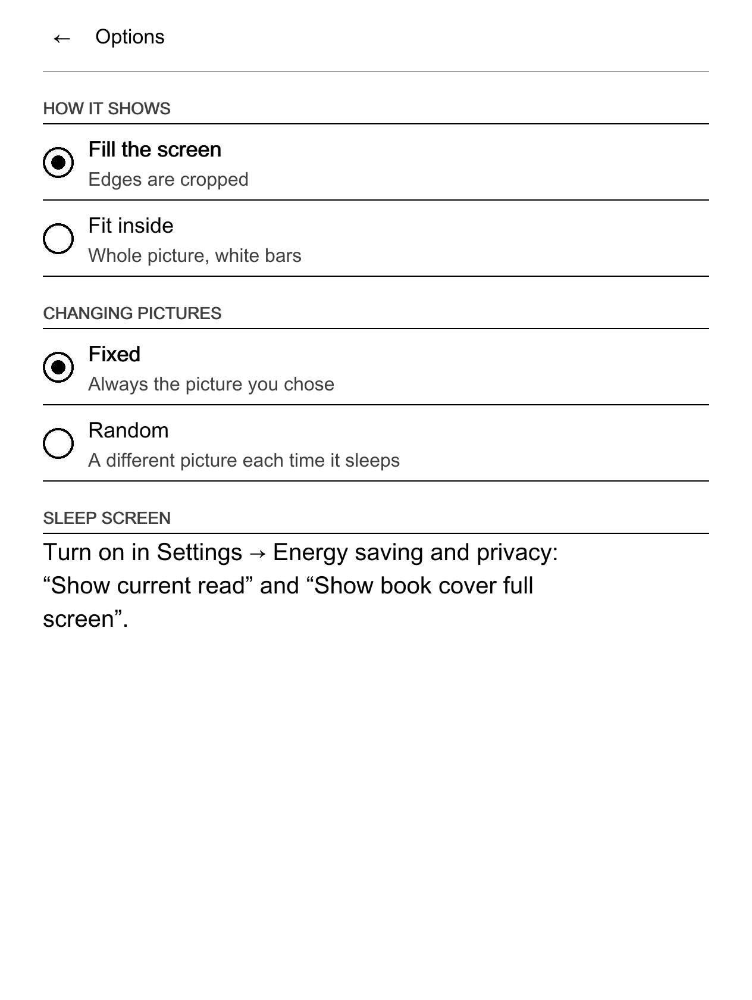
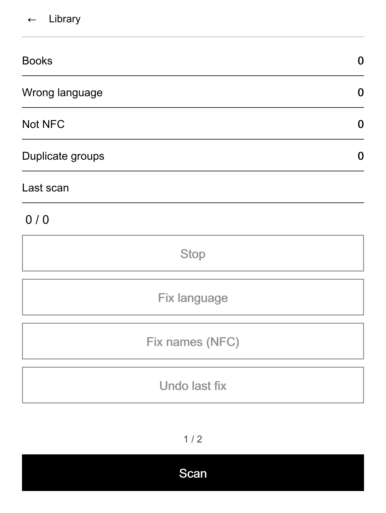
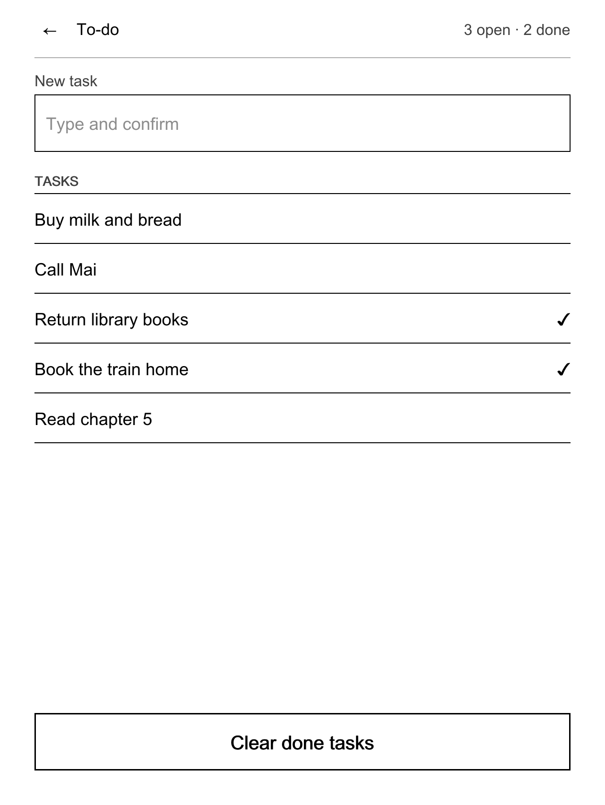

# NickelDrawer user guide

For Kobo owners who want to install NickelDrawer, use its apps and remove it again. No programming needed. Vietnamese version: [user-guide.vi.md](user-guide.vi.md).

Names in **bold** are what you see on a Kobo set to English. A name marked † has not been checked on a real English-language Kobo yet; it may differ slightly on your device.

## What NickelDrawer is (and is not)

NickelDrawer adds two rows to the **More** tab of your Kobo:

- **Apps** opens an app drawer: a list (or grid) of small tools that look like the rest of your Kobo.
- **Tweaks** opens a settings-style window with useful switches (sleep screen, screenshots, auto USB connect, text legibility) and actions (sleep, restart, rescan library).

The apps that come with it:

| App | What it does |
|---|---|
| LocalSend | Receive books, documents, comics and pictures from your phone over Wi-Fi. |
| GitHub | Download new books from your own private GitHub repository. Add-only. |
| Wallpaper | Use your own pictures as the sleep screen. |
| Library | Fix the language tag of Vietnamese books, fix Unicode names, find duplicates. |
| To-do | A small to-do list kept on the Kobo. |

What it is not:

- **Not made by Kobo.** NickelDrawer is an independent project. It is not made by, affiliated with or endorsed by Rakuten Kobo. "Kobo" and "Nickel" are trademarks of their owners.
- **Not a new reading app.** It does not replace Kobo's reader, store or library. It adds rows and screens to Kobo's own software (called Nickel).
- **Not a cloud service.** It has no account and sends nothing anywhere unless you start a feature that needs the network.
- **Not open source.** NickelDrawer is source-available under the PolyForm Noncommercial 1.0.0 license: free for personal use, study, hobby projects and non-profit organisations; no commercial use.

> **Status: beta (1.0.0-beta.1).** NickelDrawer has been tried on one Kobo Libra 2 with one firmware build. Parts of it have run on that device; much of what this guide describes has only been tested on a computer so far. Each chapter says what has been tried on a real device. Read [Safety and uninstall](#safety-and-uninstall) before you install.

## Check that your Kobo is supported

NickelDrawer supports the **Kobo Libra 2** with one of these five firmware builds:

| Firmware | Status |
|---|---|
| 4.38.23828 | Earlier test builds of the drawer and its app screens ran on a device. The current build is waiting for its full device test session. |
| 4.38.23697 | Checked on a computer only. Never run on a device. |
| 4.38.23684 | Checked on a computer only. Never run on a device. |
| 4.38.23648 | Checked on a computer only. Never run on a device. |
| 4.38.23552 | Checked on a computer only. Never run on a device. |

"Checked on a computer" means the program checks, for each build, that every Kobo function it needs exists. It does not mean someone used it on that build.

Not supported:

- **Firmware 5.x.** Do not install NickelDrawer on a 5.x Kobo. If your Kobo offers to upgrade to 5.x, say no (see [FAQ](#faq)).
- **Other Kobo models.** No other model has been checked. Do not install it on them.

### Other Kobo models

Of the 27 Kobo models ever sold, only the Libra 2 is tested. The Libra H2O and Libra Colour have the same 1264×1680 screen and are expected to work but untested. On the 19 other models that run firmware 4.x the drawer stays off: the screens are laid out for the 1264×1680 panel, so the mod checks the model and shows "NickelDrawer does not support this model yet" once. The Kobo eReader, Wireless, Mini, the Vox and Arc tablets, and any Kobo on firmware 5.x are not supported. The drawer also loads only on the exact builds above. See the full table and how to help add a model in [Supported devices](../COMPATIBILITY.md#supported-devices).

### Find your firmware version

On the Kobo:

1. Open **Settings** → **Device information** †.
2. Read the **Software version** † line. It looks like `4.38.23828`.

Over USB (if you cannot find the menu):

1. Connect the Kobo and tap **Connect**.
2. Open the hidden folder `.kobo` on the Kobo drive and open the file `version` with a text editor.
3. The line has several parts separated by commas. The third part is the firmware, for example `4.38.23828`.

> The first part of that line is your Kobo's serial number. Do not post it in a bug report.

If your version is not in the table, stop here. NickelDrawer would turn itself off on that build (see [Troubleshooting](#troubleshooting)).

## Before you install

### Back up

Do this every time before you install, update or remove NickelDrawer.

1. Connect the Kobo to your computer with a USB cable and tap **Connect** on the Kobo.
2. Make hidden files visible on the computer:
    - macOS Finder: press Cmd + Shift + . (full stop).
    - Windows Explorer: View → Show → Hidden items.
    - Linux: usually Ctrl + H in the file manager.

3. Copy the whole `.kobo` folder and the whole `.adds` folder (if it exists) from the Kobo drive to a folder on your computer. Name it with today's date.
4. Keep this copy until you are happy with NickelDrawer.

The `.kobo` folder holds your library database (`KoboReader.sqlite`), your settings (`Kobo eReader.conf`) and the sleep-screen pictures. Your books are in the normal folders and are not touched by the install.

### Charge the battery

Charge the Kobo to **50 % or more**. An install restarts the Kobo; a flat battery in the middle of that is a bad moment.

### What the install changes

| Where | What |
|---|---|
| `.adds/koboapps/` | The host tool, shared files, translations, icons. |
| `.adds/apps/` | One folder per app. Each app keeps its own settings in its `data/` folder. |
| Kobo system (`/usr/local/Kobo/imageformats/`) | One file, the NickelDrawer mod, installed by the Kobo itself from `KoboRoot.tgz` at restart. |
| `.adds/nickeldrawer/` | A folder for the switch files described in [Safety and uninstall](#safety-and-uninstall). |

Nothing else changes until you use an app or a tweak. Each app writes only to its own folders (for example LocalSend writes to `Books`, `Documents`, `Comics` and `Pictures`). Tweaks change Kobo settings only when you tap them.

NickelDrawer does not need NickelMenu and works next to it. It also works next to kobo-tieng-viet (Vietnamese fonts and fixes for Kobo).

## Install

There are two ways. Most people use **way A**.

### Way A: copy the release files (any computer)

You need: the Kobo, a USB cable, a computer, and two files from the latest NickelDrawer release:

- `koboapps-<version>.zip`: the apps and the host tool.
- `KoboRoot-nickeldrawer.tgz`: the Kobo mod. (The same file is also inside the zip, at `onboard/.adds/koboapps/mod/`.)

Steps:

1. Do the [backup](#back-up) and charge the battery.
2. Connect the Kobo and tap **Connect**. Make hidden files visible (see above).
3. Unzip `koboapps-<version>.zip` on the computer. Inside, open `onboard`, then `.adds`. You see two folders: `koboapps` and `apps`.
4. On the Kobo drive, open the `.adds` folder. If there is none, create a folder named `.adds` (with the dot) at the top level of the drive.
5. Copy the two folders `koboapps` and `apps` into the Kobo's `.adds` folder.

    > **macOS Finder warning.** If the Kobo already has a folder with the same name, Finder asks whether to **Replace** it. **Replace deletes everything inside the old folder**, including app settings and other mods' files. Hold the Option key while you drag and choose **Merge** instead, or copy only on a first install. Windows merges folders by default.

6. Copy `KoboRoot-nickeldrawer.tgz` into the Kobo's `.kobo` folder and rename the copy to exactly `KoboRoot.tgz`.
7. Eject the Kobo safely (macOS: the eject button in Finder; Windows: "Safely remove hardware"). Then unplug the cable.
8. The Kobo shows that it is updating and restarts. This takes a minute or two. If it does not restart by itself, restart it from the power menu.
9. When the Kobo shows **Home**, wait about 20 seconds before you do anything else. In the first 15 seconds after a start, turning the Kobo off removes the mod again (this is the safety net; see [Safety and uninstall](#safety-and-uninstall)).
10. Tap **More**. You should see two new rows: **Apps** and **Tweaks**.

If the rows are not there, see [Troubleshooting](#troubleshooting).

### Way B: the installer script (macOS or Linux, from the source code)

This way is for people who build NickelDrawer from its source code. It backs up everything it replaces and never touches app `data/` folders.

```sh
make check build dist                 # build everything (needs Go; the mod needs Docker)
tools/install-to-kobo.sh --dry-run    # show what would happen; changes nothing
tools/install-to-kobo.sh              # install
```

| Option | What it does |
|---|---|
| `--dry-run` | Print every step, change nothing. |
| `--with-mod` | Always stage the Kobo mod, even if it did not change. |
| `--no-mod` | Install apps and host tool only, not the mod. |
| `--remove-legacy` | Also remove an old hand-made LocalSend setup (`.adds/localsend` and its NickelMenu items). |
| `--uninstall` | Remove NickelDrawer (see [Uninstall](#uninstall)). |
| `--purge` | With `--uninstall`: also delete the apps' `data/` folders. |

Good to know:

- The backup goes to `backups/<date-time>/` in the source folder on your computer.
- The script expects the Kobo at `/Volumes/KOBOeReader` (macOS). On Linux, or if your Kobo drive has another name, set it first: `KOBO_ROOT=/path/to/kobo tools/install-to-kobo.sh`.
- It switches off NickelMenu's tab in the bottom bar (the drawer replaces it) and removes menu items that older versions generated. `--uninstall` puts the tab back.
- After it finishes: eject, unplug, and let the Kobo restart if the mod was staged.

## First look

### Open the drawer

1. Tap **More** in the bottom bar.
2. Tap **Apps**.

The **Apps** row may show a second line: an app that is busy (for example "LocalSend Receiving") or **1 update**. A dot means an update is waiting; the same dot shows on the gear in the drawer header.

The drawer has:

- a header with **←** (back to More), the title **Apps**, and four small buttons: **refresh**, **list**, **grid** and, last, the gear **⚙** (settings);
- the section **INSTALLED** with your apps;
- the hint "Hold an app for info or to remove it.";
- the page number (for example `1 / 2`) with **‹ ›** arrows.

### List or grid

Tap the list or grid button in the header. The list shows each app with its icon, name and a status line. The grid shows four icons per row with their names; **Refresh** and the gear **⚙** sit in the header in both views. The drawer remembers your choice.

### Turn pages

Use the Kobo's page-turn buttons or tap the **‹ ›** arrows. The page-turn buttons also flip pages inside long app screens.

### Refresh the list

You copied a new app over USB, or removed one? Tap the refresh button in the header. The drawer also reloads every time you open it.

### Info and remove

Hold your finger on an app for about half a second. A menu opens:

- **Info**: version, which folders the app reads and writes, whether it uses the network, and its folder.
- The app's quick actions, only the few it offers for this menu (for example **Stop receiving** in LocalSend). An action that could lose data asks first. Everything else is on the app's screen.
- **Remove…**: deletes the app. You are asked first.

> **Remove deletes the app's whole folder, including its `data/`.** For GitHub that is your token and settings. For Library that is the backups and the trash, so you can no longer undo a fix or restore a trashed book. Your books and pictures in the normal folders stay. Undo or restore what you need first.

### Moving around

- **←** in a header always goes back exactly one level: picture → gallery → app → drawer → More.
- Tapping a tab in the bottom bar (for example **Home**) leaves the drawer and the app completely. Next time the drawer opens on its first page. Work that runs in the background (an import, a sync) keeps running.
- Leaving a screen never stops what the app is doing.

### Messages

Apps answer with a short message at the bottom of the screen (a "toast"), for example "Set as wallpaper". When something did not work, the message says so and the details go to the app's log file, `data/log.txt` in the app's folder (`.adds/apps/<app>/data/log.txt`). You can read it over USB.

## LocalSend: receive books from your phone



*Picture made on a computer at the Kobo's screen size, not a photo of a device.*

### What you need

- The free **LocalSend** app on your phone or computer (from your app store or localsend.org).
- The Kobo and the phone on the **same Wi-Fi** network.

### Receive files

1. Open **More** → **Apps** → **LocalSend**.
2. Tap **Start receiving**.
    - If Wi-Fi is off, the Kobo asks "Wi-Fi is off. Turn it on to continue." Tap **Turn on Wi-Fi**. When Wi-Fi is connected, receiving starts.

3. The screen shows a large **PIN**, the **Device** name and the **IP** address, and the status **Receiving**.
4. On the phone, open LocalSend, tap **Send**, pick the files, then tap your Kobo in the list of nearby devices.
5. Enter the PIN from the Kobo on the phone.
6. The files arrive. Each one appears under **Received** and is put in the right place:

| File | Goes to |
|---|---|
| EPUB, KEPUB, MOBI | `Books` |
| PDF, TXT, HTML, RTF | `Documents` |
| CBZ, CBR | `Comics` |
| PNG, JPEG, GIF | `Pictures` |
| anything else | rejected (see below) |

7. When you are done, tap **Stop and update library**. The Kobo stops receiving and rescans the library so the new books show up.

Good to know:

- A file with the same name as an existing one is never overwritten. The new one gets a number, for example `book (2).epub`.
- Each file is checked: its content must match its name (a `.epub` must really be an EPUB) and it must not be too large (books 200 MB, PDF 300 MB, comics 500 MB, pictures 20 MB, text files 20 MB). Files that fail go to `.adds/koboapps/inbox/rejected/` and are deleted after 7 days.
- The PIN is made once and stays the same. To get a new PIN, delete `.adds/apps/localsend/data/pin.txt` over USB.
- You can tap **←** and do other things. Receiving goes on, and the **Apps** row shows that LocalSend is receiving.
- **Receiving stops by itself after 15 minutes without a new file.** The screen then says so, and the library is rescanned.
- The Kobo may still go to sleep on its own timer while you send. No app can keep it awake. Touch the screen now and then during a long transfer.

*Tried on a device:* receiving one EPUB with an older menu-based version of this app (the book arrived in the library). The current screen has not been re-tested on a device yet.

## GitHub: sync books from your repository



*Picture made on a computer, not a photo of a device.*

The GitHub app downloads new books from a **private GitHub repository** that you own. It only adds: it never deletes or overwrites a book on your Kobo, and a book you deleted on the Kobo is not downloaded again.

### Prepare (once, on your phone or computer)

1. Create a **private** repository on GitHub, for example `my-books`. Put your books in a folder, for example `epub/`.
2. Create a **fine-grained personal access token** on GitHub: Settings → Developer settings → Personal access tokens → Fine-grained tokens → Generate new token.
    - **Repository access:** Only select repositories → pick only your books repository.
    - **Permissions:** Repository permissions → **Contents: Read-only**.
    - **Expiration:** choose an end date.

3. Keep the token in your phone's password manager. You will paste it on your phone in step 4 below.

> **Token safety.** Never type the token on the Kobo, never send it to anyone, never post a screenshot of it. The token gives read access to your books repository and nothing else. If you lose the Kobo, revoke the token on GitHub.

### Pair the Kobo with your phone

1. Open **More** → **Apps** → **GitHub**. The first time it shows **Not paired**.
2. Tap **Pair with your phone**, then **Start pairing**. Turn on Wi-Fi if the Kobo asks.

    

3. The Kobo shows a QR code, an address like `http://192.168.1.23:8765`, a 6-digit code and how long pairing stays open (10 minutes).
4. On a phone on the **same Wi-Fi**, scan the QR code (or type the address in the browser). On the page:
    - **Code from the Kobo**: the 6 digits.
    - **Repository**: `owner/name`, for example `yourname/my-books`.
    - **Branch (optional)**: leave empty for the default branch.
    - **Folder (optional)**: the books folder, for example `epub`. Empty means the whole repository.
    - **Access token**: paste the token.

5. Tap **Check and save**. The Kobo checks everything with GitHub before it saves anything.
6. When the page says **Paired**, close it. On the Kobo the status changes to **Ready**. Tap **←** to see Repo, Branch and Folder.

Only pair on your own Wi-Fi: the pairing page is not encrypted (plain HTTP). It closes after success, after 5 wrong codes, or after 10 minutes. **Stop pairing** closes it at once.

### Sync

1. Tap **Sync now**. The message says "Syncing in the background."
2. The screen shows "Downloading 2 / 7" and the file name. You can leave the screen.
3. When it finishes, the screen shows for example "3 new, 120 already here, 0 errors", and the library rescans by itself if books were added.

Where books go: books to `Books/GitHub`, PDFs to `Documents/GitHub`, comics to `Comics/GitHub`. Files are checked like LocalSend files (type, size, real content); others are skipped. If nothing changed on GitHub since the last sync, nothing is downloaded.

A book you delete on the Kobo stays deleted: the next sync skips it. A book you delete from the repository stays on the Kobo.

### Pairing and sync messages

| Message | What to do |
|---|---|
| Wrong code. 4 tries left. | Type the 6 digits shown on the Kobo again. After 5 wrong codes pairing stops: start it again on the Kobo. |
| Repository … not found, or the token cannot see it. | Check the `owner/name` spelling. Check that the token includes this repository with Contents: Read-only. |
| Branch … does not exist in … | Leave the branch empty to use the default one, or fix its name. |
| Folder … does not exist on branch … | Fix the folder name, or add a book to that folder in the repository, or leave the folder empty. |
| GitHub refused (401): bad or expired token. | Make a new token and pair again. |
| GitHub refused (403): the token cannot read this repo's contents. | Give the token Contents: Read-only on this repository. |
| The token must start with github_pat_ or ghp_ … | Paste the whole token, with nothing before or after it. |
| Pairing timed out. / Pairing stopped: too many wrong codes. | Tap **Start pairing** again on the Kobo. |
| No Wi-Fi. Connect, then try again. | Turn on Wi-Fi on the Kobo. |
| GitHub API limit reached. Try later. | Wait an hour and sync again. |
| Sync failed. See data/log.txt. | Read `.adds/apps/ghsync/data/log.txt` over USB. It never contains your token. |

On a failed check nothing is saved, the old settings stay, and the token box on the page is emptied so you paste it again.

An empty repository still pairs; the first sync reports 0 books.

*Tried on a device:* not yet. The pairing and sync code is tested on a computer.

## Wallpaper: your pictures on the sleep screen



*Picture made on a computer, not a photo of a device.*

### The two Kobo settings you need

Kobo shows a picture from NickelDrawer only on its **full-screen book cover** sleep screen. So:

1. Open **Settings** → **Energy saving and privacy**.
2. Turn on **Show current read**.
3. Turn on **Show book cover full screen**.
4. Open any book once, so the Kobo has a "current read".
5. In **More** → **Tweaks**, keep **Sleep screen** on.

The Wallpaper app reminds you when either setting is off ("Sleep screen off · See Options").

### Add pictures

1. Connect the Kobo over USB and copy PNG or JPEG pictures straight into the `Pictures` folder (not into sub-folders). Up to 20 MB each. You can also send them with LocalSend: pictures go to `Pictures` too.
2. Eject and open **More** → **Apps** → **Wallpaper**.
3. The first time, with an empty gallery, the pictures already in `Pictures` are imported by themselves. Later, tap the import button in the header (**Import pictures**).
4. The header shows "Importing 3/13" and the grid fills in as each picture is converted. You can leave the screen meanwhile.

Each picture is scaled to the screen and turned into 16 shades of grey. Your originals in `Pictures` are not changed. The same picture is never imported twice.

### Browse and view

- The gallery shows 12 pictures per page (4 across, 3 down). Use the page-turn buttons for more.
- The picture in use has a thick frame and a ✓.
- Tap a picture to open the viewer. The title shows its place, for example `3 / 13`.



In the viewer:

- Tap the right third of the screen (or a page-turn button) for the next picture, the left third for the previous one. At the first or last picture nothing happens.
- Tap the middle to hide the bars and see the picture full size. A round **←** button stays in the top-left corner: tap it (or the middle again) to show the bars.
- **←** in the header goes back to the gallery, at the page of the picture you were viewing.

### Set the wallpaper

In the viewer, tap **Set as wallpaper**. The message says "Set as wallpaper", the title shows **In use ✓** and the button turns into **In use**. Put the Kobo to sleep to see it.

You can also hold a picture in the gallery. A menu opens with **Set as wallpaper**, **View**, **Info** (name, size, date added), **Remove from Wallpaper…** and **Remove with original…**.

### Options

Tap the gear in the gallery header.



| Option | Choices |
|---|---|
| **How it shows** | **Fill the screen** (edges are cropped) or **Fit inside** (whole picture, white bars). Pictures are converted again in the background. |
| **Changing pictures** | **Fixed** (always the picture you chose) or **Random** (a different picture each time it sleeps). |
| **Sleep screen** | **Ready ✓**, or which Kobo setting to turn on. |

### Remove a picture

- **Remove…** in the viewer, or **Remove from Wallpaper…** in the gallery menu, takes the picture out of Wallpaper. The original stays in `Pictures`. You are asked first; tapping outside the question does not remove anything.
- **Remove with original…** also deletes the original from `Pictures`, but only if it is exactly the same file. Otherwise the original is kept and the message says so.

*Tried on a device:* importing from `Pictures` and the full-screen sleep picture worked (with the two settings on and a current book). An earlier build of the gallery and viewer ran on a device; the current gallery, viewer and options screens have not been re-tested yet.

## Library: tidy your books



*Picture made on a computer, not a photo of a device.*

The Library app looks at the books in `Books`, `Documents` and `Comics`. It is mostly for Vietnamese books, but the duplicate finder works for any book.

It never touches the Kobo's library database. Every change backs up the book first, and the library rescans by itself afterwards.

### Scan

1. Open **More** → **Apps** → **Library**.
2. Tap **Scan**. The screen shows "Scanning n/N". It runs in the background; you can leave and come back.
3. You get counts:
    - **Books**: EPUB books found.
    - **Wrong language**: Vietnamese books tagged as another language, usually English. The Kobo then hyphenates and looks up words as if they were English.
    - **Not NFC**: names or titles written in a non-standard Unicode form (see below).
    - **Duplicate groups**: sets of books that are the same.
    - **Last scan**: when you last scanned.

### Fix the language

1. Tap **Fix language**, then **Fix**.
2. Each Vietnamese book with a wrong language is copied to the app's backup folder, then only its language is set to Vietnamese. The new file is checked before it replaces the old one.
3. Open the book again to see the new hyphenation. If the Kobo still uses the old language, rescan the library (**Tweaks** → **Rescan library**).

### Fix names (NFC)

Vietnamese letters with marks (like "ệ") can be stored in two ways. They look the same but search and sorting treat them as different. **Fix names (NFC)** rewrites file names, titles and authors in the standard form (NFC). It backs up first.

### Undo

**Undo last fix** puts back the originals of the last language or name fix, including the old file names.

### Duplicates

1. Under **Duplicates**, tap one book to select it. Nothing happens yet.
2. Tap **Move to trash**, then **Move**. The book goes to the app's trash for 30 days.
3. The last copy of a book can never be moved to the trash.
4. **Restore from trash** puts back the duplicates you trashed on the most recent day. It never overwrites a file.

Trashed books older than 30 days are deleted at the start of the next scan.

**Stop** ends a running scan or fix after the current book.

Limits: hidden files and links are skipped, and files over 200 MB are ignored.

*Tried on a device:* not yet.

## To-do: a small task list



*Picture made on a computer, not a photo of a device.*

A short task list that lives only on your Kobo. No account, no network.

### Add a task

1. Open **More** → **Apps** → **To-do**.
2. Tap the **New task** box. Kobo's own keyboard opens.
3. Type the task and confirm. The task appears at the end of the list and the message says "Task added".

The header shows how many tasks are open and done, for example "3 open · 2 done".

### Mark done, delete, clear

- **Tap a task** to mark it done (a ✓ appears). Tap it again to open it again.
- **Hold a task** and choose **Delete...** to remove it. You are asked first.
- **Clear done tasks** at the bottom removes every task with a ✓. You are asked first. The button is greyed out while no task is done.

Limits: at most 200 tasks, and 200 characters per task. The same task cannot be added twice.

Your list is kept in `.adds/apps/todo/data/todo.json`. If that file is ever damaged, the app keeps a copy as `todo.json.corrupt`, starts with an empty list and tells you so.

*Tried on a device:* not yet. Typing with Kobo's keyboard inside an app screen has not been tried on a device yet; if the keyboard does not open, the box shows "Change this from your phone or computer."

## Tweaks

Open **More** → **Tweaks**. A window like Kobo's own Settings opens, with two columns. Close it with **✕** or by tapping outside it. Use the page-turn buttons if it has more than one page.

| Tweak | What it does | When it takes effect |
|---|---|---|
| **Sleep screen** (On/Off) | Off hides the sleep-screen pictures folder, so Kobo shows its normal sleep screen. Your pictures are kept. Must be On for Wallpaper. | Next time the Kobo sleeps. |
| **Screenshots** (On/Off) | Kobo's hidden screenshot setting. | Not yet confirmed on a device. If nothing changes, restart. |
| **Auto USB connect** (On/Off) | When on, the Kobo connects to a computer without asking **Connect**. | Not yet confirmed on a device. If nothing changes, restart. |
| **Text legibility** (On/Off) | Better letter spacing and ligatures. **KEPUB books only** (books bought from Kobo or converted to KEPUB); plain EPUB and PDF do not change. | Close and reopen the book. |
| **IP address** | Shows the Kobo's Wi-Fi address, or "No Wi‑Fi". Tapping does nothing. | — |
| **Invert and reboot** | Swaps black and white on the whole screen and restarts. Run it again to switch back. Asks first. | After the restart. |
| **Sleep** | Puts the Kobo to sleep now. | At once. |
| **Reboot** | Restarts the Kobo. Asks first. | At once. |
| **Rescan library** | Asks Kobo to look for new or changed books. | At once. |

A switch flips at once and a message confirms it, for example "Screenshots on".

The switches write to the Kobo's own settings file (`.kobo/Kobo/Kobo eReader.conf`); **Sleep screen** renames the `.kobo/screensaver` folder. They stay as you left them after you remove NickelDrawer, so set them back first if you want.

*Tried on a device:* not yet.

## Updates

NickelDrawer can update its apps, its host tool and its Kobo mod over Wi-Fi. It only installs a release that carries the maintainer's digital signature. Nothing is checked or downloaded unless you tap a button.

### Settings: the gear

Tap **⚙** in the header of the drawer to open **NickelDrawer settings**. It has four parts:

- **Hidden apps**: a switch for every app that is hidden by default (today: **UI Kit**). Turn it on and the app appears in the drawer when you go back; turn it off to hide it again. Nothing to edit over USB, and the choice survives updates.
- **Updates**: the installed **Version**, the **New version** (only after a check found one) and the **Source** (the GitHub repository). Buttons **Check** and **Update to <version>**.
- **Debug**: **Write debug log** (see "Send a useful bug report" below). It takes effect after a restart.
- **About**: your firmware with ✓ when NickelDrawer supports it or **!** when it does not, and **About the project** (version, a QR code to open the project page on your phone, maintainer, license, credits).

### Updates: check and install

Updates come from the project's GitHub repository by default; the installer sets this up. If you want a different repository, open `.adds/koboapps/data/update.json` over USB and change `"repo"` to `owner/name` (an empty `"repo"` turns updates off and the Source reads **Off**). The installer never overwrites that file, but it fills in the default when `"repo"` is empty.

1. Open **More** → **Apps** → **⚙**.
2. In **Updates**, tap **Check**. The Kobo turns on Wi-Fi if needed and checks. Nothing is installed. If there is a newer release, the gear gets a black dot, the **New version** row appears with a dot, and the big button reads **Update to <version>**.
3. Tap **Update to <version>**, then **Update** to confirm. Keep Wi-Fi on until it ends. The screen shows "Updating..." and then the result.
4. If the result says "Restart the Kobo to finish", restart it (**Tweaks** → **Reboot**).

### What a restart does after an update

When a release changes the Kobo mod, the update puts the new mod in `.kobo/KoboRoot.tgz`. The Kobo installs it during the next restart, the same way as the first install. Apps and the host tool are already updated before the restart.

### If something goes wrong

- Every file is checked against the signed list before anything is replaced. A bad signature or a damaged file stops the update, and nothing changes.
- If a problem shows up after the files were replaced, the old version is put back by itself.
- Your app data (tokens, settings, pictures, trash) is never part of an update.
- An older release is never installed over a newer one.
- "A system update is already waiting for a restart": restart the Kobo, then update again.

*Tried on a device:* not yet. The update steps are tested on a computer.

## Languages

### How the language is chosen

NickelDrawer uses the language of your Kobo (**Settings** → **Language and dictionaries** †). Change the Kobo's language, then open the drawer again. If a translation is missing for your language, English is shown. A Kobo set to Brazilian Portuguese looks for `pt_BR`, then `pt`, then English.

English and Vietnamese are maintained by the project. In other languages, a few texts that the Kobo mod draws itself (the **Apps** and **Tweaks** rows, some error messages, the "not supported" message) stay in English.

### Add a language

You need no programming, only a text editor. Each translation is a small file of `"key": "text"` lines.

1. Copy `en.json` to `<code>.json` (for example `fr.json`) in each of these folders:
    - `.adds/koboapps/locales/` (drawer, tweaks, updates, settings),
    - `.adds/koboapps/screens/settings/locales/` (the settings and About screens),
    - `.adds/apps/<app>/locales/` for each app.

2. Translate only the texts on the right. Never change the keys on the left.
3. Keep every `{placeholder}` exactly as written, and keep `\n` line breaks.
4. Keep texts short: the screen is small. Names at most 24 characters, button labels at most 32, and no `:` in labels.
5. Eject and open the drawer with the Kobo set to that language.

To share your translation, see [docs/TRANSLATING.md](../TRANSLATING.md). Right-to-left languages are not supported yet.

## Troubleshooting

| Symptom | Likely cause | Fix |
|---|---|---|
| No **Apps** or **Tweaks** row in **More**. | The mod is not installed, is switched off, or does not support your firmware. | Check that `.kobo/KoboRoot.tgz` is gone (the Kobo deletes it after installing). Check that `.adds/nickeldrawer/` has no `disable` file. Check your firmware version. Copy `KoboRoot.tgz` again and restart. |
| Message "NickelDrawer does not support this model yet". | Your Kobo is not a model with the 1264×1680 screen the drawer is laid out for (only Libra 2, Libra H2O and Libra Colour are). | Nothing is broken; the Kobo works as normal. The drawer stays off on this model. See docs/COMPATIBILITY.md. |
| Message "NickelDrawer does not support this firmware yet". | Your firmware is not one of the five supported builds, often after Kobo updated itself. | Nothing is broken; the Kobo works as normal. Wait for a NickelDrawer release that supports your build. |
| A line under the drawer title: "Kobo is offering update 5.x — NickelDrawer will stop working". | Kobo offers firmware 5.x. | Decline the offer on the Kobo if you want to keep NickelDrawer. |
| The drawer shows **PROBLEMS** or "appsctl is not installed. Reinstall koboapps." | The host tool is missing or damaged. | Copy `.adds/koboapps` from the release zip again. Tap **Try again**. |
| The Kobo does not appear on the computer, or never asks **Connect**. | The drawer or an app screen was open, or an app was busy, when you plugged in. | Unplug. Tap **Home**. Stop LocalSend if it is receiving. Plug in again and tap **Connect**. If it still fails, restart the Kobo. |
| An app shows "That did not work. See data/log.txt." | The app hit a problem. | Read `.adds/apps/<app>/data/log.txt` over USB. The last lines say what broke. |
| An app opens a screen with "Can't open the app", **Back** and **Try again**. | The app's files are incomplete or damaged. | Copy that app's folder from the release zip again, then tap the refresh button in the header. |
| A new app does not appear. | The drawer has not reloaded, or the app's files are wrong. | Tap the refresh button in the header. A broken app is listed under **PROBLEMS** with the reason. |
| Wallpaper picture does not appear on the sleep screen. | A Kobo setting is off, there is no current book, or **Sleep screen** is off. | Turn on **Show current read** and **Show book cover full screen** (**Settings** → **Energy saving and privacy**). Open any book once. Turn **Tweaks** → **Sleep screen** on. Set a picture as wallpaper. |
| LocalSend on the phone does not find the Kobo. | Different Wi-Fi, a guest network that hides devices from each other, receiving stopped, or the Kobo fell asleep. | Put both on the same home Wi-Fi (not a guest network). Open LocalSend on the Kobo and check it says **Receiving**. Wake the Kobo. If your phone's LocalSend can send to an address, use the IP shown on the Kobo. |
| GitHub pairing shows an error. | See the message. | See [Pairing and sync messages](#pairing-and-sync-messages). |
| The pairing page does not open on the phone. | Different Wi-Fi, or pairing closed. | Use the same Wi-Fi. Check the Kobo still shows the code. Start pairing again. |
| "No Wi-Fi. Connect, then try again." | Wi-Fi is off or not connected. | Turn on Wi-Fi in the Kobo's status bar, then try again. |
| A text box says "Change this from your phone or computer." | Text entry on the Kobo is not available on this firmware or is switched off. | Remove the file `.adds/nickeldrawer/no-keyboard` if you created it. |
| The screen colours are inverted and stay that way. | **Invert and reboot** was used. | Run **Tweaks** → **Invert and reboot** again. |
| The Kobo freezes. | Something went wrong in Kobo's software. | Hold the power button for about 15 seconds until the screen changes, release, then press it again to start. |
| The Kobo restarts again and again after an install. | The mod crashes at start. | Turn the Kobo off within 15 seconds after it starts (see [Safety net](#the-safety-net-failsafe)). If that does not help, create the `uninstall` switch over USB. |

### Send a useful bug report

1. Turn on **⚙** → **Debug** → **Write debug log** and restart the Kobo (or create an empty file `.adds/nickeldrawer/debug` over USB; it is the same switch). The drawer then writes a step log to `.adds/nickeldrawer/debug.log`.
2. Repeat what went wrong.
3. Connect over USB and copy `debug.log` and the app's `data/log.txt`.
4. Read them before you share them. Remove anything personal (book titles, names, your Wi-Fi address). Never share `data/token`.
5. Say which firmware you have, what you did, what you expected and what happened.

## Safety and uninstall

### The rules

- Apps run with full rights on the Kobo, which holds your library. Install only apps you trust.
- Back up before you install, update or remove.
- Never edit `KoboReader.sqlite` by hand. NickelDrawer never edits it.

### Switch files

Create these as **empty files** over USB in the folder `.adds/nickeldrawer/` (create the folder if it is missing). The Kobo reads them when it starts, so restart after you add or delete one.

| File | Effect |
|---|---|
| `uninstall` | Removes the NickelDrawer mod at the next start, then deletes itself. |
| `disable` | Keeps the mod installed but inactive: **More** looks like stock. Delete the file and restart to switch it on again. |
| `no-screens` | Tapping an app runs its main action instead of opening its screen. For troubleshooting. |
| `no-keyboard` | Text boxes show "Change this from your phone or computer." instead of the Kobo keyboard. |
| `debug` | Writes a step log to `debug.log` in the same folder. |

### The safety net (failsafe)

The mod is built on NickelHook, which has a safety net: if the Kobo crashes or is turned off during the first **15 seconds** after the mod loads at start-up, the mod is left out from then on and the Kobo starts as stock. To use it on purpose: start the Kobo and turn it off (hold the power button) as soon as **Home** appears.

*Tried on a device:* the safety net has not been tried with the NickelDrawer mod yet. Install and removal with the `uninstall` file were tried with a small test mod.

### Uninstall

**With the installer** (way B):

```sh
tools/install-to-kobo.sh --uninstall --dry-run   # see what would be removed
tools/install-to-kobo.sh --uninstall             # asks whether to keep the apps' data/ folders
```

It backs up first, removes the apps and the host tool, keeps any received files still waiting in the inbox, writes the `uninstall` switch, and puts NickelMenu's tab back. Add `--purge` to also delete the apps' `data/` folders. Then eject and restart the Kobo.

**By hand:**

1. Before you start: in **Tweaks**, set **Sleep screen**, **Screenshots**, **Auto USB connect** and **Text legibility** as you want them to stay. If you used Library, restore any trashed books you want back.
2. Connect over USB. Create the empty file `.adds/nickeldrawer/uninstall`.
3. Eject and restart the Kobo. The mod is removed, and **Apps** and **Tweaks** disappear from **More**.
4. Connect again and delete the folders `.adds/koboapps` and `.adds/apps` (and `.adds/nickeldrawer` if you like).
5. Delete the pictures named `nd-wallpaper-*.png` in `.kobo/screensaver`, or the Kobo keeps showing them on the sleep screen.

**Last resort:** if the Kobo will not start normally, use the [safety net](#the-safety-net-failsafe). If that fails too, use the `disable` switch over USB, or reset the Kobo with Kobo's own instructions.

### What stays after uninstall

| Stays | Where |
|---|---|
| Books, documents, comics and pictures you received or synced | `Books`, `Documents`, `Comics`, `Pictures`, and the `GitHub` folders inside them |
| Files received but not yet sorted | `.adds/koboapps/inbox/` (only if there are any) |
| App data, unless you delete it or use `--purge` | `.adds/apps/<app>/data/` (GitHub token, Wallpaper library, Library backups and trash) |
| Sleep-screen pictures | `.kobo/screensaver/nd-wallpaper-*.png` |
| Kobo settings changed in **Tweaks** | `.kobo/Kobo/Kobo eReader.conf`, and `.kobo/screensaver.disabled` if **Sleep screen** was off |
| The installer's backups | `backups/` on your computer |

## Privacy

- **No telemetry.** NickelDrawer does not collect or send usage data.
- **Network only when you start it:**
  - LocalSend listens on your Wi-Fi while it is receiving, and stops when you tap stop or after 15 minutes without a file.
  - GitHub pairing opens a small page on your Wi-Fi for up to 10 minutes. Sync talks to GitHub only.
  - Updates talk to GitHub only when you tap **Check** or **Update to <version>**.
  - Wallpaper, Library, To-do and Tweaks never use the network.
- **Your GitHub token** is stored only on the Kobo, in `.adds/apps/ghsync/data/token`. It never appears on the screen, in logs or in the app's status. But the Kobo's storage cannot protect single files: anyone who connects your Kobo to a computer can read that file. That is why the token should be fine-grained, limited to one repository and read-only. Revoke it on GitHub if you lose the Kobo.
- **The LocalSend PIN** is stored in `.adds/apps/localsend/data/pin.txt`, readable the same way.
- Logs stay on the Kobo. Nothing is uploaded.

## FAQ

**Will a Kobo firmware update remove NickelDrawer?**
It can. A firmware update may replace the mod file, and a new build that NickelDrawer does not know makes it switch itself off with a short message. Your apps and their data stay in `.adds`. Install a NickelDrawer release that supports the new build.

**Kobo offers me "5.x". Should I accept?**
Not if you want to keep NickelDrawer: it does not work on 5.x. On a Libra 2, skip the offer. Also never install firmware made for other models.

**Does NickelDrawer slow down my Kobo or drain the battery?**
It does nothing until you open it. Apps run only while you use them, and background jobs end by themselves. It has not been measured over long use yet.

**Do I need NickelMenu?**
No. NickelDrawer works with or without it.

**Does it change my reading progress, collections or the library database?**
No. Nothing in NickelDrawer edits `KoboReader.sqlite`. Library edits book files only (after a backup) and asks Kobo to rescan.

**Can I use it on a Kobo Clara or Libra Colour?**
Only the Libra 2 is tested. The Libra H2O and Libra Colour have the same screen and are expected to work, but only on one of the supported firmware builds (the Libra Colour is on 4.45, which is not one yet); on other models the drawer stays off and shows "NickelDrawer does not support this model yet". See [Supported devices](../COMPATIBILITY.md#supported-devices).

**Can I use it in a shop or company?**
No. The license allows personal, study, hobby and non-profit use only.

**What is "UI Kit"?**
A hidden app for app makers and testers that shows every screen component with sample content. It does not appear in the drawer by default; turn it on with **⚙** → **Hidden apps** → **UI Kit**.

**Where are my files?**
Received books in `Books`, `Documents`, `Comics`, `Pictures`. GitHub books in the `GitHub` folders inside them. App settings in `.adds/apps/<app>/data/`.

<a id="vietnamese-system-ui"></a>

## Optional: Vietnamese system UI

This is separate from NickelDrawer, which already has its own Vietnamese translation and works with or without it. Kobo's own menus can be shown in Vietnamese, with fonts that cover Vietnamese letters (without the fix, accented letters may show as boxes), by installing the third-party project [kobo-tieng-viet](https://github.com/redphx/kobo-tieng-viet) by redphx. It has its own license terms, is not part of NickelDrawer and is not affiliated with Kobo.

- **Firmware:** 4.x only; 3.x and 5.x are not supported (per the project page). Decline Kobo's 5.x (Qt6) offer: see the [FAQ](#faq) and [DECISIONS.md](../DECISIONS.md).
- **Install:** back up first, copy the project's `KoboRoot.tgz` into the hidden `.kobo` folder (do not unzip it), eject, wait about 3 minutes. Select **Extra: vi** under Settings → Language and dictionaries † if the language does not switch by itself. Uninstall: an empty `uninstall.txt` in `.adds/tiengviet/`. Follow the project's own instructions; they may change.
- **With NickelDrawer:** either order works; install one, let the Kobo reboot, then the other. After a Kobo firmware update, check both.
- **Fonts for reading:** copy `.ttf` or `.otf` files to a `fonts` folder at the Kobo root, then pick them in the reading menu (Supplemental, Font Face; [Kobo help](https://help.kobo.com/hc/en-us/articles/13009477876631-Load-fonts-onto-your-Kobo-eReader)). Check Vietnamese coverage with `python3 tools/vncheck.py font.ttf` (needs `pip install fonttools`). A book with embedded fonts may ignore your choice.
- **Reading tips:** convert EPUBs to KEPUB ([kepubify](https://github.com/pgaskin/kepubify), or Calibre with the [Kobo Touch Extended](https://www.mobileread.com/forums/showthread.php?t=211135) plugin), keep file names and metadata in NFC and set the book language to `vi` (the Library app fixes both: [Library](#library-tidy-your-books)).
- **Dictionary:** [redphx/tudien](https://github.com/redphx/tudien) is an optional English-Vietnamese dictionary; third-party dictionaries are at your own risk.

The full steps are in the Vietnamese guide: [Cài thêm: giao diện Kobo bằng tiếng Việt](user-guide.vi.md#s-giao-dien-tieng-viet).

## Glossary

Kobo's own names (the screens NickelDrawer works with) and NickelDrawer's names, on a Kobo set to English and to Vietnamese.

| English | Vietnamese | What it is |
|---|---|---|
| More | Thêm | Tab in the bottom bar. NickelDrawer adds its rows here. |
| Home | Trang chủ | Tab in the bottom bar. |
| My Books † | Thư viện | Kobo's library tab. Not the same as NickelDrawer's Library app. |
| Settings | Cài đặt | Kobo's settings. |
| Energy saving and privacy | Tiết kiệm pin và riêng tư | Settings page with the sleep-screen options. |
| Show current read | Hiển thị sách đang đọc | Sleep-screen option needed by Wallpaper. |
| Show book cover full screen | Hiển thị bìa sách toàn màn hình | Sleep-screen option needed by Wallpaper. |
| Device information † | Thông tin thiết bị † | Settings page with the firmware version. |
| Language and dictionaries † | Ngôn ngữ và từ điển † | Settings page for the Kobo's language. |
| Connect | Kết nối | Button the Kobo shows when you plug in USB. |
| Apps | Ứng dụng | NickelDrawer's row in More, and the drawer's title. |
| Tweaks | Tinh chỉnh | NickelDrawer's settings window in More. |
| INSTALLED / SYSTEM | ĐÃ CÀI / HỆ THỐNG | Sections of the drawer. |
| Refresh | Làm mới | Header button that reloads the drawer. |
| Settings (⚙) | Cài đặt | The gear in the drawer header: hidden apps, updates, debug, about. |
| Info / Remove… | Thông tin / Gỡ… | Long-press menu of an app. |
| Wallpaper | Hình nền | The sleep-screen pictures app. |
| Library | Thư viện | NickelDrawer's book-tidying app. |
| To-do | Việc cần làm | The task-list app. |
| UI Kit | Bộ giao diện | Hidden app for app makers. |
| App drawer | Ngăn Ứng Dụng | The page that lists your apps. |
| Firmware | Firmware | Kobo's system software, version like 4.38.23828. |
| Toast | (thông báo ngắn) | Short message at the bottom of the screen. |
| KEPUB | KEPUB | Kobo's own EPUB format (books from the Kobo store). |
| NFC | NFC | The standard way to store letters with accent marks. |
