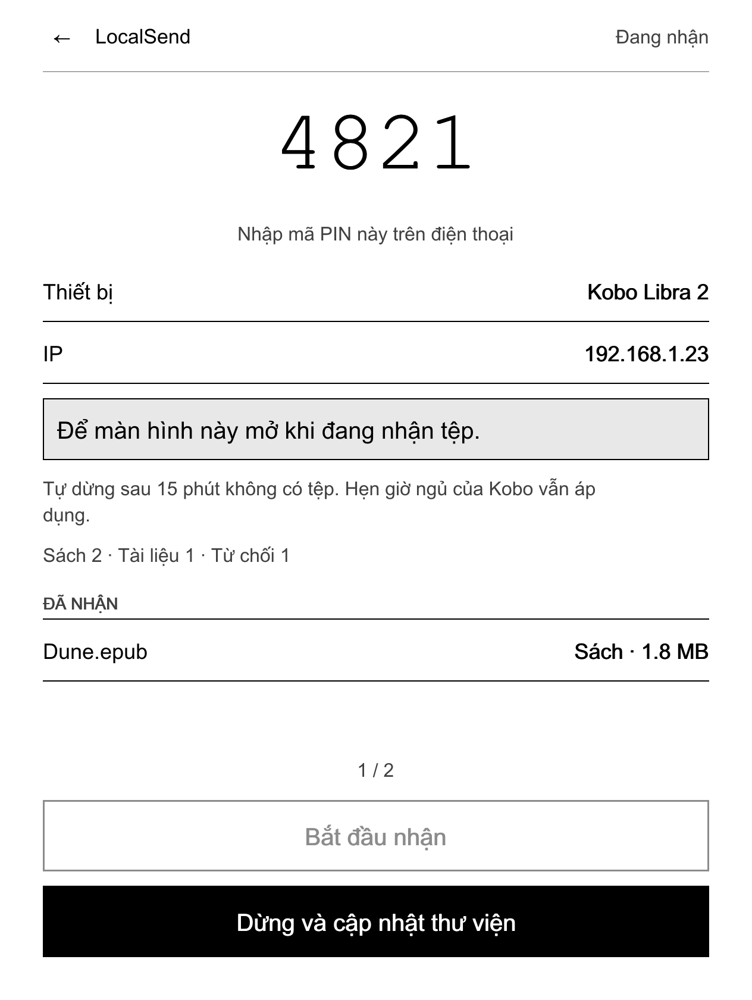
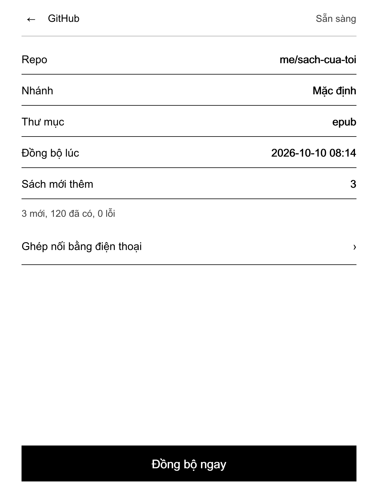
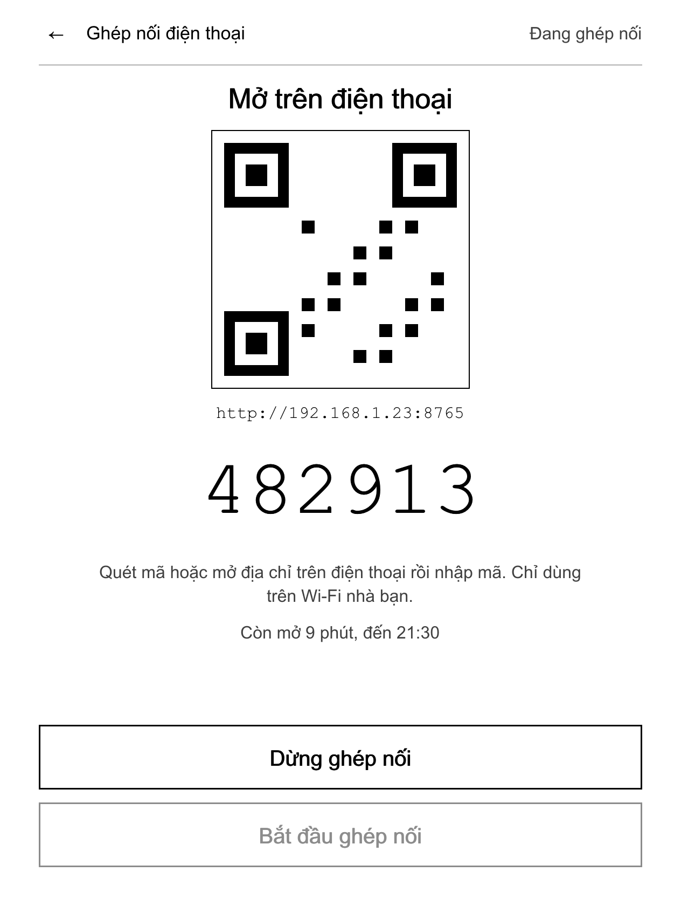
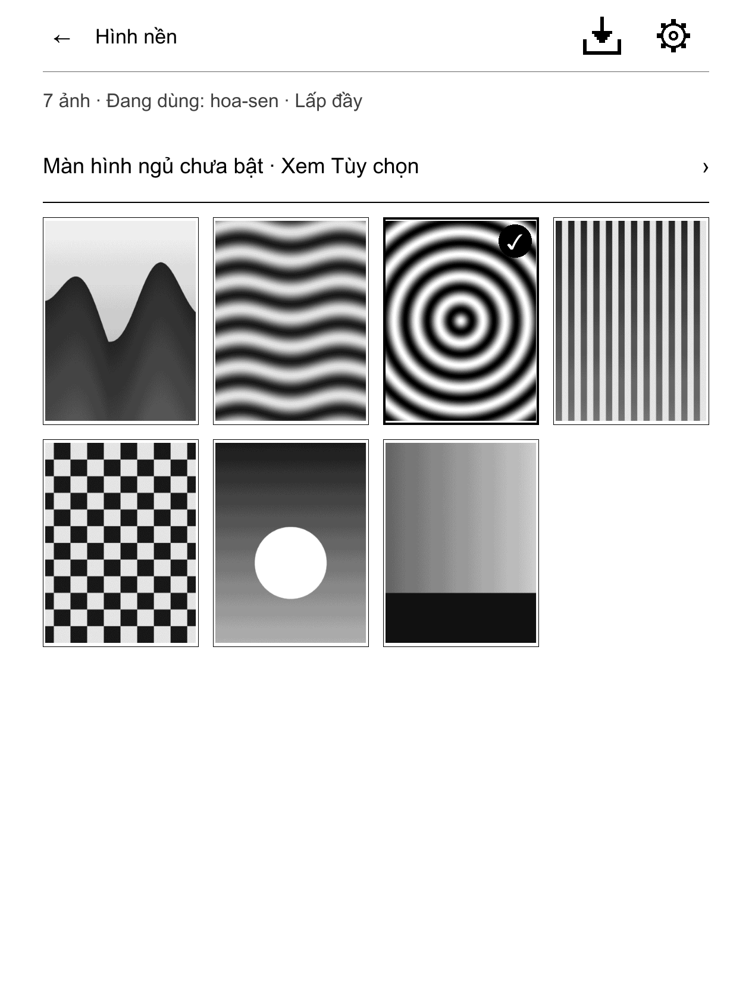
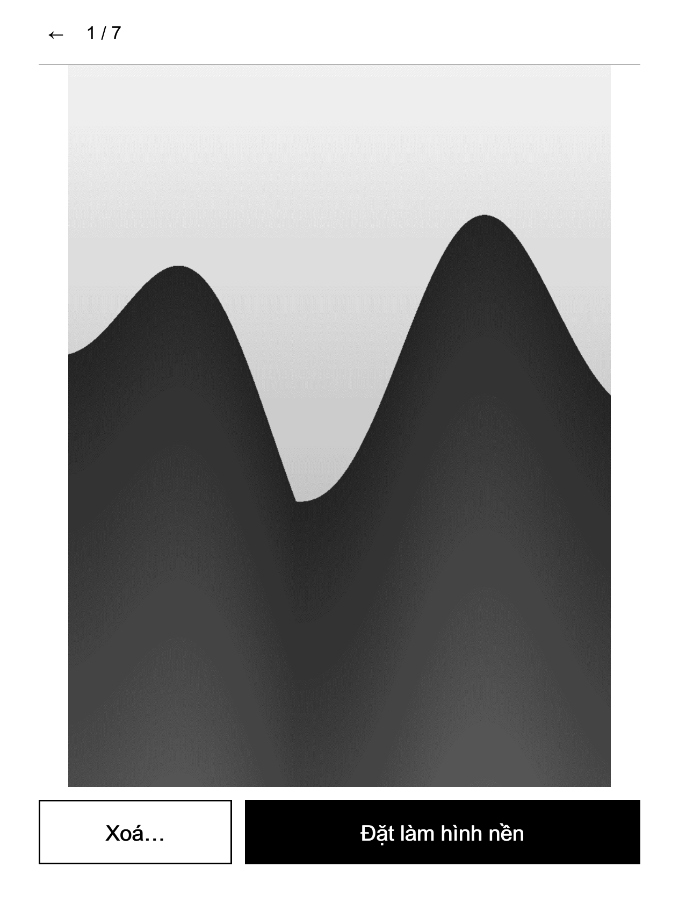
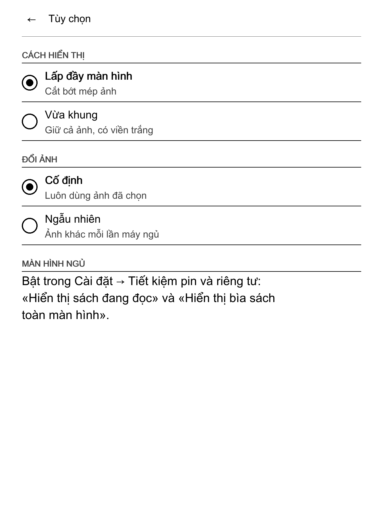
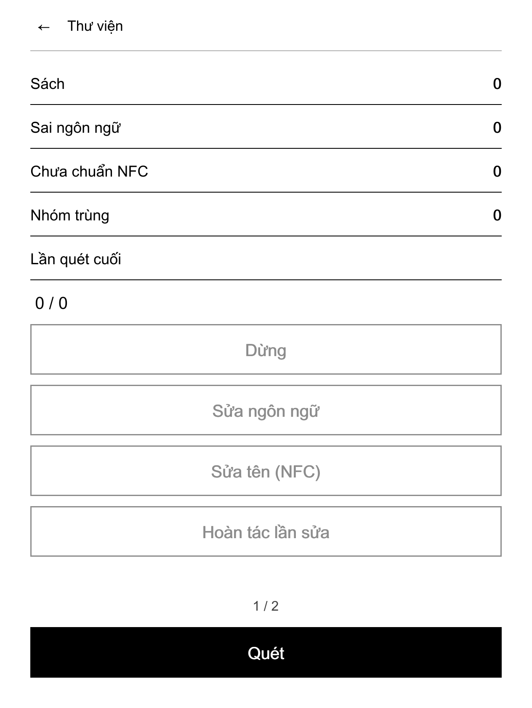
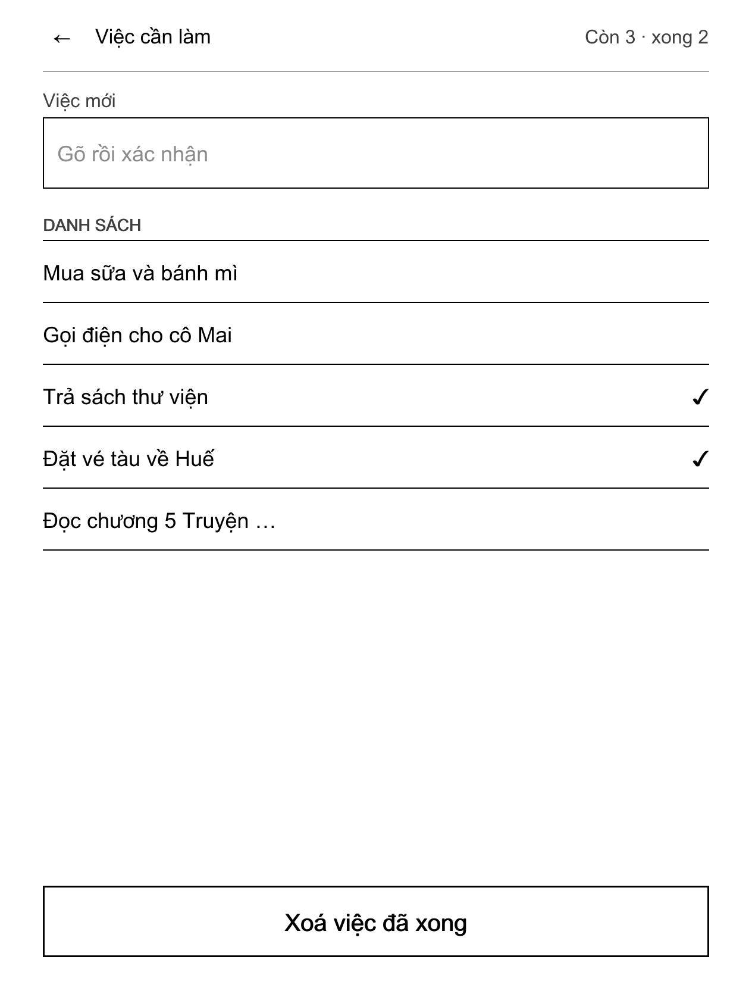

# Hướng dẫn sử dụng NickelDrawer

Dành cho người dùng Kobo muốn cài NickelDrawer, dùng các ứng dụng của nó và gỡ ra khi cần. Không cần biết lập trình. Bản tiếng Anh: [user-guide.en.md](user-guide.en.md).

Chữ **in đậm** là đúng chữ bạn thấy trên Kobo để tiếng Việt. Tên có dấu † chưa được đối chiếu trên máy thật; trên máy bạn có thể khác đôi chút.

## NickelDrawer là gì (và không phải là gì)

NickelDrawer thêm hai hàng vào tab **Thêm** của Kobo:

- **Ứng dụng** mở Ngăn Ứng Dụng: danh sách (hoặc lưới) các công cụ nhỏ, trông giống phần còn lại của Kobo.
- **Tinh chỉnh** mở một cửa sổ kiểu Cài đặt với các công tắc hay dùng (màn hình chờ, chụp màn hình, tự kết nối USB, chữ rõ nét) và vài thao tác (ngủ, khởi động lại, quét lại thư viện).

Các ứng dụng đi kèm:

| Ứng dụng | Làm gì |
|---|---|
| LocalSend | Nhận sách, tài liệu, truyện tranh và ảnh từ điện thoại qua Wi-Fi. |
| GitHub | Tải sách mới từ repo GitHub riêng của bạn. Chỉ thêm, không xoá. |
| Hình nền | Dùng ảnh của bạn làm màn hình ngủ. |
| Thư viện | Sửa nhãn ngôn ngữ của sách tiếng Việt, chuẩn hoá tên Unicode, tìm sách trùng. |
| Việc cần làm | Danh sách việc cần làm nằm gọn trong máy. |

NickelDrawer **không** phải là:

- **Sản phẩm của Kobo.** Đây là dự án độc lập, không do Rakuten Kobo làm, không liên kết và không được Rakuten Kobo bảo trợ. "Kobo" và "Nickel" là nhãn hiệu của chủ sở hữu.
- **Ứng dụng đọc sách mới.** Nó không thay trình đọc, cửa hàng hay thư viện của Kobo. Nó chỉ thêm hàng và màn hình vào phần mềm gốc của Kobo (tên là Nickel).
- **Dịch vụ đám mây.** Không cần tài khoản, không gửi gì đi đâu nếu bạn không tự bật một tính năng cần mạng.
- **Phần mềm nguồn mở.** NickelDrawer công khai mã nguồn theo giấy phép PolyForm Noncommercial 1.0.0: miễn phí cho cá nhân, học tập, sở thích và tổ chức phi lợi nhuận; không dùng cho mục đích thương mại.

> **Trạng thái: bản thử (1.0.0-beta.1).** NickelDrawer mới được thử trên một máy Kobo Libra 2 với một bản firmware. Một phần đã chạy trên máy đó; phần lớn những gì sách này mô tả mới chỉ được kiểm trên máy tính. Mỗi chương ghi rõ phần nào đã thử trên máy thật. Đọc mục [An toàn và gỡ cài đặt](#s-an-toan-va-go-cai-at) trước khi cài.

## Kiểm tra máy của bạn có được hỗ trợ không

NickelDrawer hỗ trợ **Kobo Libra 2** với một trong năm bản firmware sau:

| Firmware | Tình trạng |
|---|---|
| 4.38.23828 | Các bản thử nghiệm trước của Ngăn và màn hình ứng dụng đã chạy trên máy. Bản hiện tại đang chờ buổi thử đầy đủ trên máy. |
| 4.38.23697 | Chỉ kiểm trên máy tính. Chưa chạy trên máy thật. |
| 4.38.23684 | Chỉ kiểm trên máy tính. Chưa chạy trên máy thật. |
| 4.38.23648 | Chỉ kiểm trên máy tính. Chưa chạy trên máy thật. |
| 4.38.23552 | Chỉ kiểm trên máy tính. Chưa chạy trên máy thật. |

"Kiểm trên máy tính" nghĩa là chương trình đã được kiểm rằng mọi chức năng Kobo nó cần đều có trong bản firmware đó. Không có nghĩa là đã có người dùng thử trên bản đó.

Không hỗ trợ:

- **Firmware 5.x.** Đừng cài NickelDrawer lên Kobo chạy 5.x. Nếu Kobo mời nâng cấp lên 5.x, hãy từ chối (xem [Hỏi đáp](#s-hoi-ap)).
- **Các dòng Kobo khác.** Chưa dòng nào khác được kiểm. Đừng cài lên chúng.

### Xem phiên bản firmware

Trên Kobo:

1. Mở **Cài đặt** → **Thông tin thiết bị** †.
2. Xem dòng phiên bản phần mềm †. Nó có dạng `4.38.23828`.

Qua USB (nếu không tìm thấy mục đó):

1. Cắm Kobo vào máy tính, bấm **Kết nối** trên Kobo.
2. Mở thư mục ẩn `.kobo` trên ổ Kobo, mở tệp `version` bằng trình soạn thảo văn bản.
3. Dòng trong tệp có nhiều phần, cách nhau bằng dấu phẩy. Phần thứ ba là firmware, ví dụ `4.38.23828`.

> Phần đầu tiên của dòng đó là số sê-ri máy bạn. Đừng dán nó vào báo lỗi công khai.

Nếu phiên bản của bạn không có trong bảng, dừng ở đây. Trên bản đó NickelDrawer sẽ tự tắt (xem [Xử lý sự cố](#s-xu-ly-su-co)).

## Trước khi cài

<a id="s-sao-luu"></a>

### Sao lưu

Làm việc này mỗi lần trước khi cài, cập nhật hay gỡ NickelDrawer.

1. Cắm Kobo vào máy tính bằng cáp USB, bấm **Kết nối** trên Kobo.
2. Cho máy tính hiện tệp ẩn:
    - macOS Finder: bấm Cmd + Shift + . (dấu chấm).
    - Windows Explorer: Xem → Hiện → Mục ẩn.
    - Linux: thường là Ctrl + H trong trình quản lý tệp.

3. Chép nguyên thư mục `.kobo` và nguyên thư mục `.adds` (nếu có) từ ổ Kobo vào một thư mục trên máy tính. Đặt tên theo ngày hôm nay.
4. Giữ bản sao này cho đến khi bạn yên tâm với NickelDrawer.

Thư mục `.kobo` chứa cơ sở dữ liệu thư viện (`KoboReader.sqlite`), cài đặt (`Kobo eReader.conf`) và ảnh màn hình ngủ. Sách của bạn nằm ở các thư mục thường và không bị việc cài đặt động đến.

### Sạc pin

Sạc Kobo **từ 50 % trở lên**. Việc cài sẽ khởi động lại máy; hết pin giữa chừng là điều không nên.

### Việc cài thay đổi những gì

| Ở đâu | Cái gì |
|---|---|
| `.adds/koboapps/` | Công cụ chủ, tệp dùng chung, bản dịch, biểu tượng. |
| `.adds/apps/` | Mỗi ứng dụng một thư mục. Mỗi ứng dụng giữ cài đặt riêng trong thư mục `data/` của nó. |
| Hệ thống Kobo (`/usr/local/Kobo/imageformats/`) | Một tệp: mod NickelDrawer, do chính Kobo cài từ `KoboRoot.tgz` khi khởi động lại. |
| `.adds/nickeldrawer/` | Thư mục cho các tệp công tắc, xem [An toàn và gỡ cài đặt](#s-an-toan-va-go-cai-at). |

Ngoài ra không có gì thay đổi cho đến khi bạn dùng một ứng dụng hay một tinh chỉnh. Mỗi ứng dụng chỉ ghi vào thư mục của nó (ví dụ LocalSend ghi vào `Books`, `Documents`, `Comics` và `Pictures`). Tinh chỉnh chỉ đổi cài đặt Kobo khi bạn bấm vào.

NickelDrawer không cần NickelMenu và chạy được cùng nó. Nó cũng chạy cùng kobo-tieng-viet (phông và bản sửa tiếng Việt cho Kobo).

## Cài đặt

Có hai cách. Đa số dùng **cách A**.

### Cách A: chép tệp phát hành (máy tính nào cũng được)

Bạn cần: Kobo, cáp USB, máy tính, và hai tệp trong bản phát hành mới nhất của NickelDrawer:

- `koboapps-<phiên bản>.zip`: các ứng dụng và công cụ chủ.
- `KoboRoot-nickeldrawer.tgz`: mod cho Kobo. (Tệp này cũng có trong tệp zip, ở `onboard/.adds/koboapps/mod/`.)

Các bước:

1. [Sao lưu](#s-sao-luu) và sạc pin.
2. Cắm Kobo, bấm **Kết nối**. Cho hiện tệp ẩn (xem trên).
3. Giải nén `koboapps-<phiên bản>.zip` trên máy tính. Bên trong, mở `onboard`, rồi `.adds`. Bạn thấy hai thư mục: `koboapps` và `apps`.
4. Trên ổ Kobo, mở thư mục `.adds`. Nếu chưa có, tạo thư mục tên `.adds` (có dấu chấm) ở ngay gốc ổ.
5. Chép hai thư mục `koboapps` và `apps` vào thư mục `.adds` của Kobo.

    > **Cảnh báo với macOS Finder.** Nếu Kobo đã có thư mục cùng tên, Finder hỏi có **Thay thế** (Replace) không. **Thay thế sẽ xoá mọi thứ trong thư mục cũ**, kể cả cài đặt ứng dụng và tệp của mod khác. Giữ phím Option khi kéo thả và chọn **Gộp** (Merge), hoặc chỉ chép theo cách này ở lần cài đầu. Windows tự gộp thư mục.

6. Chép `KoboRoot-nickeldrawer.tgz` vào thư mục `.kobo` của Kobo và đổi tên bản chép thành đúng `KoboRoot.tgz`.
7. Ngắt kết nối Kobo an toàn (macOS: nút eject trong Finder; Windows: "Tháo phần cứng an toàn"). Rồi rút cáp.
8. Kobo báo đang cập nhật và tự khởi động lại, mất một đến hai phút. Nếu máy không tự khởi động lại, hãy khởi động lại bằng nút nguồn.
9. Khi Kobo hiện **Trang chủ**, đợi khoảng 20 giây rồi mới làm gì khác. Trong 15 giây đầu sau khi khởi động, tắt máy sẽ gỡ mod ra (đó là lưới an toàn, xem [An toàn và gỡ cài đặt](#s-an-toan-va-go-cai-at)).
10. Bấm **Thêm**. Bạn sẽ thấy hai hàng mới: **Ứng dụng** và **Tinh chỉnh**.

Nếu không thấy hai hàng đó, xem [Xử lý sự cố](#s-xu-ly-su-co).

### Cách B: tập lệnh cài (macOS hoặc Linux, từ mã nguồn)

Cách này dành cho người tự dựng NickelDrawer từ mã nguồn. Nó sao lưu mọi thứ nó thay và không bao giờ đụng vào thư mục `data/` của ứng dụng.

```sh
make check build dist                 # dựng mọi thứ (cần Go; mod cần Docker)
tools/install-to-kobo.sh --dry-run    # chỉ in ra sẽ làm gì; không đổi gì
tools/install-to-kobo.sh              # cài
```

| Tuỳ chọn | Làm gì |
|---|---|
| `--dry-run` | In từng bước, không đổi gì. |
| `--with-mod` | Luôn đặt mod Kobo vào chỗ chờ cài, kể cả khi mod không đổi. |
| `--no-mod` | Chỉ cài ứng dụng và công cụ chủ, không cài mod. |
| `--remove-legacy` | Gỡ thêm bản LocalSend tự làm kiểu cũ (`.adds/localsend` và các mục NickelMenu của nó). |
| `--uninstall` | Gỡ NickelDrawer (xem [Gỡ cài đặt](#s-go-cai-at)). |
| `--purge` | Dùng cùng `--uninstall`: xoá luôn thư mục `data/` của các ứng dụng. |

Nên biết:

- Bản sao lưu nằm trong `backups/<ngày-giờ>/` ở thư mục mã nguồn trên máy tính.
- Tập lệnh tìm Kobo ở `/Volumes/KOBOeReader` (macOS). Trên Linux, hoặc nếu ổ Kobo có tên khác, đặt trước: `KOBO_ROOT=/đường/dẫn/tới/kobo tools/install-to-kobo.sh`.
- Nó tắt tab của NickelMenu ở thanh dưới (Ngăn Ứng Dụng thay cho tab đó) và xoá các mục menu do bản cũ tạo ra. `--uninstall` bật lại tab.
- Xong thì ngắt kết nối, rút cáp và để Kobo khởi động lại nếu mod đã được đặt chờ cài.

## Làm quen

### Mở Ngăn Ứng Dụng

1. Bấm **Thêm** ở thanh dưới.
2. Bấm **Ứng dụng**.

Hàng **Ứng dụng** có thể có dòng thứ hai: một ứng dụng đang chạy (ví dụ "LocalSend Đang nhận") hoặc **1 bản cập nhật**. Dấu chấm nghĩa là có bản cập nhật đang chờ.

Ngăn có:

- thanh tiêu đề với **←** (về Thêm), tiêu đề **Ứng dụng**, và hai nút chuyển giữa **danh sách** và **lưới**;
- mục **ĐÃ CÀI** với các ứng dụng của bạn;
- mục **HỆ THỐNG** với **Làm mới danh sách** và, nếu bạn đã thiết lập cập nhật, **Cập nhật**;
- dòng gợi ý "Giữ một ứng dụng để xem thông tin hoặc gỡ.";
- số trang (ví dụ `1 / 2`) với mũi tên **‹ ›**.

### Danh sách hay lưới

Bấm nút danh sách hoặc lưới ở thanh tiêu đề. Danh sách hiện mỗi ứng dụng với biểu tượng, tên và một dòng trạng thái. Lưới hiện bốn biểu tượng mỗi hàng kèm tên; ở chế độ lưới, **Làm mới danh sách** và **Cập nhật** thành nút nhỏ trên thanh tiêu đề. Ngăn nhớ lựa chọn của bạn.

### Lật trang

Dùng nút lật trang của Kobo hoặc bấm mũi tên **‹ ›**. Nút lật trang cũng lật trang trong màn hình ứng dụng dài.

### Làm mới danh sách

Bạn vừa chép thêm hay xoá một ứng dụng qua USB? Bấm **Làm mới danh sách** (ở chế độ lưới: nút làm mới trên thanh tiêu đề). Ngăn cũng tự tải lại mỗi lần bạn mở.

### Thông tin và gỡ

Giữ ngón tay trên một ứng dụng khoảng nửa giây. Một menu hiện ra:

- **Thông tin**: phiên bản, ứng dụng đọc và ghi những thư mục nào, có dùng mạng không, và thư mục của nó.
- Vài thao tác nhanh mà ứng dụng đưa vào menu này (ví dụ **Dừng nhận** trong LocalSend). Thao tác có thể làm mất dữ liệu sẽ hỏi trước. Mọi thứ khác nằm trên màn hình của ứng dụng.
- **Gỡ…**: xoá ứng dụng. Máy hỏi lại trước.

> **Gỡ sẽ xoá cả thư mục của ứng dụng, kể cả `data/`.** Với GitHub, đó là token và cài đặt. Với Thư viện, đó là bản sao lưu và thùng rác, nên bạn không thể hoàn tác lần sửa hay khôi phục sách đã bỏ nữa. Sách và ảnh ở các thư mục thường vẫn còn. Hãy hoàn tác hoặc khôi phục những gì cần trước.

### Đi lại giữa các màn hình

- **←** trên thanh tiêu đề luôn lùi đúng một tầng: ảnh → lưới ảnh → ứng dụng → Ngăn → Thêm.
- Bấm một tab ở thanh dưới (ví dụ **Trang chủ**) là rời hẳn Ngăn và ứng dụng. Lần sau Ngăn mở lại từ trang đầu. Việc đang chạy nền (nhập ảnh, đồng bộ) vẫn tiếp tục.
- Rời một màn hình không bao giờ dừng việc ứng dụng đang làm.

### Thông báo

Ứng dụng trả lời bằng một thông báo ngắn ở cuối màn hình, ví dụ "Đã đặt làm hình nền". Khi có gì không được, thông báo sẽ nói vậy và chi tiết được ghi vào tệp nhật ký của ứng dụng, `data/log.txt` trong thư mục ứng dụng (`.adds/apps/<ứng dụng>/data/log.txt`). Bạn đọc được tệp này qua USB.

## LocalSend: nhận sách từ điện thoại



*Ảnh dựng trên máy tính theo đúng cỡ màn hình Kobo, không phải ảnh chụp máy thật.*

### Bạn cần

- Ứng dụng **LocalSend** miễn phí trên điện thoại hoặc máy tính (tải từ kho ứng dụng hoặc localsend.org).
- Kobo và điện thoại dùng **cùng một mạng Wi-Fi**.

### Nhận tệp

1. Mở **Thêm** → **Ứng dụng** → **LocalSend**.
2. Bấm **Bắt đầu nhận**.
    - Nếu Wi-Fi đang tắt, Kobo hỏi "Wi-Fi đang tắt. Hãy bật để tiếp tục." Bấm **Bật Wi-Fi**. Khi Wi-Fi kết nối xong, việc nhận bắt đầu.

3. Màn hình hiện **mã PIN** lớn, tên **Thiết bị**, địa chỉ **IP**, và trạng thái **Đang nhận**.
4. Trên điện thoại, mở LocalSend, bấm **Gửi** (Send), chọn tệp, rồi bấm vào tên Kobo trong danh sách thiết bị ở gần.
5. Nhập mã PIN trên Kobo vào điện thoại.
6. Tệp về máy. Mỗi tệp hiện dưới mục **Đã nhận** và được xếp vào đúng chỗ:

| Tệp | Vào |
|---|---|
| EPUB, KEPUB, MOBI | `Books` |
| PDF, TXT, HTML, RTF | `Documents` |
| CBZ, CBR | `Comics` |
| PNG, JPEG, GIF | `Pictures` |
| loại khác | bị từ chối (xem dưới) |

7. Xong thì bấm **Dừng và cập nhật thư viện**. Kobo dừng nhận và quét lại thư viện để sách mới hiện ra.

Nên biết:

- Tệp trùng tên với tệp đã có không bao giờ bị ghi đè. Tệp mới được thêm số, ví dụ `sach (2).epub`.
- Mỗi tệp đều được kiểm: nội dung phải đúng với đuôi tệp (tệp `.epub` phải thật là EPUB) và không quá lớn (sách 200 MB, PDF 300 MB, truyện tranh 500 MB, ảnh 20 MB, tệp văn bản 20 MB). Tệp không đạt vào `.adds/koboapps/inbox/rejected/` và bị xoá sau 7 ngày.
- Mã PIN được tạo một lần và giữ nguyên. Muốn mã mới, xoá tệp `.adds/apps/localsend/data/pin.txt` qua USB.
- Bạn có thể bấm **←** và làm việc khác. Kobo vẫn nhận, và hàng **Ứng dụng** cho biết LocalSend đang nhận.
- **Việc nhận tự dừng sau 15 phút không có tệp mới.** Khi đó màn hình báo, và thư viện được quét lại.
- Kobo vẫn có thể tự ngủ theo hẹn giờ của nó khi bạn đang gửi. Không ứng dụng nào giữ máy thức được. Khi gửi lâu, thỉnh thoảng chạm màn hình.

*Đã thử trên máy:* nhận một EPUB bằng phiên bản cũ của ứng dụng này (chạy qua menu); sách đã vào thư viện. Màn hình hiện tại chưa được thử lại trên máy.

## GitHub: đồng bộ sách từ repo của bạn



*Ảnh dựng trên máy tính, không phải ảnh chụp máy thật.*

Ứng dụng GitHub tải sách mới từ một **repo GitHub riêng tư** của bạn. Nó chỉ thêm: không bao giờ xoá hay ghi đè sách trên Kobo, và sách bạn đã xoá trên Kobo sẽ không bị tải lại.

### Chuẩn bị (một lần, trên điện thoại hoặc máy tính)

1. Tạo một repo **riêng tư** (private) trên GitHub, ví dụ `sach-cua-toi`. Để sách vào một thư mục, ví dụ `epub/`.
2. Tạo một **fine-grained personal access token** trên GitHub: Settings → Developer settings → Personal access tokens → Fine-grained tokens → Generate new token.
    - **Repository access:** Only select repositories → chỉ chọn repo sách của bạn.
    - **Permissions:** Repository permissions → **Contents: Read-only**.
    - **Expiration:** chọn ngày hết hạn.

3. Lưu token trong trình quản lý mật khẩu của điện thoại. Bạn sẽ dán nó trên điện thoại ở bước 4 phần dưới.

> **Giữ an toàn cho token.** Không bao giờ gõ token trên Kobo, không gửi cho ai, không chụp màn hình có token. Token chỉ cho quyền đọc repo sách của bạn, không hơn. Nếu mất Kobo, hãy thu hồi (revoke) token trên GitHub.

### Ghép nối Kobo với điện thoại

1. Mở **Thêm** → **Ứng dụng** → **GitHub**. Lần đầu nó hiện **Chưa ghép nối**.
2. Bấm **Ghép nối bằng điện thoại**, rồi **Bắt đầu ghép nối**. Bật Wi-Fi nếu Kobo hỏi.

    

3. Kobo hiện mã QR, một địa chỉ dạng `http://192.168.1.23:8765`, một mã 6 số và thời gian còn mở (10 phút).
4. Trên điện thoại dùng **cùng Wi-Fi**, quét mã QR (hoặc gõ địa chỉ vào trình duyệt). Trên trang đó:
    - **Mã từ Kobo**: 6 chữ số.
    - **Repo**: dạng `owner/name`, ví dụ `tencuaban/sach-cua-toi`.
    - **Nhánh (không bắt buộc)**: bỏ trống để dùng nhánh mặc định.
    - **Thư mục (không bắt buộc)**: thư mục sách, ví dụ `epub`. Bỏ trống là cả repo.
    - **Token truy cập**: dán token.

5. Bấm **Kiểm tra và lưu**. Kobo kiểm mọi thứ với GitHub rồi mới lưu.
6. Khi trang báo **Đã ghép nối**, đóng trang. Trên Kobo, trạng thái đổi thành **Sẵn sàng**. Bấm **←** để xem Repo, Nhánh và Thư mục.

Chỉ ghép nối trên Wi-Fi nhà bạn: trang ghép nối không mã hoá (HTTP thường). Trang tự đóng khi thành công, sau 5 lần sai mã, hoặc sau 10 phút. **Dừng ghép nối** đóng ngay.

### Đồng bộ

1. Bấm **Đồng bộ ngay**. Thông báo "Đang đồng bộ trong nền."
2. Màn hình hiện "Đang tải 2 / 7" và tên tệp. Bạn có thể rời màn hình.
3. Xong thì màn hình hiện ví dụ "3 mới, 120 đã có, 0 lỗi", và thư viện tự quét lại nếu có sách mới.

Sách vào đâu: sách vào `Books/GitHub`, PDF vào `Documents/GitHub`, truyện tranh vào `Comics/GitHub`. Tệp được kiểm như tệp LocalSend (loại, dung lượng, nội dung thật); tệp không đạt bị bỏ qua. Nếu trên GitHub không có gì mới từ lần trước, không có gì được tải.

Sách bạn xoá trên Kobo sẽ không quay lại: lần đồng bộ sau bỏ qua nó. Sách bạn xoá khỏi repo vẫn còn trên Kobo.

<a id="s-thong-bao-khi-ghep-noi-va-ong-bo"></a>

### Thông báo khi ghép nối và đồng bộ

| Thông báo | Cách xử lý |
|---|---|
| Sai mã. Còn 4 lần thử. | Gõ lại 6 số đang hiện trên Kobo. Sai 5 lần thì phiên ghép nối dừng: bắt đầu lại trên Kobo. |
| Không tìm thấy repo …, hoặc token không thấy repo này. | Kiểm lại chính tả `owner/name`. Kiểm token có chọn repo này với quyền Contents: Read-only. |
| Nhánh … không có trong … | Bỏ trống ô nhánh để dùng nhánh mặc định, hoặc sửa tên nhánh. |
| Thư mục … không có trên nhánh … | Sửa tên thư mục, hoặc thêm một cuốn sách vào thư mục đó trong repo, hoặc bỏ trống ô thư mục. |
| GitHub từ chối (401): token sai hoặc hết hạn. | Tạo token mới rồi ghép nối lại. |
| GitHub từ chối (403): token không có quyền đọc Contents của repo này. | Cho token quyền Contents: Read-only với repo này. |
| Token phải bắt đầu bằng github_pat_ hoặc ghp_ … | Dán nguyên token, không thừa ký tự trước hay sau. |
| Hết thời gian ghép nối. / Đã dừng ghép nối: nhập sai mã quá nhiều lần. | Bấm lại **Bắt đầu ghép nối** trên Kobo. |
| Chưa có Wi-Fi. Kết nối rồi thử lại. | Bật Wi-Fi trên Kobo. |
| Hết lượt gọi API GitHub. Thử lại sau. | Đợi khoảng một giờ rồi đồng bộ lại. |
| Đồng bộ lỗi. Xem data/log.txt. | Đọc `.adds/apps/ghsync/data/log.txt` qua USB. Tệp này không bao giờ chứa token. |

Khi kiểm không đạt, không có gì được lưu, cài đặt cũ vẫn giữ, và ô token trên trang được xoá trống để bạn dán lại.

Repo còn trống vẫn ghép nối được; lần đồng bộ đầu báo 0 sách.

*Đã thử trên máy:* chưa. Phần ghép nối và đồng bộ đã được kiểm trên máy tính.

## Hình nền: ảnh của bạn trên màn hình ngủ



*Ảnh dựng trên máy tính, không phải ảnh chụp máy thật.*

### Hai cài đặt Kobo cần bật

Kobo chỉ hiện ảnh của NickelDrawer khi màn hình ngủ đang ở kiểu **bìa sách toàn màn hình**. Vì vậy:

1. Mở **Cài đặt** → **Tiết kiệm pin và riêng tư**.
2. Bật **Hiển thị sách đang đọc**.
3. Bật **Hiển thị bìa sách toàn màn hình**.
4. Mở một cuốn sách bất kỳ một lần, để Kobo có "sách đang đọc".
5. Trong **Thêm** → **Tinh chỉnh**, để **Màn hình chờ** ở **Bật**.

Ứng dụng Hình nền nhắc bạn khi một trong hai cài đặt đang tắt ("Màn hình ngủ chưa bật · Xem Tùy chọn").

### Thêm ảnh

1. Cắm Kobo qua USB và chép ảnh PNG hoặc JPEG thẳng vào thư mục `Pictures` (không để trong thư mục con). Tối đa 20 MB mỗi ảnh. Bạn cũng có thể gửi bằng LocalSend: ảnh cũng vào `Pictures`.
2. Ngắt kết nối rồi mở **Thêm** → **Ứng dụng** → **Hình nền**.
3. Lần đầu, khi thư viện ảnh còn trống, các ảnh đã có trong `Pictures` được tự nhập. Về sau, bấm nút nhập ở thanh tiêu đề (**Nhập ảnh**).
4. Tiêu đề hiện "Đang nhập 3/13" và lưới đầy dần khi từng ảnh được chuyển đổi. Bạn có thể rời màn hình trong lúc đó.

Mỗi ảnh được thu theo cỡ màn hình và chuyển sang 16 mức xám. Ảnh gốc trong `Pictures` không bị đổi. Cùng một ảnh không bao giờ bị nhập hai lần.

### Xem ảnh

- Lưới hiện 12 ảnh mỗi trang (4 ngang, 3 dọc). Dùng nút lật trang để xem tiếp.
- Ảnh đang dùng có viền dày và dấu ✓.
- Chạm một ảnh để mở trình xem. Tiêu đề cho biết vị trí, ví dụ `3 / 13`.



Trong trình xem:

- Chạm một phần ba bên phải màn hình (hoặc nút lật trang) để sang ảnh sau, một phần ba bên trái để về ảnh trước. Ở ảnh đầu hoặc cuối thì không có gì xảy ra.
- Chạm giữa màn hình để ẩn các thanh và xem ảnh đủ cỡ. Một nút tròn **←** nằm ở góc trên bên trái: chạm nó (hoặc chạm giữa lần nữa) để hiện lại các thanh.
- **←** trên thanh tiêu đề về lại lưới, đúng trang có ảnh bạn vừa xem.

### Đặt làm hình nền

Trong trình xem, bấm **Đặt làm hình nền**. Thông báo "Đã đặt làm hình nền", tiêu đề hiện **Đang dùng ✓** và nút chuyển thành **Đang dùng**. Cho máy ngủ để xem.

Bạn cũng có thể giữ một ảnh trong lưới. Menu hiện ra có **Đặt làm hình nền**, **Xem**, **Thông tin** (tên, kích thước, ngày nhập), **Xoá khỏi Hình nền…** và **Xoá cả ảnh gốc…**.

### Tùy chọn

Bấm biểu tượng bánh răng trên thanh tiêu đề của lưới.



| Tùy chọn | Lựa chọn |
|---|---|
| **Cách hiển thị** | **Lấp đầy màn hình** (cắt bớt mép ảnh) hoặc **Vừa khung** (giữ cả ảnh, có viền trắng). Ảnh được chuyển đổi lại trong nền. |
| **Đổi ảnh** | **Cố định** (luôn dùng ảnh đã chọn) hoặc **Ngẫu nhiên** (ảnh khác mỗi lần máy ngủ). |
| **Màn hình ngủ** | **Sẵn sàng ✓**, hoặc cho biết cần bật cài đặt Kobo nào. |

### Xoá ảnh

- **Xoá…** trong trình xem, hoặc **Xoá khỏi Hình nền…** trong menu của lưới, bỏ ảnh khỏi Hình nền. Ảnh gốc vẫn ở `Pictures`. Máy hỏi trước; chạm ra ngoài hộp hỏi thì không xoá gì.
- **Xoá cả ảnh gốc…** xoá luôn ảnh gốc trong `Pictures`, nhưng chỉ khi đó đúng là tệp giống hệt. Nếu không, ảnh gốc được giữ và thông báo nói rõ.

*Đã thử trên máy:* nhập ảnh từ `Pictures` và ảnh toàn màn hình khi máy ngủ đã chạy đúng (khi bật hai cài đặt và có sách đang đọc). Một bản trước của lưới ảnh và trình xem đã chạy trên máy; lưới ảnh, trình xem và Tùy chọn hiện tại chưa được thử lại.

## Thư viện: dọn sách



*Ảnh dựng trên máy tính, không phải ảnh chụp máy thật.*

Ứng dụng Thư viện xem các sách trong `Books`, `Documents` và `Comics`. Nó chủ yếu dành cho sách tiếng Việt, nhưng phần tìm sách trùng dùng được cho mọi sách.

Nó không bao giờ đụng đến cơ sở dữ liệu thư viện của Kobo. Mỗi lần sửa đều sao lưu sách trước, và thư viện tự quét lại sau đó.

### Quét

1. Mở **Thêm** → **Ứng dụng** → **Thư viện**.
2. Bấm **Quét**. Màn hình hiện "Đang quét n/N". Việc quét chạy nền; bạn có thể rời đi rồi quay lại.
3. Bạn có các con số:
    - **Sách**: số sách EPUB tìm thấy.
    - **Sai ngôn ngữ**: sách tiếng Việt bị gắn ngôn ngữ khác, thường là tiếng Anh. Khi đó Kobo ngắt dòng và tra từ như thể sách tiếng Anh.
    - **Chưa chuẩn NFC**: tên hoặc tựa sách viết theo dạng Unicode không chuẩn (xem dưới).
    - **Nhóm trùng**: các nhóm sách giống nhau.
    - **Lần quét cuối**: lần quét gần nhất.

### Sửa ngôn ngữ

1. Bấm **Sửa ngôn ngữ**, rồi **Sửa**.
2. Mỗi sách tiếng Việt bị gắn sai ngôn ngữ được chép vào thư mục sao lưu của ứng dụng, rồi chỉ ngôn ngữ của nó được đặt lại là tiếng Việt. Tệp mới được kiểm trước khi thay tệp cũ.
3. Mở lại sách để thấy cách ngắt dòng mới. Nếu Kobo vẫn dùng ngôn ngữ cũ, quét lại thư viện (**Tinh chỉnh** → **Quét lại thư viện**).

### Sửa tên (NFC)

Chữ Việt có dấu (như "ệ") có thể được lưu theo hai cách. Nhìn giống nhau nhưng khi tìm kiếm và sắp xếp lại bị coi là khác nhau. **Sửa tên (NFC)** viết lại tên tệp, tựa sách và tác giả theo dạng chuẩn (NFC). Nó sao lưu trước.

### Hoàn tác

**Hoàn tác lần sửa** đưa bản gốc của lần sửa ngôn ngữ hay sửa tên gần nhất trở lại, kể cả tên tệp cũ.

### Sách trùng

1. Ở mục **Sách trùng**, chạm vào một cuốn để chọn. Chưa có gì xảy ra.
2. Bấm **Bỏ vào thùng rác**, rồi **Chuyển**. Sách vào thùng rác của ứng dụng trong 30 ngày.
3. Bản cuối cùng của một cuốn sách không bao giờ bỏ được vào thùng rác.
4. **Khôi phục từ thùng rác** trả lại các sách trùng đã bỏ vào thùng rác ở ngày gần nhất. Nó không bao giờ ghi đè tệp.

Sách trong thùng rác quá 30 ngày bị xoá khi bắt đầu lần quét kế tiếp.

**Dừng** dừng việc quét hoặc sửa đang chạy sau cuốn sách hiện tại.

Giới hạn: bỏ qua tệp ẩn và liên kết, bỏ qua tệp trên 200 MB.

*Đã thử trên máy:* chưa.

## Việc cần làm: danh sách việc nhỏ



*Ảnh dựng trên máy tính, không phải ảnh chụp máy thật.*

Một danh sách việc ngắn, chỉ nằm trong Kobo của bạn. Không cần tài khoản, không dùng mạng.

### Thêm việc

1. Mở **Thêm** → **Ứng dụng** → **Việc cần làm**.
2. Chạm ô **Việc mới**. Bàn phím của Kobo hiện ra.
3. Gõ việc rồi xác nhận. Việc mới hiện ở cuối danh sách và thông báo "Đã thêm việc".

Thanh tiêu đề cho biết số việc còn và đã xong, ví dụ "Còn 3 · xong 2".

### Đánh dấu xong, xoá, dọn

- **Chạm một việc** để đánh dấu xong (hiện dấu ✓). Chạm lần nữa để mở lại.
- **Giữ một việc** rồi chọn **Xoá...** để xoá. Máy hỏi trước.
- **Xoá việc đã xong** ở cuối màn hình xoá mọi việc có dấu ✓. Máy hỏi trước. Nút này mờ khi chưa có việc nào xong.

Giới hạn: tối đa 200 việc, mỗi việc tối đa 200 ký tự. Không thêm được một việc hai lần.

Danh sách được lưu ở `.adds/apps/todo/data/todo.json`. Nếu tệp đó bị hỏng, ứng dụng giữ một bản sao tên `todo.json.corrupt`, bắt đầu lại với danh sách trống và báo cho bạn.

*Đã thử trên máy:* chưa. Việc gõ bằng bàn phím Kobo trong màn hình ứng dụng chưa được thử trên máy; nếu bàn phím không hiện, ô nhập sẽ báo "Hãy đổi mục này từ điện thoại hoặc máy tính."

## Tinh chỉnh

Mở **Thêm** → **Tinh chỉnh**. Một cửa sổ giống Cài đặt của Kobo hiện ra, chia hai cột. Đóng bằng **✕** hoặc chạm ra ngoài. Dùng nút lật trang nếu có hơn một trang.

| Tinh chỉnh | Làm gì | Khi nào có tác dụng |
|---|---|---|
| **Màn hình chờ** (Bật/Tắt) | Tắt thì giấu thư mục ảnh màn hình ngủ, Kobo hiện màn hình ngủ bình thường. Ảnh vẫn được giữ. Phải Bật thì Hình nền mới hiện. | Lần ngủ tới. |
| **Chụp màn hình** (Bật/Tắt) | Cài đặt chụp màn hình ẩn của Kobo. | Chưa xác nhận trên máy. Nếu không thấy thay đổi, hãy khởi động lại. |
| **Tự kết nối USB** (Bật/Tắt) | Khi bật, Kobo kết nối với máy tính mà không hỏi **Kết nối**. | Chưa xác nhận trên máy. Nếu không thấy thay đổi, hãy khởi động lại. |
| **Chữ rõ nét** (Bật/Tắt) | Khoảng cách chữ và chữ ghép đẹp hơn. **Chỉ với sách KEPUB** (sách mua từ Kobo hoặc đã chuyển sang KEPUB); EPUB thường và PDF không đổi. | Đóng sách rồi mở lại. |
| **Địa chỉ IP** | Hiện địa chỉ Wi-Fi của Kobo, hoặc "Không có Wi‑Fi". Chạm vào không làm gì. | — |
| **Đảo màu và khởi động lại** | Đảo đen và trắng trên cả màn hình rồi khởi động lại. Chạy lần nữa để trả lại. Có hỏi trước. | Sau khi khởi động lại. |
| **Ngủ** | Cho Kobo ngủ ngay. | Ngay. |
| **Khởi động lại** | Khởi động lại Kobo. Có hỏi trước. | Ngay. |
| **Quét lại thư viện** | Nhờ Kobo tìm sách mới hoặc sách đã đổi. | Ngay. |

Công tắc đổi ngay và có thông báo xác nhận, ví dụ "Đã bật Chụp màn hình".

Các công tắc ghi vào tệp cài đặt của chính Kobo (`.kobo/Kobo/Kobo eReader.conf`); **Màn hình chờ** đổi tên thư mục `.kobo/screensaver`. Chúng giữ nguyên như bạn để sau khi gỡ NickelDrawer, nên hãy đặt lại trước nếu muốn.

*Đã thử trên máy:* chưa.

## Cập nhật

NickelDrawer có thể cập nhật các ứng dụng, công cụ chủ và mod Kobo qua Wi-Fi. Nó chỉ cài bản phát hành có chữ ký số của người duy trì dự án. Không có gì được kiểm hay tải nếu bạn không bấm nút.

### Thiết lập cập nhật (một lần)

1. Cắm Kobo qua USB.
2. Mở tệp `.adds/koboapps/data/update.json` (trình cài đặt tạo sẵn với `"repo"` rỗng; nếu chưa có thì tự tạo) và điền `owner/name` là repo GitHub nơi phát hành NickelDrawer:

        {"repo": "owner/name", "channel": "stable"}

    Dùng `"channel": "beta"` để nhận cả bản thử nghiệm.

3. Ngắt kết nối. Khi `"repo"` còn rỗng, hàng **Cập nhật** bị ẩn; sau khi điền, mục **HỆ THỐNG** trong Ngăn sẽ có hàng này.

### Kiểm tra và cài

1. Mở **Thêm** → **Ứng dụng** → **Cập nhật**.
2. Bấm **Kiểm tra cập nhật**. Kobo bật Wi-Fi nếu cần rồi kiểm tra. Chưa có gì được cài. Nếu có bản mới hơn, màn hình hiện **Đang dùng**, **Mới nhất** và **Có gì mới**, và hàng **Ứng dụng** hiện **1 bản cập nhật**.
3. Bấm **Cập nhật**, rồi **Cập nhật** lần nữa để xác nhận. Giữ Wi-Fi bật cho đến khi xong. Màn hình hiện "Đang cập nhật..." rồi kết quả.
4. Nếu kết quả có câu "Hãy khởi động lại Kobo để hoàn tất.", hãy khởi động lại (**Tinh chỉnh** → **Khởi động lại**).

### Khởi động lại sau cập nhật làm gì

Khi bản phát hành có mod Kobo mới, việc cập nhật đặt mod mới vào `.kobo/KoboRoot.tgz`. Kobo cài nó trong lần khởi động lại kế tiếp, giống hệt lần cài đầu. Ứng dụng và công cụ chủ đã được cập nhật xong trước khi khởi động lại.

### Nếu có trục trặc

- Mọi tệp đều được đối chiếu với danh sách đã ký trước khi thay. Chữ ký sai hay tệp hỏng thì việc cập nhật dừng và không có gì thay đổi.
- Nếu có lỗi sau khi tệp đã được thay, bản cũ được tự động đưa về.
- Dữ liệu ứng dụng (token, cài đặt, ảnh, thùng rác) không bao giờ nằm trong bản cập nhật.
- Bản cũ hơn không bao giờ được cài đè lên bản mới hơn.
- "Đang có một bản cập nhật hệ thống chờ khởi động lại": khởi động lại Kobo rồi cập nhật lại.

*Đã thử trên máy:* chưa. Các bước cập nhật đã được kiểm trên máy tính.

## Ngôn ngữ

### Ngôn ngữ được chọn thế nào

NickelDrawer dùng ngôn ngữ của Kobo (**Cài đặt** → **Ngôn ngữ và từ điển** †). Đổi ngôn ngữ của Kobo, rồi mở lại Ngăn. Nếu ngôn ngữ của bạn chưa có bản dịch, chữ tiếng Anh được dùng. Kobo đặt tiếng Bồ Đào Nha (Brazil) sẽ tìm `pt_BR`, rồi `pt`, rồi tiếng Anh.

Dự án duy trì tiếng Anh và tiếng Việt. Ở ngôn ngữ khác, vài chữ do chính mod Kobo vẽ (hàng **Ứng dụng** và **Tinh chỉnh**, một số thông báo lỗi, thông báo "chưa hỗ trợ") vẫn là tiếng Anh.

### Thêm một ngôn ngữ

Không cần lập trình, chỉ cần trình soạn thảo văn bản. Mỗi bản dịch là một tệp nhỏ gồm các dòng `"khoá": "chữ"`.

1. Chép `en.json` thành `<mã>.json` (ví dụ `fr.json`) trong từng thư mục sau:
    - `.adds/koboapps/locales/` (Ngăn, Tinh chỉnh, cập nhật),
    - `.adds/koboapps/screens/updates/locales/` (màn hình Cập nhật),
    - `.adds/apps/<ứng dụng>/locales/` cho mỗi ứng dụng.

2. Chỉ dịch phần chữ bên phải. Không bao giờ đổi khoá bên trái.
3. Giữ nguyên mọi `{chỗ_trống}` như đã viết, và giữ các ngắt dòng `\n`.
4. Viết ngắn: màn hình nhỏ. Tên tối đa 24 ký tự, nhãn nút tối đa 32, và không có dấu `:` trong nhãn.
5. Ngắt kết nối rồi mở Ngăn khi Kobo đang đặt ngôn ngữ đó.

Muốn gửi bản dịch cho dự án, xem [docs/TRANSLATING.md](../TRANSLATING.md). Chưa hỗ trợ ngôn ngữ viết từ phải sang trái.

<a id="s-xu-ly-su-co"></a>

## Xử lý sự cố

| Hiện tượng | Nguyên nhân thường gặp | Cách xử lý |
|---|---|---|
| Không có hàng **Ứng dụng** hay **Tinh chỉnh** trong **Thêm**. | Mod chưa được cài, đang bị tắt, hoặc không hỗ trợ firmware của bạn. | Kiểm `.kobo/KoboRoot.tgz` đã biến mất (Kobo xoá nó sau khi cài). Kiểm `.adds/nickeldrawer/` không có tệp `disable`. Kiểm phiên bản firmware. Chép lại `KoboRoot.tgz` và khởi động lại. |
| Thông báo "NickelDrawer chưa hỗ trợ firmware này". | Firmware không thuộc năm bản được hỗ trợ, thường do Kobo tự cập nhật. | Không có gì hỏng; Kobo vẫn chạy bình thường. Đợi bản NickelDrawer hỗ trợ bản firmware của bạn. |
| Một dòng dưới tiêu đề Ngăn: "Kobo đang mời cập nhật 5.x — NickelDrawer sẽ ngừng hoạt động". | Kobo đang mời lên firmware 5.x. | Từ chối lời mời trên Kobo nếu bạn muốn giữ NickelDrawer. |
| Ngăn hiện mục **SỰ CỐ** hoặc "Chưa cài appsctl. Hãy cài lại koboapps." | Công cụ chủ bị thiếu hoặc hỏng. | Chép lại thư mục `.adds/koboapps` từ tệp zip phát hành. Bấm **Thử lại**. |
| Kobo không hiện trên máy tính, hoặc không hỏi **Kết nối**. | Lúc cắm cáp, Ngăn hay một màn hình ứng dụng đang mở, hoặc một ứng dụng đang bận. | Rút cáp. Bấm **Trang chủ**. Dừng LocalSend nếu đang nhận. Cắm lại và bấm **Kết nối**. Vẫn không được thì khởi động lại Kobo. |
| Ứng dụng báo "Không thành công. Xem data/log.txt." | Ứng dụng gặp lỗi. | Đọc `.adds/apps/<ứng dụng>/data/log.txt` qua USB. Mấy dòng cuối cho biết cái gì hỏng. |
| Ứng dụng mở ra màn hình "Không mở được ứng dụng" với **Quay lại** và **Thử lại**. | Tệp của ứng dụng thiếu hoặc hỏng. | Chép lại thư mục của ứng dụng đó từ tệp zip phát hành, rồi **Làm mới danh sách**. |
| Ứng dụng mới không hiện. | Ngăn chưa tải lại, hoặc tệp của ứng dụng sai. | Bấm **Làm mới danh sách**. Ứng dụng hỏng được liệt kê ở mục **SỰ CỐ** kèm lý do. |
| Ảnh Hình nền không hiện khi máy ngủ. | Một cài đặt Kobo đang tắt, chưa có sách đang đọc, hoặc **Màn hình chờ** đang tắt. | Bật **Hiển thị sách đang đọc** và **Hiển thị bìa sách toàn màn hình** (**Cài đặt** → **Tiết kiệm pin và riêng tư**). Mở một cuốn sách bất kỳ. Bật **Tinh chỉnh** → **Màn hình chờ**. Đặt một ảnh làm hình nền. |
| LocalSend trên điện thoại không thấy Kobo. | Khác Wi-Fi, mạng khách chặn các máy thấy nhau, việc nhận đã dừng, hoặc Kobo đã ngủ. | Cho cả hai dùng cùng Wi-Fi nhà (không dùng mạng khách). Mở LocalSend trên Kobo, kiểm nó báo **Đang nhận**. Đánh thức Kobo. Nếu LocalSend trên điện thoại cho gửi theo địa chỉ, dùng IP hiện trên Kobo. |
| Ghép nối GitHub báo lỗi. | Xem thông báo. | Xem [Thông báo khi ghép nối và đồng bộ](#s-thong-bao-khi-ghep-noi-va-ong-bo). |
| Trang ghép nối không mở được trên điện thoại. | Khác Wi-Fi, hoặc phiên ghép nối đã đóng. | Dùng cùng Wi-Fi. Kiểm Kobo vẫn hiện mã. Bắt đầu ghép nối lại. |
| "Chưa có Wi-Fi. Kết nối rồi thử lại." | Wi-Fi tắt hoặc chưa kết nối. | Bật Wi-Fi ở thanh trạng thái của Kobo rồi thử lại. |
| Ô nhập báo "Hãy đổi mục này từ điện thoại hoặc máy tính." | Không gõ được trên Kobo ở bản firmware này, hoặc bạn đã tắt bàn phím. | Xoá tệp `.adds/nickeldrawer/no-keyboard` nếu bạn đã tạo. |
| Màu màn hình bị đảo và cứ giữ như vậy. | Đã dùng **Đảo màu và khởi động lại**. | Chạy lại **Tinh chỉnh** → **Đảo màu và khởi động lại**. |
| Kobo bị treo. | Phần mềm Kobo gặp lỗi. | Giữ nút nguồn khoảng 15 giây cho đến khi màn hình đổi, thả ra, rồi bấm lại để bật. |
| Kobo khởi động đi khởi động lại sau khi cài. | Mod bị lỗi khi khởi động. | Tắt Kobo trong 15 giây đầu sau khi máy lên (xem [Lưới an toàn](#s-luoi-an-toan-failsafe)). Không được thì tạo tệp công tắc `uninstall` qua USB. |

### Gửi báo lỗi có ích

1. Tạo tệp rỗng `.adds/nickeldrawer/debug` qua USB rồi khởi động lại Kobo. Ngăn sẽ ghi nhật ký từng bước vào `.adds/nickeldrawer/debug.log`.
2. Làm lại việc bị lỗi.
3. Cắm USB, chép `debug.log` và `data/log.txt` của ứng dụng.
4. Đọc qua trước khi gửi. Bỏ mọi thứ riêng tư (tên sách, tên người, địa chỉ Wi-Fi của bạn). Không bao giờ gửi `data/token`.
5. Ghi rõ bản firmware, bạn đã làm gì, mong đợi gì và thực tế ra sao.

<a id="s-an-toan-va-go-cai-at"></a>

## An toàn và gỡ cài đặt

### Nguyên tắc

- Ứng dụng chạy với toàn quyền trên Kobo, nơi chứa thư viện của bạn. Chỉ cài ứng dụng bạn tin.
- Sao lưu trước khi cài, cập nhật hay gỡ.
- Đừng tự sửa `KoboReader.sqlite`. NickelDrawer không bao giờ sửa tệp đó.

### Tệp công tắc

Tạo các tệp này dưới dạng **tệp rỗng** qua USB trong thư mục `.adds/nickeldrawer/` (tạo thư mục nếu chưa có). Kobo đọc chúng khi khởi động, nên hãy khởi động lại sau khi thêm hay xoá một tệp.

| Tệp | Tác dụng |
|---|---|
| `uninstall` | Gỡ mod NickelDrawer ở lần khởi động tới, rồi tự xoá. |
| `disable` | Giữ mod nhưng cho nó nằm im: **Thêm** trông như máy gốc. Xoá tệp và khởi động lại để bật lại. |
| `no-screens` | Chạm một ứng dụng thì chạy thao tác chính thay vì mở màn hình của nó. Dùng khi dò lỗi. |
| `no-keyboard` | Ô nhập báo "Hãy đổi mục này từ điện thoại hoặc máy tính." thay vì mở bàn phím Kobo. |
| `debug` | Ghi nhật ký từng bước vào `debug.log` trong cùng thư mục. |

<a id="s-luoi-an-toan-failsafe"></a>

### Lưới an toàn (failsafe)

Mod được xây trên NickelHook, có sẵn lưới an toàn: nếu Kobo bị lỗi hoặc bị tắt trong **15 giây** đầu sau khi mod được nạp lúc khởi động, mod sẽ bị bỏ qua từ đó về sau và Kobo chạy như máy gốc. Muốn dùng có chủ ý: bật Kobo và tắt máy (giữ nút nguồn) ngay khi **Trang chủ** hiện ra.

*Đã thử trên máy:* lưới an toàn chưa được thử với mod NickelDrawer. Việc cài và gỡ bằng tệp `uninstall` đã được thử với một mod thử nghiệm nhỏ.

<a id="s-go-cai-at"></a>

### Gỡ cài đặt

**Bằng tập lệnh cài** (cách B):

```sh
tools/install-to-kobo.sh --uninstall --dry-run   # xem sẽ gỡ những gì
tools/install-to-kobo.sh --uninstall             # hỏi có giữ thư mục data/ của ứng dụng không
```

Nó sao lưu trước, gỡ các ứng dụng và công cụ chủ, giữ lại tệp đã nhận còn nằm trong hộp nhận, tạo tệp công tắc `uninstall`, và bật lại tab NickelMenu. Thêm `--purge` để xoá luôn thư mục `data/` của các ứng dụng. Sau đó ngắt kết nối và khởi động lại Kobo.

**Bằng tay:**

1. Trước tiên: trong **Tinh chỉnh**, đặt **Màn hình chờ**, **Chụp màn hình**, **Tự kết nối USB** và **Chữ rõ nét** theo ý bạn muốn giữ. Nếu đã dùng Thư viện, khôi phục những sách đã bỏ vào thùng rác mà bạn muốn giữ.
2. Cắm USB. Tạo tệp rỗng `.adds/nickeldrawer/uninstall`.
3. Ngắt kết nối và khởi động lại Kobo. Mod bị gỡ, **Ứng dụng** và **Tinh chỉnh** biến khỏi **Thêm**.
4. Cắm lại và xoá các thư mục `.adds/koboapps` và `.adds/apps` (và `.adds/nickeldrawer` nếu muốn).
5. Xoá các ảnh tên `nd-wallpaper-*.png` trong `.kobo/screensaver`, nếu không Kobo vẫn hiện chúng khi ngủ.

**Cách cuối cùng:** nếu Kobo không khởi động bình thường, dùng [lưới an toàn](#s-luoi-an-toan-failsafe). Nếu vẫn không được, dùng tệp công tắc `disable` qua USB, hoặc khôi phục Kobo theo hướng dẫn của chính Kobo.

### Những gì còn lại sau khi gỡ

| Còn lại | Ở đâu |
|---|---|
| Sách, tài liệu, truyện tranh và ảnh đã nhận hoặc đồng bộ | `Books`, `Documents`, `Comics`, `Pictures`, và các thư mục `GitHub` bên trong |
| Tệp đã nhận nhưng chưa được xếp | `.adds/koboapps/inbox/` (chỉ khi có) |
| Dữ liệu ứng dụng, trừ khi bạn xoá hoặc dùng `--purge` | `.adds/apps/<ứng dụng>/data/` (token GitHub, thư viện Hình nền, bản sao lưu và thùng rác của Thư viện) |
| Ảnh màn hình ngủ | `.kobo/screensaver/nd-wallpaper-*.png` |
| Cài đặt Kobo đã đổi trong **Tinh chỉnh** | `.kobo/Kobo/Kobo eReader.conf`, và `.kobo/screensaver.disabled` nếu **Màn hình chờ** đang tắt |
| Bản sao lưu của tập lệnh cài | `backups/` trên máy tính |

## Quyền riêng tư

- **Không thu thập dữ liệu sử dụng.** NickelDrawer không thu thập và không gửi dữ liệu sử dụng.
- **Chỉ dùng mạng khi bạn bắt đầu:**
  - LocalSend nghe trên Wi-Fi của bạn khi đang nhận, và dừng khi bạn bấm dừng hoặc sau 15 phút không có tệp.
  - Ghép nối GitHub mở một trang nhỏ trên Wi-Fi của bạn tối đa 10 phút. Đồng bộ chỉ nói chuyện với GitHub.
  - Cập nhật chỉ nói chuyện với GitHub khi bạn bấm **Kiểm tra cập nhật** hoặc **Cập nhật**.
  - Hình nền, Thư viện, Việc cần làm và Tinh chỉnh không bao giờ dùng mạng.
- **Token GitHub** chỉ được lưu trên Kobo, ở `.adds/apps/ghsync/data/token`. Nó không bao giờ hiện trên màn hình, trong nhật ký hay trong trạng thái ứng dụng. Nhưng bộ nhớ của Kobo không khoá được từng tệp: ai cắm Kobo của bạn vào máy tính cũng đọc được tệp đó. Vì vậy token nên là loại fine-grained, chỉ cho một repo và chỉ đọc. Nếu mất Kobo, hãy thu hồi token trên GitHub.
- **Mã PIN LocalSend** được lưu ở `.adds/apps/localsend/data/pin.txt`, cũng đọc được theo cách đó.
- Nhật ký nằm trên Kobo. Không có gì được tải lên.

<a id="s-hoi-ap"></a>

## Hỏi đáp

**Cập nhật firmware của Kobo có xoá NickelDrawer không?**
Có thể. Bản cập nhật firmware có thể thay tệp mod, và một bản firmware NickelDrawer chưa biết sẽ khiến nó tự tắt kèm một thông báo ngắn. Ứng dụng và dữ liệu vẫn nằm trong `.adds`. Hãy cài bản NickelDrawer hỗ trợ bản firmware mới.

**Kobo mời tôi lên "5.x". Có nên nhận không?**
Không, nếu bạn muốn giữ NickelDrawer: nó không chạy trên 5.x. Trên Libra 2, hãy bỏ qua lời mời. Cũng đừng bao giờ cài firmware dành cho dòng máy khác.

**NickelDrawer có làm Kobo chậm hay tốn pin không?**
Nó không làm gì cho đến khi bạn mở. Ứng dụng chỉ chạy khi bạn dùng, và việc chạy nền tự kết thúc. Mức pin khi dùng lâu chưa được đo.

**Tôi có cần NickelMenu không?**
Không. NickelDrawer chạy được dù có hay không có NickelMenu.

**Nó có đổi tiến độ đọc, bộ sưu tập hay cơ sở dữ liệu thư viện không?**
Không. Không phần nào của NickelDrawer sửa `KoboReader.sqlite`. Thư viện chỉ sửa tệp sách (sau khi sao lưu) và nhờ Kobo quét lại.

**Dùng được trên Kobo Clara hay Libra Colour không?**
Chưa. Chỉ hỗ trợ Libra 2.

**Tôi có thể dùng trong cửa hàng hay công ty không?**
Không. Giấy phép chỉ cho phép dùng cá nhân, học tập, sở thích và phi lợi nhuận.

**"Bộ giao diện" (UI Kit) là gì?**
Một ứng dụng ẩn dành cho người làm ứng dụng và người thử, hiện mọi thành phần giao diện với nội dung mẫu. Mặc định nó không hiện trong Ngăn.

**Tệp của tôi nằm đâu?**
Sách nhận được trong `Books`, `Documents`, `Comics`, `Pictures`. Sách GitHub trong các thư mục `GitHub` bên trong đó. Cài đặt ứng dụng trong `.adds/apps/<ứng dụng>/data/`.

## Bảng thuật ngữ

Tên của Kobo (các màn hình NickelDrawer làm việc cùng) và tên của NickelDrawer, trên Kobo để tiếng Việt và tiếng Anh.

| Tiếng Việt | Tiếng Anh | Là gì |
|---|---|---|
| Thêm | More | Tab ở thanh dưới. NickelDrawer thêm hàng của nó vào đây. |
| Trang chủ | Home | Tab ở thanh dưới. |
| Thư viện (tab) | My Books † | Tab thư viện của Kobo. Không phải ứng dụng Thư viện của NickelDrawer. |
| Cài đặt | Settings | Cài đặt của Kobo. |
| Tiết kiệm pin và riêng tư | Energy saving and privacy | Trang cài đặt có các tùy chọn màn hình ngủ. |
| Hiển thị sách đang đọc | Show current read | Tùy chọn màn hình ngủ mà Hình nền cần. |
| Hiển thị bìa sách toàn màn hình | Show book cover full screen | Tùy chọn màn hình ngủ mà Hình nền cần. |
| Thông tin thiết bị † | Device information † | Trang cài đặt có phiên bản firmware. |
| Ngôn ngữ và từ điển † | Language and dictionaries † | Trang cài đặt ngôn ngữ của Kobo. |
| Kết nối | Connect | Nút Kobo hiện khi bạn cắm USB. |
| Ứng dụng | Apps | Hàng của NickelDrawer trong Thêm, và tiêu đề của Ngăn. |
| Ngăn Ứng Dụng | App drawer | Trang danh sách ứng dụng. |
| Tinh chỉnh | Tweaks | Cửa sổ cài đặt của NickelDrawer trong Thêm. |
| ĐÃ CÀI / HỆ THỐNG | INSTALLED / SYSTEM | Các mục trong Ngăn. |
| Làm mới danh sách | Refresh list | Tải lại Ngăn. |
| Cập nhật | Updates | Màn hình cập nhật trong Ngăn. |
| Thông tin / Gỡ… | Info / Remove… | Menu khi giữ một ứng dụng. |
| Hình nền | Wallpaper | Ứng dụng ảnh màn hình ngủ. |
| Thư viện (ứng dụng) | Library | Ứng dụng dọn sách của NickelDrawer. |
| Việc cần làm | To-do | Ứng dụng danh sách việc. |
| Bộ giao diện | UI Kit | Ứng dụng ẩn cho người làm ứng dụng. |
| Firmware | Firmware | Phần mềm hệ thống của Kobo, phiên bản dạng 4.38.23828. |
| Thông báo ngắn | Toast | Dòng thông báo ở cuối màn hình. |
| KEPUB | KEPUB | Định dạng EPUB riêng của Kobo (sách từ cửa hàng Kobo). |
| NFC | NFC | Cách lưu chuẩn cho chữ có dấu. |
